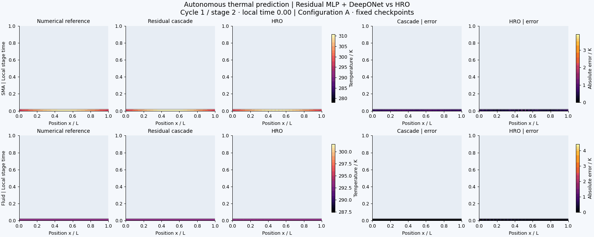
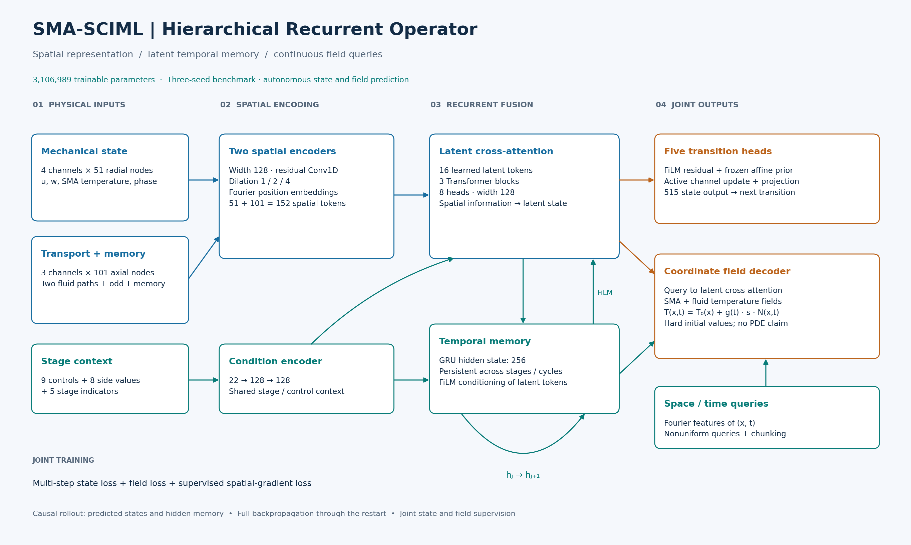
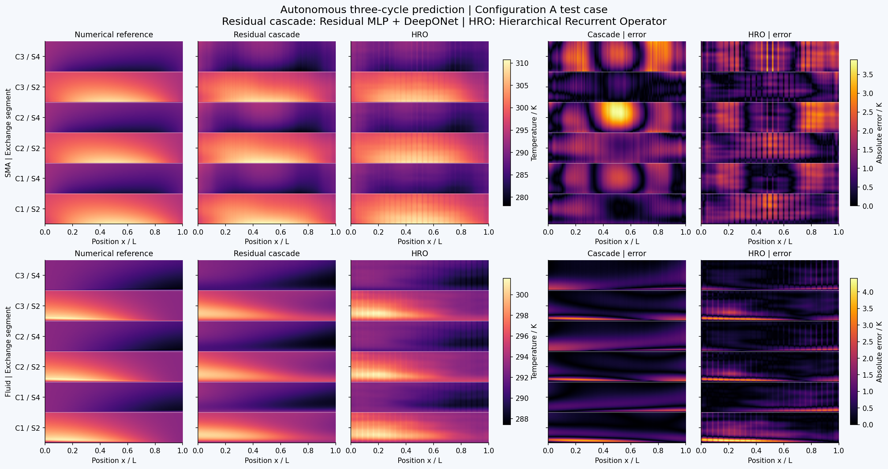
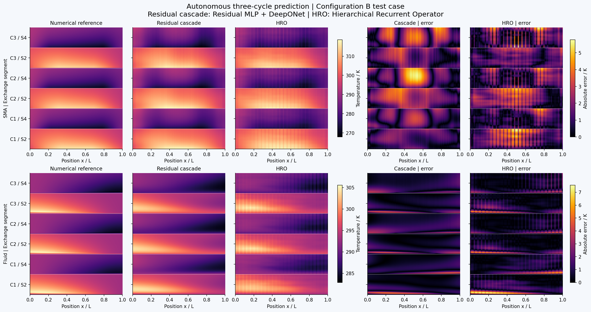

# SMA-SCIML
### Scientific machine learning for elastocaloric cooling
### 面向弹热制冷的科学机器学习

**Structured physical states · Recurrent latent memory · Continuous temperature fields**

[Architecture / 架构](docs/HIERARCHICAL_OPERATOR.md) · [Benchmarks / 基准](docs/MULTICYCLE_BENCHMARK.md) · [Documentation / 文档](docs/README.md) · [Quickstart / 使用](docs/QUICKSTART.md)

SMA-SCIML studies the coupled mechanical, phase-transformation and thermal dynamics of pressure-driven shape-memory-alloy cooling. Its **Hierarchical Recurrent Operator (HRO)** combines spatial encoders, latent attention and persistent memory to predict physical states and temperature fields across repeated cycles.

SMA-SCIML 研究压力驱动形状记忆合金制冷中的力学、相变与传热耦合。**分层循环算子（Hierarchical Recurrent Operator，HRO）**融合空间编码、潜变量注意力和持续记忆，预测多循环物理状态与温度场。



*Autonomous three-cycle forecasts from the same initial conditions and controls. The residual cascade combines a Residual MLP state predictor with DeepONet; HRO predicts states and fields jointly. Panels share temperature and error scales. The illustrated case and checkpoints are fixed by the benchmark protocol.*

*两类模型从相同初态与控制条件自主预测三循环。残差级联系统由 Residual MLP 状态预测器和 DeepONet 组成；HRO 联合预测状态与场。图中共用温度及误差色标，展示工况和检查点由基准协议固定。*

## Architecture / 模型架构



**3.11M trainable parameters · 515 physical-state variables · 256 recurrent-memory variables · SMA and fluid temperature fields**

**311 万可训练参数 · 515 维物理状态 · 256 维循环记忆 · SMA 与流体双温度场**

| Component / 模块 | Structure / 结构 | Role / 作用 |
|---|---|---|
| Spatial encoders / 空间编码器 | Separate radial and axial residual CNNs; width 128, dilations 1/2/4 | Preserve displacement, phase and transport neighborhoods / 保留位移、相变与输运的空间邻域 |
| Latent attention / 潜变量注意力 | 152 spatial tokens → 16 latent tokens; three Transformer blocks, eight heads | Fuse mechanical and thermal representations / 融合力学与热学表示 |
| Recurrent dynamics / 循环动力学 | GRU256; five FiLM-conditioned transition heads; frozen affine prior | Carry state and memory across stages and restarts / 跨阶段和重启传递状态与记忆 |
| Coordinate decoder / 坐标解码器 | Fourier features and query-to-latent attention; exact stage-entry temperatures | Predict SMA and fluid temperatures at space–time coordinates / 在时空坐标上预测温度 |
| Joint objective / 联合目标 | Multi-step state, field and supervised spatial-gradient losses | Train the state and field branches through complete trajectories / 沿完整轨迹联合训练状态与场分支 |

The model uses its own predicted states during autonomous rollout. Training spans two cycles; evaluation extends to three. The coordinate decoder shares latent memory with the state predictor, while decoded fields do not directly update the explicit state.

自主推进使用模型自身的预测状态；训练覆盖两循环，评价延伸至三循环。坐标解码器与状态预测器共享潜变量记忆，解码温度场不直接回写显式状态。

[Equations, dimensions and training settings / 公式、维度与训练设置](docs/HIERARCHICAL_OPERATOR.md) · [Editable architecture figure / 可编辑架构图](assets/showcase/architecture.svg)

## Multi-cycle benchmark / 多循环基准

The historical multi-cycle dataset contains **eight two-cycle training cases and four test cases**, including two three-cycle cases. The table reports cycle-3/stage-4 RMSE: pooled over those two cases per seed, then **mean ± sample SD across three seeds**. Field RMSE excludes the initial frame.

历史多循环数据集包含 **八个两循环训练工况和四个测试工况**，其中两个为三循环工况。下表为第三循环第四阶段 RMSE：每个种子汇总两个工况，再计算**三种子的均值 ± 样本标准差**。场误差排除初始帧。

| Method / 方法 | SMA state / 状态 K | SMA field / 场 K | Fluid field / 流体场 K |
|---|---:|---:|---:|
| Residual cascade · one-step training / 残差级联·单步训练 | 1.543 ± 0.116 | 2.076 ± 0.032 | 0.989 ± 0.252 |
| Residual cascade · one-step fine-tuning / 残差级联·单步微调 | 1.516 ± 0.097 | 2.060 ± 0.050 | 0.984 ± 0.251 |
| Residual cascade · multi-step fine-tuning / 残差级联·多步微调 | 1.533 ± 0.113 | 2.069 ± 0.048 | 0.985 ± 0.249 |
| **Hierarchical Recurrent Operator (HRO)** | **1.120 ± 0.061** | **1.600 ± 0.118** | **0.775 ± 0.020** |
| Affine state baseline / 仿射状态基线 | 1.176 | — | — |

HRO reduces these third-cycle errors by **27.4%, 22.9% and 21.7%** relative to the one-step residual cascade. Its SMA-state improvement over the affine baseline is **4.8%**. Earlier-cycle SMA state errors and some fluid/phase state errors increase, and spatial oscillations remain visible. Training recipes differ, so these results compare complete systems rather than isolate individual architectural contributions. The two historical test cases do not establish independent generalization.

相比单步残差级联，HRO 的第三循环三项误差分别降低 **27.4%、22.9%、21.7%**；相比仿射基线，SMA 状态误差降低 **4.8%**。早期循环的 SMA 状态及部分流体/相分数误差有所上升，场中仍存在空间振荡。由于训练方案不同，这里评价的是完整系统，各模块贡献需要消融分析；两个历史测试工况不足以证明独立泛化能力。

[Per-case results, full diagnostics and protocol / 逐工况结果、完整诊断与协议](docs/MULTICYCLE_BENCHMARK.md)

## Field demonstrations / 场演示

<details>
<summary><strong>Space–time fields for both three-cycle cases / 两个三循环工况的时空场</strong></summary>





Each band represents local time within one exchange stage; mechanical-stage durations are omitted. These are one-dimensional space × time fields, not two-dimensional plate measurements.

每条带对应单个换热阶段的局部时间，不包含力学阶段时长。图中为一维空间 × 时间场，并非二维板面测量。

</details>

[Interactive field explorer / 交互场浏览器](assets/showcase/explorer.html) — download the repository and open the HTML locally to select stages, inspect errors and play stored temperature fields. No server is required. / 下载仓库后在本地打开 HTML，即可选择换热阶段、检查误差并播放保存的温度场，无需服务器。

## Research scope / 研究范围

The project also provides performance surrogates, DeepONet/Fourier/POD comparisons, inverse PINNs, conformal uncertainty calibration and offline acquisition/design studies. On a **separate 63-case single-cycle dataset**, the performance ensemble reduces COP prediction RMSE from **0.0627 to 0.0192** relative to Ridge. A directional-memory interface reduces stage-4 SMA-field RMSE from **1.6966 to 0.5927 K** in a fixed-checkpoint cascade comparison.

项目还包含性能代理、DeepONet/Fourier/POD 对照、逆问题 PINN、保形不确定性校准及离线选样/设计研究。在**独立配置的 63 工况单循环数据集**中，性能集成相对 Ridge 将 COP 预测 RMSE 从 **0.0627 降至 0.0192**；固定检查点级联对照中，方向记忆接口将第四阶段 SMA 场误差从 **1.6966 降至 0.5927 K**。

Module ablations, smoother coordinate decoding, state/field consistency and energy accounting define the research directions. The evidence is numerical; experimental validation and complete coupled energy closure remain open.

模块消融、更平滑的坐标解码、状态/场一致性与能量核算构成后续研究方向。现有证据来自数值数据，实验验证及完整耦合能量闭合仍待完成。

[Research overview / 研究概览](docs/SHOWCASE.md) · [Result gallery / 结果图集](docs/RESULTS_GALLERY.md) · [Data card / 数据说明](docs/DATA_CARD.md)

## Quickstart / 快速开始

Python 3.12 · PyTorch · CPU. Verification and demonstrations use the bundled data and checkpoints.

验证及演示使用仓库内的数据与检查点，支持 CPU 运行。

```bash
git clone https://github.com/piAlbertSHI/SMA-SCIML.git
cd SMA-SCIML
python -m pip install -r requirements.txt
python -m examples.validate_bundle
python -m examples.formal_hierarchical --verify-only
python -m examples.field_showcase --output demo-output-fields
```

[Training and inference guide / 训练与推理指南](docs/QUICKSTART.md) · [Model catalogue / 模型目录](docs/MODELS.md) · [Contribution guidelines / 开发规范](CONTRIBUTING.md)

**Availability / 获取与许可:** repository access is restricted during release preparation. No open-source or data-redistribution license has been granted. / 仓库在发布准备期间限制访问，目前尚未授予开源或数据再分发许可。 [Distribution policy / 分发规范](docs/PUBLIC_RELEASE_CHECKLIST.md)
