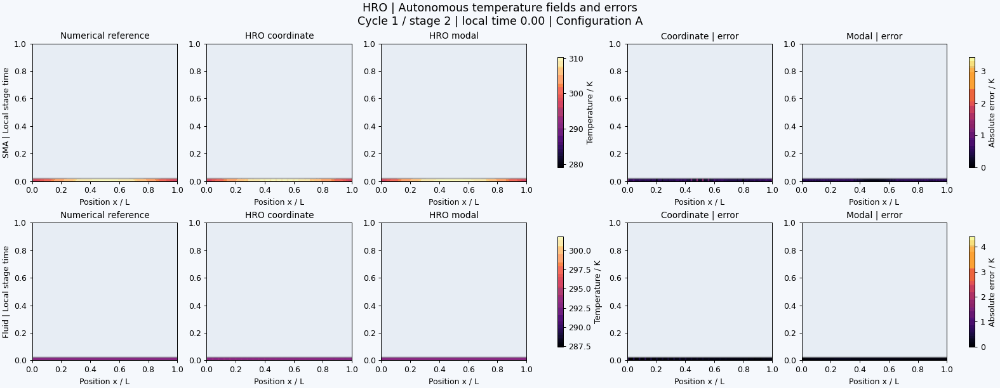
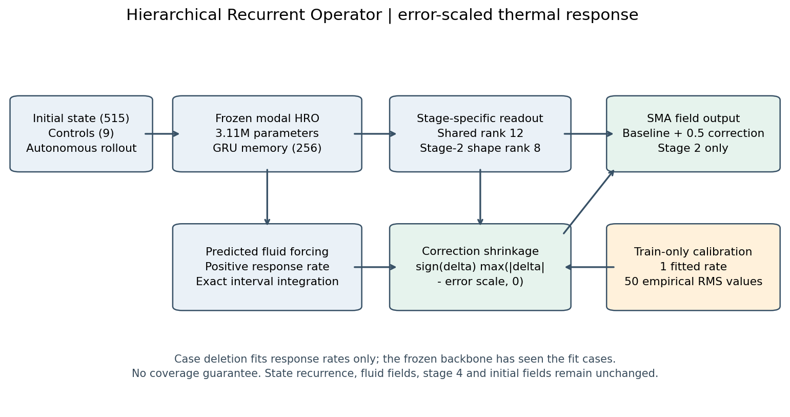

# SMA-SCIML
### Scientific machine learning for elastocaloric cooling
### 面向弹热制冷的科学机器学习

**Structured physical states · Recurrent latent memory · Continuous temperature fields**

[Architecture / 架构](docs/HRO_MODAL.md) · [Benchmarks / 基准](docs/HRO_MODAL.md#results--结果) · [Documentation / 文档](docs/README.md) · [Quickstart / 使用](docs/QUICKSTART.md)

SMA-SCIML studies the coupled mechanical, phase-transformation and thermal dynamics of pressure-driven shape-memory-alloy cooling. Its **Hierarchical Recurrent Operator (HRO)** combines spatial encoders, latent attention and persistent memory to predict physical states and temperature fields across repeated cycles.

SMA-SCIML 研究压力驱动形状记忆合金制冷中的力学、相变与传热耦合。**分层循环算子（Hierarchical Recurrent Operator，HRO）**融合空间编码、潜变量注意力和持续记忆，预测多循环物理状态与温度场。



*Autonomous three-cycle forecasts from the same initial conditions and controls. Coordinate HRO is compared with modal HRO trained through joint trajectories and a dedicated decoder phase. Temperature and error scales are shared; the first preset case and seed are shown, without smoothing or best-checkpoint selection.*

*模型从相同初态与控制条件自主预测三循环，比较坐标 HRO 与经过轨迹联合训练、解码器专项训练的模态 HRO。共用温度及误差色标，固定展示首个预设工况与种子，不平滑预测，也不挑选最优检查点。*

## Architecture / 模型架构


**3.11M trainable parameters · 515 physical-state variables · 256 recurrent-memory variables · SMA and fluid temperature fields**

**311 万可训练参数 · 515 维物理状态 · 256 维循环记忆 · SMA 与流体双温度场**

| Component / 模块 | Structure / 结构 | Role / 作用 |
|---|---|---|
| Spatial encoders / 空间编码器 | Separate radial and axial residual CNNs; width 128, dilations 1/2/4 | Preserve displacement, phase and transport neighborhoods / 保留位移、相变与输运的空间邻域 |
| Latent attention / 潜变量注意力 | 152 spatial tokens → 16 latent tokens; three Transformer blocks, eight heads | Fuse mechanical and thermal representations / 融合力学与热学表示 |
| Recurrent dynamics / 循环动力学 | GRU256; five FiLM-conditioned transition heads; frozen affine prior | Carry state and memory across stages and restarts / 跨阶段和重启传递状态与记忆 |
| Modal decoder / 模态解码器 | Time-query attention → two sets of 24 spatial coefficients; exact stage-entry temperatures | Predict continuous fields with explicit spatial structure / 以显式空间结构预测连续温度场 |
| Two-phase training / 双阶段训练 | 200 joint updates + 320 cached decoder updates; all 101 spatial points | Learn complete trajectories, then refine fields with the state backbone frozen / 训练完整轨迹，再冻结状态主干精炼温度场 |

The model uses its own predicted states during autonomous rollout. Training spans two cycles; evaluation extends to three. The modal decoder shares latent memory with the state predictor, while decoded fields do not directly update the explicit state. It has **3,111,771 trainable parameters**. Three fixed-seed fits took **7.9 minutes** of CPU training, with no fresh physical simulations.

自主推进使用模型自身的预测状态；训练覆盖两循环，评价延伸至三循环。模态解码器与状态预测器共享潜变量记忆，解码温度场不直接回写显式状态。模型包含 **3,111,771 个可训练参数**，三种子正式训练合计耗时 **7.9 分钟 CPU 时间**，未新增物理仿真。

[Equations, dimensions and training settings / 公式、维度与训练设置](docs/HRO_MODAL.md) · [Research design and literature / 研究设计与论文对照](docs/HRO_RESEARCH_DESIGN.md) · [Editable architecture figure / 可编辑架构图](assets/hro_modal/architecture.svg)

## Multi-cycle benchmark / 多循环基准

The historical multi-cycle dataset contains **eight two-cycle training cases and four test cases**, including two three-cycle cases. The table reports cycle-3/stage-4 RMSE: pooled over those two cases per seed, then **mean ± sample SD across three seeds**. Field RMSE excludes the initial frame.

历史多循环数据集包含 **八个两循环训练工况和四个测试工况**，其中两个为三循环工况。下表为第三循环第四阶段 RMSE：每个种子汇总两个工况，再计算**三种子的均值 ± 样本标准差**。场误差排除初始帧。

| Method / 方法 | SMA state / 状态 K | SMA field / 场 K | Fluid field / 流体场 K |
|---|---:|---:|---:|
| Residual cascade · one-step training / 残差级联·单步训练 | 1.543 ± 0.116 | 2.076 ± 0.032 | 0.989 ± 0.252 |
| Residual cascade · one-step fine-tuning / 残差级联·单步微调 | 1.516 ± 0.097 | 2.060 ± 0.050 | 0.984 ± 0.251 |
| Residual cascade · multi-step fine-tuning / 残差级联·多步微调 | 1.533 ± 0.113 | 2.069 ± 0.048 | 0.985 ± 0.249 |
| HRO · coordinate decoder / 坐标解码 | 1.120 ± 0.061 | 1.600 ± 0.118 | 0.775 ± 0.020 |
| **HRO · modal decoder, two-phase training / 模态解码、双阶段训练** | **1.040 ± 0.068** | **1.627 ± 0.148** | **0.619 ± 0.112** |
| **HRO · error-scaled thermal response / 误差收缩热响应** | 1.040 ± 0.068 | **1.176 ± 0.165** | 0.619 ± 0.112 |
| Affine state baseline / 仿射状态基线 | 1.176 | — | — |

Compared with coordinate HRO, modal HRO reduces third-cycle SMA-state error by **7.2%** and fluid-field error by **20.1%**; SMA-field error increases **1.7%**. Across all four test cases and exchange stages, SMA/fluid field RMSE decreases **18.6% / 36.4%**, with substantially lower spatial-gradient error. Improvements vary by case. Training budgets and spatial supervision differ; this is a system comparison on an already examined historical test set, not independent confirmatory evidence.

相比坐标 HRO，模态 HRO 将第三循环 SMA 状态误差降低 **7.2%**、流体场误差降低 **20.1%**，SMA 场误差增加 **1.7%**。汇总全部四个测试工况及换热阶段，SMA／流体场 RMSE 下降 **18.6%／36.4%**，空间梯度误差显著减小。不同工况改善程度不同，训练预算及空间监督也存在差异；这是在已分析历史测试集上的系统对照，并非独立确证证据。

[Per-case results, diagnostics and protocol / 逐工况结果、诊断与协议](docs/HRO_MODAL.md) · [Residual-cascade comparison / 残差级联对照](docs/MULTICYCLE_BENCHMARK.md) · [Spatial-supervision ablation / 空间监督消融](docs/HRO_SPATIAL_SUPERVISION.md)

## Field demonstrations / 场演示

### Error-scaled thermal response / 误差收缩热响应

The error-scaled thermal response configuration extends the frozen modal HRO with a stage-specific spatial readout and a fluid-driven mean-temperature response. Training-case error scales shrink weak corrections. Relative to the spatial readout alone, overall SMA field RMSE improves from **0.8999 to 0.8565 K**, and the pooled third-cycle RMSE across both exchange stages improves from **0.9887 to 0.9726 K**. All ten stage-2 segment means improve across three fixed seeds. Two individual seed-segment comparisons regress. These results use the historical development benchmark.

误差收缩热响应配置在冻结模态 HRO 上加入分阶段空间读出和流体驱动的均温响应，通过训练工况的经验误差尺度收缩较弱的修正。相比分阶段空间读出，总体 SMA 场 RMSE 从 **0.8999 降至 0.8565 K**，第三循环两个换热阶段合并后从 **0.9887 降至 0.9726 K**。十个第二阶段换热段的三种子均值全部改善，两个单种子段退步。结果来自历史开发回归基准。



[Architecture, native field comparisons and limitations / 架构、原生场对照与局限](docs/HRO_ERROR_SCALED_RESPONSE.md) · [Verified checkpoints / 已验证检查点](checkpoints/hro_recommended.json)

<details>
<summary><strong>Stage-2 temperature and error fields / 第二阶段温度场与误差场</strong></summary>


The error maps use pointwise RMS across three seeds, with a common reference and candidate scale within each row. / 误差图为三种子逐点均方根，同一行的基线和响应配置共用误差色标。

</details>

<details>
<summary><strong>Space–time fields for both three-cycle cases / 两个三循环工况的时空场</strong></summary>


Each band represents local time within one exchange stage; mechanical-stage durations are omitted. These are one-dimensional space × time fields, not two-dimensional plate measurements.

每条带对应单个换热阶段的局部时间，不包含力学阶段时长。图中为一维空间 × 时间场，并非二维板面测量。

</details>

[Coordinate-HRO field explorer / 坐标 HRO 场浏览器](assets/showcase/explorer.html) — download the repository and open the HTML locally to inspect the coordinate-decoder reference. The animation and atlases above compare it with modal HRO. / 下载仓库后在本地打开 HTML，可查看坐标解码基线；上方动画和时空图给出与模态 HRO 的对照。

## Research scope / 研究范围

The project also provides performance surrogates, DeepONet/Fourier/POD comparisons, inverse PINNs, conformal uncertainty calibration and offline acquisition/design studies. On a **separate 63-case single-cycle dataset**, the performance ensemble reduces COP prediction RMSE from **0.0627 to 0.0192** relative to Ridge. A directional-memory interface reduces stage-4 SMA-field RMSE from **1.6966 to 0.5927 K** in a fixed-checkpoint cascade comparison.

项目还包含性能代理、DeepONet/Fourier/POD 对照、逆问题 PINN、保形不确定性校准及离线选样/设计研究。在**独立配置的 63 工况单循环数据集**中，性能集成相对 Ridge 将 COP 预测 RMSE 从 **0.0627 降至 0.0192**；固定检查点级联对照中，方向记忆接口将第四阶段 SMA 场误差从 **1.6966 降至 0.5927 K**。

Matched-budget ablations, stage-consistent state/field coupling, uncertainty under extrapolation and energy accounting define the research directions. The historical constitutive implementation and material parameters have been recovered for compatible data expansion. The evidence is numerical; experimental validation and complete coupled energy closure remain open.

匹配预算的消融、符合阶段语义的状态／场耦合、外推不确定性及能量核算构成后续研究方向。历史本构实现及材料参数已恢复，可用于后续兼容性验证和数据扩充。现有证据来自数值数据，实验验证及完整耦合能量闭合仍待完成。

[Research overview / 研究概览](docs/SHOWCASE.md) · [Result gallery / 结果图集](docs/RESULTS_GALLERY.md) · [Full-cycle scalar contract / 完整循环标量契约](docs/WP2_SCALAR_RELIABILITY.md#full-cycle-scalar-contract) · [Data card / 数据说明](docs/DATA_CARD.md)

## Quickstart / 快速开始

Python 3.12 · PyTorch · CPU. Verification and demonstrations use the bundled data and checkpoints.

验证及演示使用仓库内的数据与检查点，支持 CPU 运行。

```bash
git clone https://github.com/piAlbertSHI/SMA-SCIML.git
cd SMA-SCIML
python -m pip install -r requirements.txt
python -m examples.validate_bundle
python -m examples.verify_modal_evidence
python -m examples.modal_showcase --output demo-output-fields
```

[Training and inference guide / 训练与推理指南](docs/QUICKSTART.md) · [Model catalogue / 模型目录](docs/MODELS.md) · [Contribution guidelines / 开发规范](CONTRIBUTING.md)

**Availability / 获取与许可:** repository access is restricted during release preparation. No open-source or data-redistribution license has been granted. / 仓库在发布准备期间限制访问，目前尚未授予开源或数据再分发许可。 [Distribution policy / 分发规范](docs/PUBLIC_RELEASE_CHECKLIST.md)
