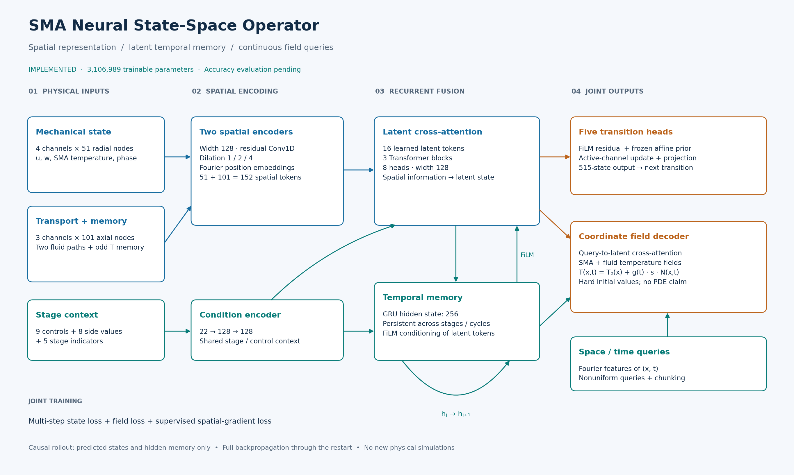
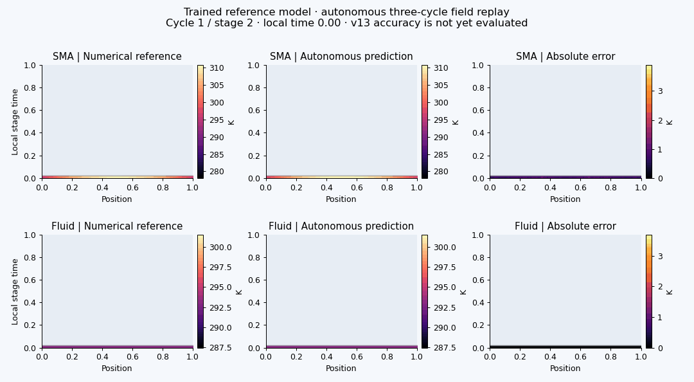
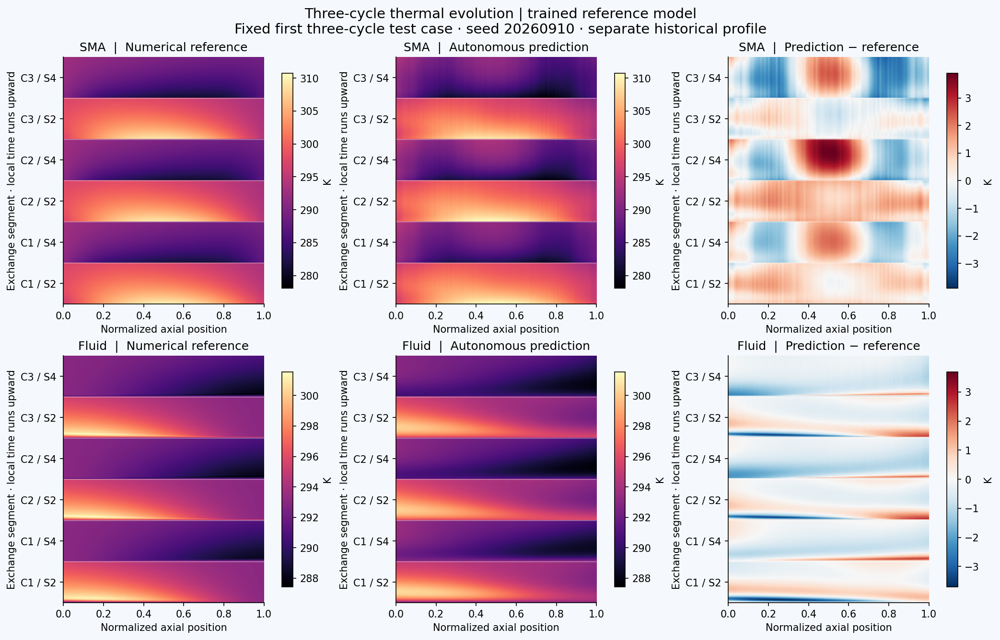

# SMA SciML
### Neural state-space operators for elastocaloric cooling
### 面向弹热制冷的神经状态空间算子

**Spatial encoding · Latent attention · Recurrent dynamics · Continuous temperature fields**

[Architecture / 架构](docs/HIERARCHICAL_OPERATOR.md) · [Field explorer / 场演示](#demos) · [Results / 完整结果](docs/RESULTS_GALLERY.md) · [Run / 运行](#run)

SMA SciML models the coupled mechanical, phase-transformation and thermal dynamics of pressure-driven shape-memory-alloy cooling. The current development centers on a **hierarchical recurrent operator** that advances physical states and decodes temperature fields within one differentiable model.

SMA SciML 面向压力驱动形状记忆合金制冷中的力学、相变与传热耦合。当前核心为**分层循环神经算子**，在同一个可微模型中推进物理状态、保留历史记忆并解码温度场。


*Trained reference model: a fixed test stage with observed entry fields. This existing numerical demonstration is separate from the new architecture below, whose accuracy has not yet been evaluated.*

*已训练参考模型：固定测试换热阶段，输入为已知入口场。该数值演示与下方新增架构分开标注；新架构精度尚未评价。*

## Architecture / 模型架构



**3.11 million trainable parameters · 515 explicit state variables · 256 recurrent memory variables · two temperature fields**

**311 万可训练参数 · 515 维显式状态 · 256 维循环记忆 · SMA/流体双温度场**

| Layer / 层级 | Implemented design / 已实现设计 | Purpose / 作用 |
|---|---|---|
| Spatial representation / 空间表示 | Separate radial and axial residual CNN encoders, width 128, dilations 1/2/4 / 独立径向与轴向残差编码器 | Preserve mechanical, phase and transport structure / 保留力学、相变及输运结构 |
| Information fusion / 信息融合 | 152 spatial tokens → 16 latent tokens; three Transformer blocks, eight heads / 152 空间 token 压缩至 16 潜 token | Combine spatial information without flattening everything into a small MLP / 融合结构化空间信息 |
| Cycle dynamics / 循环动力学 | GRU memory + FiLM-conditioned stage heads + frozen affine prior / GRU 记忆、FiLM 阶段头与冻结仿射先验 | Carry history through exchange and mechanical restart / 跨换热与力学重启传递历史 |
| Field prediction / 场预测 | Fourier coordinate features + query-to-latent attention; exact initial values / 傅里叶坐标特征、交叉注意力与硬初值 | Query two continuous-coordinate temperature fields / 查询两类连续坐标温度场 |
| Joint training / 联合训练 | Multi-step state + field + supervised spatial-gradient losses / 多步状态、场值与空间梯度监督 | Backpropagate field errors through the state and memory chain / 将场误差回传至状态与记忆链 |

The architecture, joint trainer, self-contained checkpoint format and inference API are implemented. **Execution verification is complete; accuracy benchmarking is pending.** Seven architecture tests and a three-update joint-training run verify gradients, stage ownership, hard initial conditions, causal rollout and checkpoint replay. The larger parameter count is a capacity choice, not evidence of better prediction.

架构、联合训练器、自包含检查点和推理接口已实现。**运行验证完成，精度基准尚待开展。** 七项架构测试及三次联合训练更新验证了梯度、阶段归属、硬初值、因果推进和权重回放。更大的参数量表示容量选择，不直接代表预测更好。

[Architecture report: dimensions, equations, losses and execution evidence / 架构报告：维度、公式、损失与运行证据](docs/HIERARCHICAL_OPERATOR.md) · [Editable SVG / 可编辑架构图](assets/operator_showcase_v2/architecture.svg)

<a id="demos"></a>
<a id="gallery"></a>

## Numerical demonstrations / 数值演示

### Three-cycle thermal evolution / 三循环热演化



A trained historical state model supplies every exchange entry to its field decoder, using its own predictions across three cycles. The animation reveals reference, predicted and error fields through six exchange segments. **Fixed first three-cycle test case, seed 20260910; these are archived v12 results, not v13 results.**

已训练的历史状态模型在三循环中自主推进，为各换热段提供预测入口，再由场算子解码。动画展示六段换热中的数值参考、预测及误差场。**固定第一个三循环测试工况、种子 20260910；这是已保存 v12 结果，不是 v13 的精度展示。**

<details>
<summary><strong>Inspect the complete space–time field atlas / 展开完整时空场图谱</strong></summary>



Each band is one exchange segment with normalized local time. Reference and prediction share temperature limits; signed error uses its own scale. The bands omit mechanical-stage durations and are not a continuous wall-clock axis. Later-cycle errors remain visible.

每条带对应一个换热阶段，使用局部归一化时间；参考与预测共用温度色标，有符号误差单独标度。条带未包含力学阶段时长，不能作为连续实际时间轴；后续循环的误差如实保留。

</details>

### Offline field explorer / 离线交互场演示

[Open the demo file in the repository / 查看演示文件](assets/operator_showcase_v2/explorer.html)

After cloning, open `assets/operator_showcase_v2/explorer.html` locally. Switch between numerical reference, prediction and error; select any of the six exchange segments and play the stored fields. It is self-contained and needs no server, MATLAB, network connection or API key. GitHub displays the GIFs above directly; the interactive HTML runs locally.

克隆后在浏览器打开上述 HTML，可切换参考/预测/误差、选择六个换热段并播放场演化。文件自包含，不需要服务器、MATLAB、联网或 API 密钥。GitHub 直接显示上方 GIF，交互 HTML 在本地运行。

Logic checks use a mock DOM/canvas; actual browser QA remains pending because this environment blocks local-file previews. / 已校验模拟 DOM/canvas 下的交互逻辑；本环境禁止本地文件预览，真实浏览器验收待完成。

## Established results and evaluation scope / 已有结果与评价范围

The project also includes performance ensembles, DeepONet/Fourier/POD comparisons, inverse PINNs, calibrated uncertainty and offline acquisition/design studies. On the main **63-case numerical benchmark**, the five-member performance ensemble reduces COP prediction RMSE **0.0627 → 0.0192** relative to Ridge. Transferring predicted directional memory reduces stage-4 field error **1.6966 → 0.5927 K** in a fixed-seed cascade comparison.

项目还包含性能集成、DeepONet/Fourier/POD 对照、逆问题 PINN、区间校准和离线选样/设计支线。在主 **63 工况数值基准**上，五成员性能集成将 COP 预测 RMSE 相比 Ridge 从 **0.0627 降至 0.0192**；固定种子级联对照中，传递预测方向记忆使第四阶段场误差从 **1.6966 降至 0.5927 K**。

The separate historical corpus contains eight two-cycle training cases and four test cases. Its latest multi-step continuation only slightly improves third-cycle error and does not beat matched one-step continuation on the primary metrics. POD and affine baselines remain strong. These results motivate the new architecture; they do not validate it. Full physical energy closure, independent confirmation and experimental validation remain open.

独立历史数据采用八个两循环训练工况及四个测试工况。此前多步续训对第三循环的改善有限，主要指标未超过同预算单步续训；POD 和仿射基线仍然很强。这些结果为新架构提供研究动机，但不构成新架构的验证。完整物理能量闭合、独立确认与实物验证仍待完成。

[Complete result gallery / 完整结果图集](docs/RESULTS_GALLERY.md) · [Multi-step comparison / 多步对照](docs/MULTICYCLE_MULTISTEP.md) · [Data and provenance / 数据来源](docs/DATA_CARD.md)

<a id="run"></a>

## Run / 运行

Python 3.12 · CPU · PyTorch. No new physical simulations are needed.

```bash
python -m pip install -r requirements.txt
python -m examples.validate_bundle
python -m examples.verify_hierarchical
# Small execution check in a fresh directory / 新目录小规模运行验证
python -m examples.train_hierarchical --output run-output-v13 --updates 3 --batch-cases 2 --lr 0.0001
# Generate architecture and numerical demonstrations / 生成架构与数值演示
python -m examples.operator_showcase --output demo-output-operator
```

| Resource / 资源 | Contents / 内容 |
|---|---|
| [Architecture report / 新架构报告](docs/HIERARCHICAL_OPERATOR.md) | Implemented modules, parameter counts, equations and training contract / 模块、参数、公式与训练合同 |
| [Model source / 模型代码](SciML/models/v13/hierarchical_operator.py) | Spatial encoding, latent attention, recurrence and coordinate decoder / 空间编码、注意力、递推与场解码 |
| [Execution evidence / 运行证据](evidence/architecture/v13_execution_v1/summary.json) | Gradient coverage, checkpoint replay and output shapes / 梯度覆盖、回放与输出形状 |
| [Research portfolio / 项目支线](docs/SHOWCASE.md) | Prior models, experiments and research questions / 已有模型、实验与研究问题 |
| [Quickstart / 使用说明](docs/QUICKSTART.md) | Environment, commands and validation / 环境、命令与验证 |

**Private repository.** GitHub Pages remains disabled. Public release requires owner approval. Historical reports, comparisons and failed evidence are preserved.

**仓库继续保持 private，未启用 GitHub Pages。** 公开发布需所有者批准，历史报告、对照与失败证据均保留。
