# SMA SciML

### Scientific Machine Learning for Elastocaloric Cooling
### 面向弹热制冷的科学机器学习

**Hybrid dynamics · Neural operators · Inverse modeling · Uncertainty-aware design**  
**混合动力学模型 · 神经算子 · 参数反演 · 不确定性驱动设计**

[English](#english) · [中文](#chinese) · [Gallery / 图文成果](#gallery) · [Results / 成果展示](docs/SHOWCASE.md) · [Run / 运行](#run) · [Technical details / 架构参数](docs/MODELS.md)

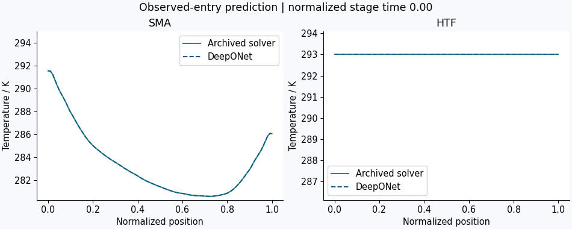

*DeepONet prediction versus the numerical reference for a fixed test case: SMA and heat-transfer-fluid temperatures during stage 4, conditioned on the observed stage-entry fields.*  
*固定测试工况第四阶段的 SMA 与传热流体温度预测；以已知阶段入口场为条件，与数值解对照。*

<a id="english"></a>

## Overview

SMA SciML is a computational research project that connects multiphysics simulation with machine learning for **pressure-driven NiTi shape-memory-alloy elastocaloric cooling**. The physical system is a clamped thin circular plate undergoing loading, heat rejection, unloading and heat absorption. Its coupled mechanical, phase-transformation and thermal states make it a useful setting for studying predictive models with physical structure.

The project addresses three linked questions: **How accurately can cycle performance be predicted from operating conditions? What state information is needed to propagate an entire cycle? How can predictive uncertainty guide the next simulation or design candidate?** The implemented workflow spans scalar surrogates, autonomous stage transitions, temperature-field operators, inverse problems and offline design decisions.

The main benchmark contains **63 simulated operating conditions**, split by complete case into **37 training / 13 calibration / 13 test cases**. Temperature-field evaluation uses 50 time points × 101 spatial points for each heat-exchange stage. An independent historical dataset supports additional two- and three-cycle rollout studies. COP denotes the coefficient of performance.

### Selected results

| Result | Measured outcome | Evaluation setting |
|---|---|---|
| Cycle-performance prediction | **69.3% lower COP RMSE:** 0.0627 → 0.0192 | Ridge → five-member neural ensemble; mean over three seeds |
| Autonomous state propagation | **36.3% lower final-stage SMA-state RMSE:** 0.1260 → 0.0802 K | Affine → Ridge + neural residual; three-seed mean; no future stage-state input |
| Directional memory transfer | **65.1% lower stage-4 SMA-field RMSE:** 1.6966 → 0.5927 K | Fixed-seed cascade comparison; transfer of predicted stage-2 spatial memory |
| Field-model comparison | POD/Ridge leads in **3 of 4** stage/field metrics; Fourier leads in stage-4 SMA temperature | Matched supervision; neural-model means over three seeds |
| Multi-cycle training | Third-cycle SMA-state RMSE **1.5432 → 1.5334 K** with multi-step training; matched one-step continuation reaches **1.5163 K** | Three seeds; fixed two-case cohort; no new simulations; [full comparison](docs/MULTICYCLE_MULTISTEP.md) |

These are reductions in prediction error, not gains in physical cooling efficiency. [Results and evaluation context →](docs/SHOWCASE.md)

### Model architecture

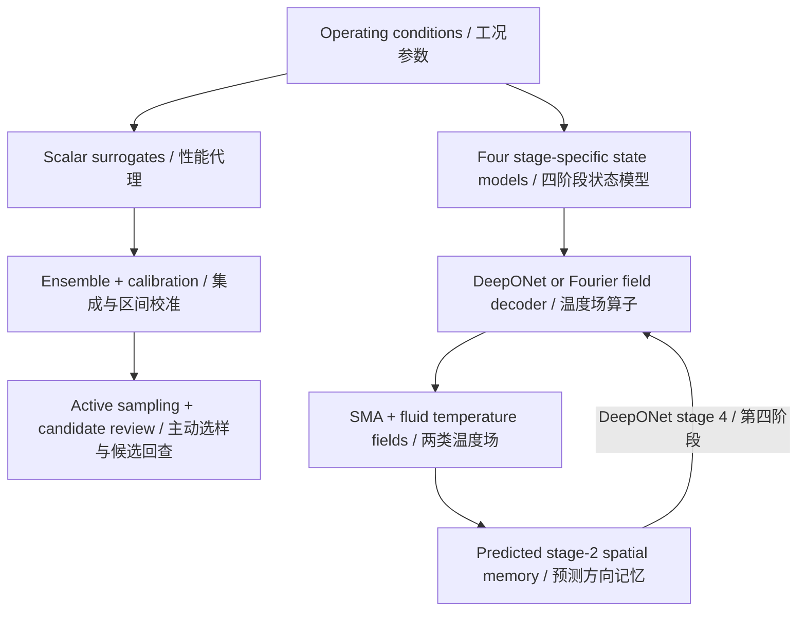

The scalar/design and state/field paths share the simulation dataset. They are separately trained modules; field-to-performance energy readout and joint training are research extensions. PINN inversion is a complementary branch using manufactured diffusion data and local thermal-response curves.

| Module | Implemented architecture | Purpose |
|---|---|---|
| Performance surrogate | `7 → 32 → 32 → 5` SiLU MLP; five-member ensemble; Ridge/RF/HistGB baselines | Predict cooling energy, pumping work, COP, specific cooling power and temperature span |
| Hybrid state model | Four stage-specific Ridge + residual MLPs: `426 → 32 → 32 → d`, `d = 204 / 313 / 313 / 160` | Advance 414 state variables using 12 control features |
| Historical multi-cycle model | Five Ridge + residual MLPs: `529 → 32 → 32 → d`, `d = 414 / 414 / 414 / 261 / 204`; **146,411 neural parameters** | Advance 515 states, including directional memory and restart; full gradients through nine transitions |
| DeepONet | Three branches `204 / 9 / 8 → 32 → 32 → 32`; fusion `96 → 48`; coordinate trunk `2 → 32 → 32 → 48`; **20,898 parameters** | Query two temperature fields with an exact initial-condition construction |
| Fourier / POD baselines | Spatial Fourier: width 12, two layers, eight modes, **7,886 parameters**; POD: four modes per field + Ridge | Compare spectral and low-rank representations under matched supervision |
| Inverse models | Diffusion PINN `2 → 24 → 24 → 1` + `log(a)`; local ODE network `1 → 24 → 24 → 1` + `log(k)` | Identify a diffusion coefficient or a local effective thermal-response rate |
| Uncertainty and design | Five-member, six-output ensemble; conformal calibration; three-member acquisition models | Compare `12 → 17 → 22` label budgets and review three candidates from a finite pool |

### Research direction

The strongest finding is that **state representation and interfaces can matter as much as network architecture**. A radial state representation discarded directional temperature information needed by a later stage; transferring the predicted antisymmetric component substantially improved the cascade without retraining the field network. The strong POD baseline also identifies where added neural complexity has yet to pay off.

The first multi-step experiment is complete: two-cycle training fit improves, but third-cycle prediction does not beat the matched one-step continuation. The next priorities are diagnosing memory/restart errors with training-only validation, material-property inputs for transfer, objective-specific acquisition, and energy-consistent field-to-performance readout. [Research questions and milestones →](docs/SHOWCASE.md#potential)

### Evaluation scope

Results are numerical benchmarks on the current simulation domain. The test split has informed development; an independent confirmation set and experimental validation remain future work. The main field operators enforce initial conditions but do not yet enforce the full SMA governing equations or energy balance. PINN diffusion results use a manufactured problem. The finite-pool design study evaluates archived candidates, with engineering safety still unverified. Detailed data coverage and COP accounting are documented in the [data card](docs/DATA_CARD.md).

<a id="chinese"></a>

## 项目概述

SMA SciML 是一个将多物理仿真与机器学习结合的计算研究项目，面向**压力驱动 NiTi 形状记忆合金的弹热制冷**。研究对象为周边夹持薄圆板，经历加载、放热、卸载和吸热四个阶段。力学响应、相变与传热相互耦合，为研究具有物理结构的预测模型提供了具体问题。

项目围绕三个问题展开：**能否从工况准确预测循环性能？推进完整循环需要保留哪些状态信息？如何利用预测不确定性选择下一次仿真或设计候选？** 当前已实现性能代理、阶段自主推进、温度场算子、参数反演与离线设计决策的完整工作流程。

主数据集包含 **63 个数值工况**，按完整工况划分为 **37 个训练 / 13 个校准 / 13 个测试样本**。每个换热阶段在 50 个时刻 × 101 个空间点上评价温度场；独立的历史数据还支持两循环和三循环推演。COP 表示制冷性能系数。

### 关键结果

| 结果 | 定量表现 | 评价条件 |
|---|---|---|
| 循环性能预测 | **COP RMSE 降低 69.3%：**0.0627 → 0.0192 | Ridge → 五成员神经集成，三个种子均值 |
| 自主状态推进 | **末阶段 SMA 状态 RMSE 降低 36.3%：**0.1260 → 0.0802 K | 仿射基线 → Ridge + 神经残差，三个种子均值，不读取未来阶段状态 |
| 方向记忆传递 | **第四阶段 SMA 场 RMSE 降低 65.1%：**1.6966 → 0.5927 K | 固定种子级联对照，传递预测的第二阶段空间记忆 |
| 场模型对照 | POD/Ridge 在 **4 项指标中的 3 项**领先；Fourier 在第四阶段 SMA 温度上领先 | 相同监督数据，神经模型取三个种子均值 |
| 多循环训练 | 多步训练使第三循环 SMA 状态 RMSE **1.5432 → 1.5334 K**；同预算单步续训为 **1.5163 K** | 三个种子、固定两个测试工况，无新增仿真；[完整对照](docs/MULTICYCLE_MULTISTEP.md) |

以上百分比指预测误差下降，不代表实体制冷效率提高。[查看图表与评价条件 →](docs/SHOWCASE.md)

### 模型架构

上方架构图展示两条共用仿真数据的路径：**工况 → 性能代理 → 不确定性与设计决策**，以及**工况 → 四阶段状态模型 → 温度场算子**。各模块分别训练；场到性能的能量读出与联合训练属于后续研究。PINN 反演作为补充支线，分别处理制造扩散问题和局部温度响应曲线。

| 模块 | 已实现架构 | 解决的问题 |
|---|---|---|
| 性能代理 | `7 → 32 → 32 → 5` SiLU MLP、五成员集成，配套 Ridge/RF/HistGB 基线 | 预测冷量、泵功、COP、比制冷功率与温差 |
| 混合状态模型 | 四个阶段专属 Ridge + 残差 MLP：`426 → 32 → 32 → d`，`d = 204 / 313 / 313 / 160` | 由 414 维状态和 12 维控制推进循环状态 |
| 历史多循环模型 | 五个 Ridge + 残差 MLP：`529 → 32 → 32 → d`，`d = 414 / 414 / 414 / 261 / 204`；**146,411 神经参数** | 推进含方向记忆和重启的 515 维状态，梯度穿过完整九步链 |
| DeepONet | 三个 branch：`204 / 9 / 8 → 32 → 32 → 32`；融合 `96 → 48`；trunk：`2 → 32 → 32 → 48`；**20,898 参数** | 查询 SMA/流体温度场，通过输出构造严格满足初值 |
| Fourier / POD 对照 | 一维空间 Fourier：宽度 12、两层、8 个模式、**7,886 参数**；POD：每场 4 模态 + Ridge | 在相同监督下比较频域表示与低秩表示 |
| 反演模型 | 扩散 PINN：`2 → 24 → 24 → 1` + `log(a)`；局部 ODE：`1 → 24 → 24 → 1` + `log(k)` | 识别扩散系数或局部有效热响应率 |
| 不确定性与设计 | 五成员六输出集成、conformal 校准、三成员选样模型 | 比较 `12 → 17 → 22` 标签预算，并回查有限池中的三个候选 |

### 项目潜力

一个核心发现是：**状态表示和模块接口，与网络架构同样重要。** 原径向状态丢失了后续阶段需要的方向温度信息；传递预测场的反对称分量后，无需重训场网络即可明显改善级联误差。POD 的强基线表现也明确了神经模型在哪些任务上尚未体现优势。

首轮多步训练已完成：两循环训练拟合改善，但第三循环预测尚未超过同预算单步续训。下一阶段将结合训练集内部验证定位记忆/重启误差，引入物性特征研究迁移，研究目标相关选样，并建立满足能量核算要求的场到性能读出。[查看研究问题与验收目标 →](docs/SHOWCASE.md#potential)

### 评价范围

当前成果来自既有仿真范围内的数值基准。测试集已参与开发，新的独立确认集和实物验证仍待完成。主场算子已满足硬初值，但尚未加入完整 SMA 控制方程与能量闭合；扩散 PINN 使用制造问题。设计研究采用有限候选池的归档回查，工程安全尚待验证。数据覆盖和 COP 功分母口径见[数据说明](docs/DATA_CARD.md)。

<a id="gallery"></a>

## Results gallery / 图文成果汇报

**Seventeen result figures across the modeling pipeline, plus the temperature animation above.** The gallery includes completed diversity-acquisition and multi-step training experiments using existing data, without new physics simulations. Figures 15–17 show the latest multi-cycle comparison.

**17 组结果图覆盖模型全流程，另有上方温度动画。** 本页汇集各支线研究，以及使用现有数据完成的多样性选样和多步训练实验，没有新增物理仿真。最新多循环对照见图 15–17。

[Figure index & editable SVG / 图表索引与可编辑 SVG](docs/FIGURE_INDEX.md) · [Architecture and detailed results / 架构及详细结果](docs/SHOWCASE.md)

### 01 · Performance surrogates / 性能代理

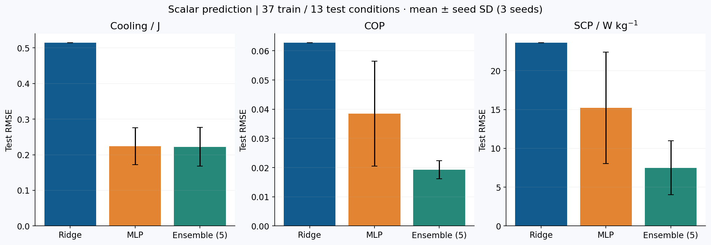

The five-member ensemble reduces COP RMSE from **0.0627 to 0.0192** and specific-cooling-power RMSE from **23.59 to 7.50 W/kg** versus Ridge. Bars show three-seed means, with seed standard deviations.  
五成员集成相比 Ridge，将 COP RMSE 从 **0.0627 降至 0.0192**，比制冷功率 RMSE 从 **23.59 降至 7.50 W/kg**。图中为三个种子均值与种子间标准差。

### 02 · Autonomous stage dynamics / 四阶段自主推进

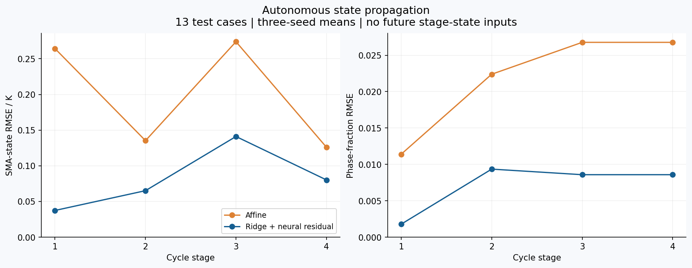

Ridge plus neural residuals improves both thermal-state and phase-fraction prediction over the affine baseline. Stage-3 errors reveal where mechanical unloading and re-equilibration make propagation harder. Inputs are requested conditions and predicted states.  
Ridge 加神经残差同时改善温度状态与相变量预测。第三阶段误差较高，提示卸载与重平衡是状态推进中的难点；输入仅来自工况请求和自身预测状态。

### 03 · Neural operators versus low-rank models / 神经算子与低秩基线

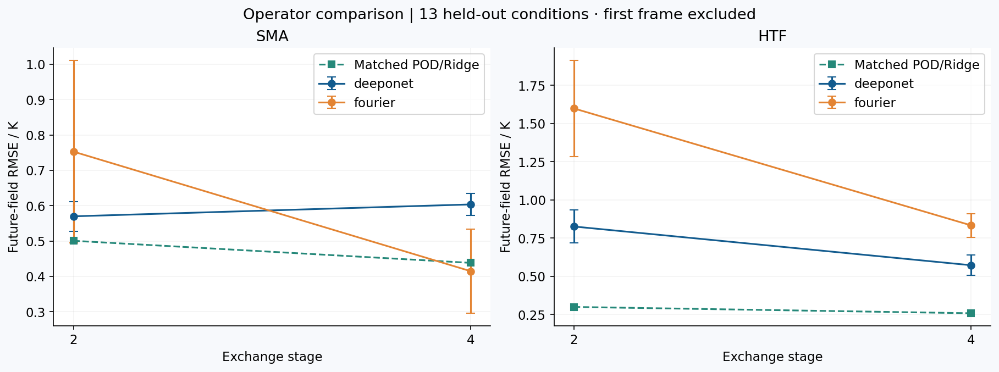

DeepONet, spatial Fourier and POD/Ridge are compared under matched supervision. POD leads in three of four field metrics, while Fourier leads for stage-4 SMA temperature; the result makes model selection depend on measured performance.  
DeepONet、空间 Fourier 与 POD/Ridge 使用相同监督进行比较。POD 在四项场指标中的三项领先，Fourier 在第四阶段 SMA 温度上领先，模型选择以实际对照结果为依据。

### 04 · What the field model predicts / 温度场预测的实际输出

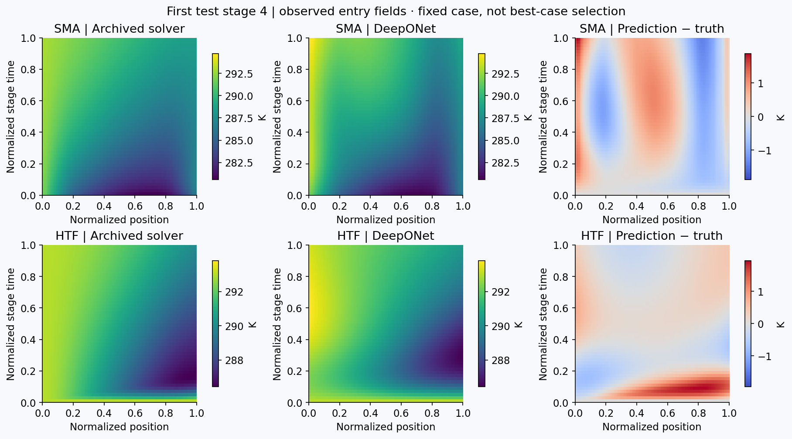

A fixed stage-4 test example shows reference fields, predicted fields and spatial error patterns. SMA/fluid RMSE is **0.6281 / 0.4891 K** for this example, conditioned on observed entry fields; aggregate performance is reported separately above.  
固定第四阶段测试样本展示数值场、预测场与空间误差。该样本的 SMA/流体 RMSE 为 **0.6281 / 0.4891 K**，使用已知入口场；全测试集结果见上一图。

### 05 · Directional memory across stages / 跨阶段方向记忆

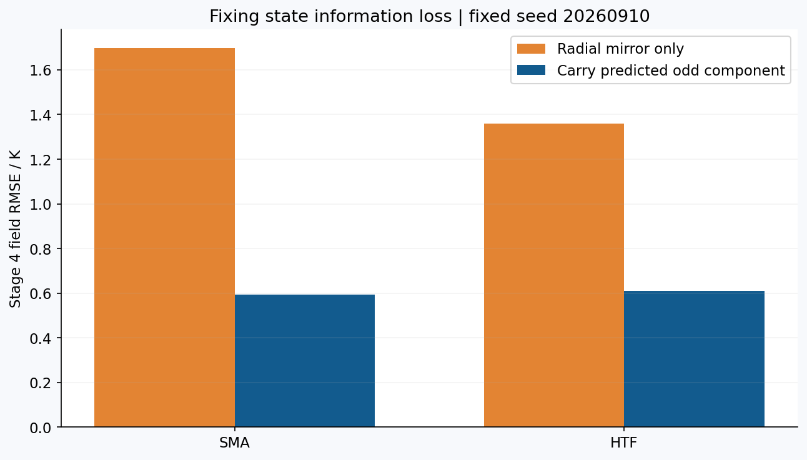

Carrying the odd component of the **predicted** earlier field lowers stage-4 SMA-field error by **65.1%** with fixed weights and seed. This isolates information loss at the state–field interface as a major source of cascade error.  
在权重与种子固定时，传递前一阶段**预测场**的奇分量，使第四阶段 SMA 场误差下降 **65.1%**，明确了状态—场接口的信息损失是级联误差的重要来源。

### 06 · Architecture ablations / 架构消融与初值一致性

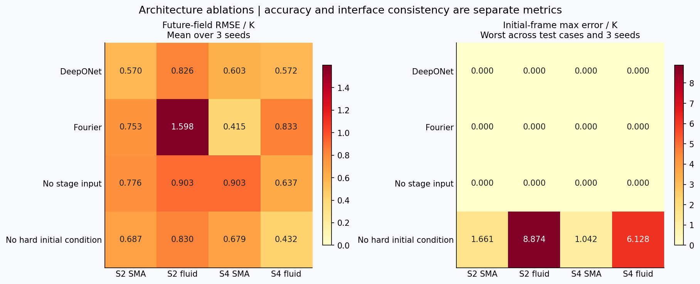

Removing the stage input increases several field errors. Removing hard initial conditions can reduce an individual future error while producing initial-frame errors up to **8.87 K**. Accuracy and interface consistency are therefore evaluated separately.  
去掉阶段输入后，多项场误差上升；去掉硬初值虽然可能降低某项未来误差，却引入最高 **8.87 K** 的初始帧误差。因此需要同时评价预测精度与接口一致性。

### 07 · PINN inverse problem / PINN 参数反演

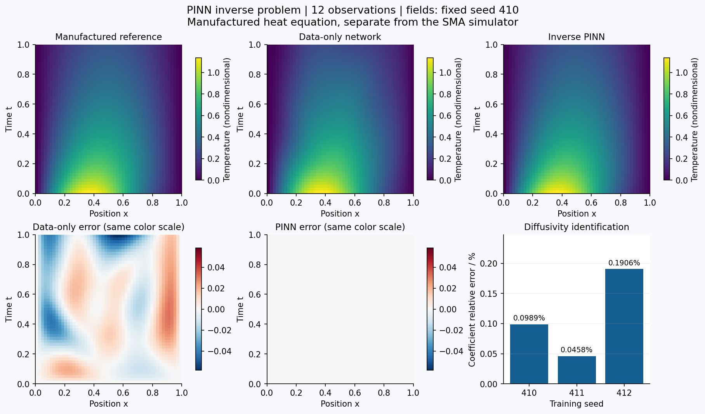

With 12 observations, the inverse PINN reconstructs a manufactured diffusion field and identifies its coefficient with **0.0458%–0.1906%** error across three seeds. The error maps share a color scale; this is a controlled heat-equation study, distinct from SMA material calibration.  
使用 12 个观测，逆问题 PINN 重构制造扩散温度场，三个种子的系数误差为 **0.0458%–0.1906%**。误差图使用相同色标；该支线验证热方程反演方法，与 SMA 材料标定分别处理。

### 08 · Local thermal-response identification / 局部热响应辨识

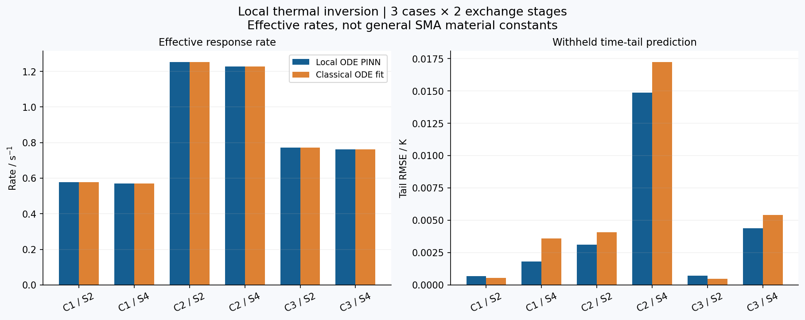

Six fits compare a local ODE PINN with classical ODE identification. Estimated effective rates agree closely; the PINN has lower withheld-tail error in four fits and higher error in two. The parameters describe local response rather than universal material constants.  
六组拟合比较局部 ODE PINN 与经典 ODE 识别。两者的有效速率接近；PINN 在四组留出时间尾段上误差更低、两组更高。识别参数描述局部响应，而非通用材料常数。

### 09 · Calibrated uncertainty / 校准后的预测不确定性

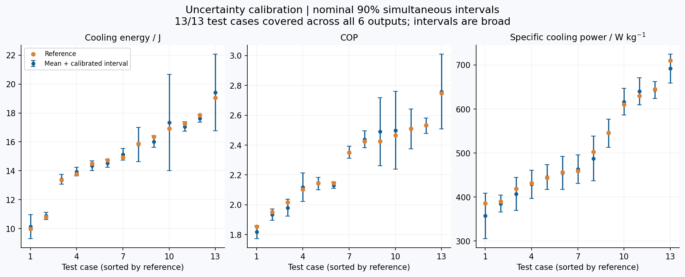

Nominal 90% simultaneous intervals cover all six outputs in **13/13** archived test cases. The plot also exposes interval width, so coverage is not mistaken for precision. With only 13 calibration cases, finite 95% intervals are unavailable under the implemented rule.  
名义 90% 同时区间在 **13/13** 个归档测试工况上覆盖全部六个目标，图中同时展示区间宽度。当前仅有 13 个校准工况，按所用规则无法给出有限的 95% 区间。

### 10 · Generalization under distribution shift / 分布变化下的泛化

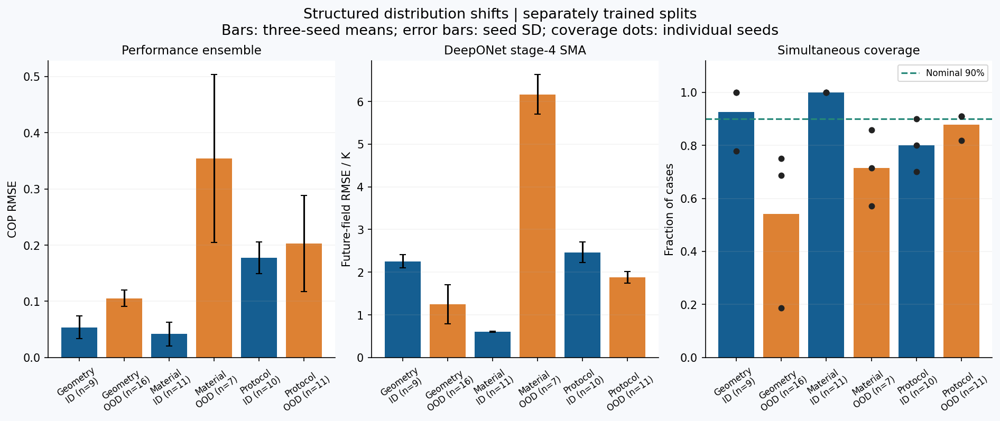

Geometry, material and operating-protocol shifts use separate splits and retrained models. Material shift markedly increases prediction error; coverage can drop below its nominal level. The figure identifies specific transfer challenges instead of treating every OOD task as equivalent.  
几何、材料和运行协议变化分别采用独立切分并重新训练。材料变化显著放大预测误差，区间覆盖也可能低于名义水平；不同分布变化对应的迁移难点需要分别分析。

### 11 · Physics-loss ablation / 物理损失消融

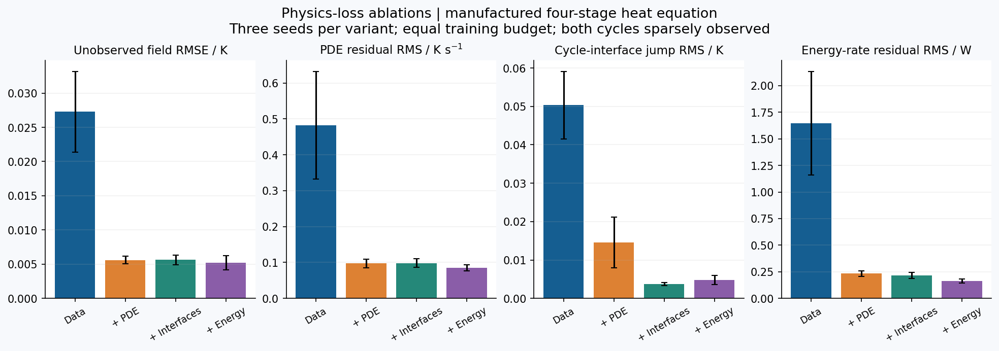

In a manufactured four-stage heat equation, the full loss reduces unobserved-field RMSE from **0.0273 to 0.0052 K**. Additional energy loss improves energy residuals but slightly worsens cycle-interface error relative to the interface-only variant. This is a controlled physics-loss study, not SMA energy-closure validation.  
在制造四阶段热方程中，完整损失将未观测场 RMSE 从 **0.0273 降至 0.0052 K**。加入能量项改善能量残差，但相对接口约束版本略增循环接口误差；这是物理损失对照实验，尚不代表真实 SMA 能量闭合。

### 12 · Historical multi-cycle prediction / 历史多循环推演

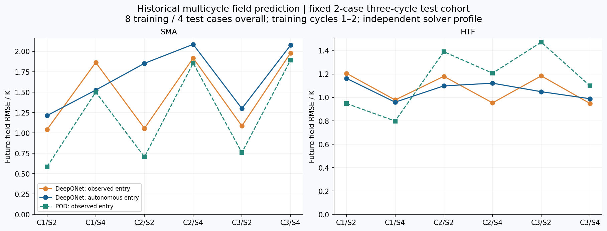

An independent historical profile uses eight training and four test cases. The plotted cohort consists of the **same two three-cycle test cases** at all horizons; training uses cycles 1–2. Autonomous third-cycle stage-4 errors are **2.076 K (SMA)** and **0.989 K (fluid)**, motivating multi-step training.  
独立历史版本使用八个训练、四个测试工况。图中各预测长度始终对应**相同的两个三循环测试工况**，训练仅使用第一、第二循环。自主第三循环末阶段误差为 **2.076 K（SMA）**和 **0.989 K（流体）**，为多步训练提供明确目标。

### 13 · New: diversity-aware acquisition / 本次新增：多样性选样

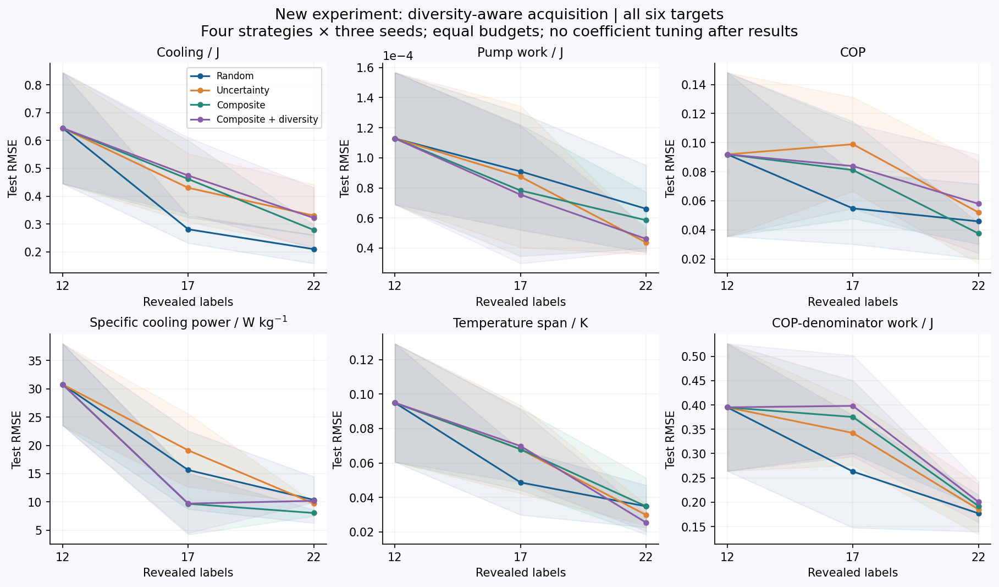

A fixed **50:50 composite-score / distance-rank** rule was evaluated over **four strategies × three seeds**, with identical 12→17→22 budgets and 200 updates per member. All three original baselines were reproduced. At 22 labels, diversity lowers temperature-span RMSE from **0.03480 to 0.02534 K**, but increases COP RMSE from **0.03751 to 0.05794** versus composite. Shading is seed standard deviation; all six targets are shown.  
本次以固定 **50:50 复合分数/距离排名**构建新策略，完成**四策略 × 三种子**实验，各策略采用相同的 12→17→22 预算和每成员 200 次更新，三个原基线均得到重现。22 标签时，多样性策略使温差 RMSE 从 **0.03480 降至 0.02534 K**，但 COP RMSE 相比原复合策略由 **0.03751 升至 0.05794**。阴影为种子标准差，全部六个目标均予展示。

[Protocol, decisions, weights and results / 协议、决策记录、权重与结果](docs/ACQUISITION_DIVERSITY.md)

### 14 · Candidate design trade-offs / 候选设计权衡

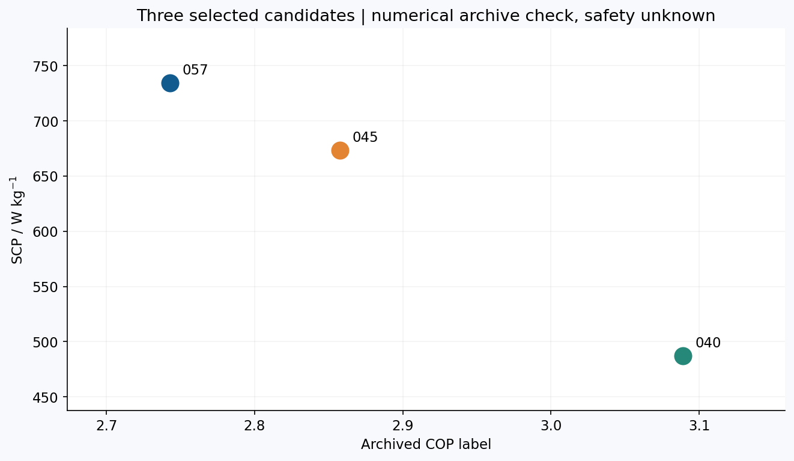

Three candidates from a 15-case pool were checked against archived numerical results after prediction. The study connects calibrated surrogates to candidate review; it does not establish a continuous global optimum or engineering safety certification.  
对 15 个候选中的三个方案先预测、后进行归档数值回查，将校准代理模型连接到候选设计评价。当前结果限定于有限候选池，尚未验证连续全局最优或工程安全。

### 15 · New: multi-step training / 新增：多步训练对照

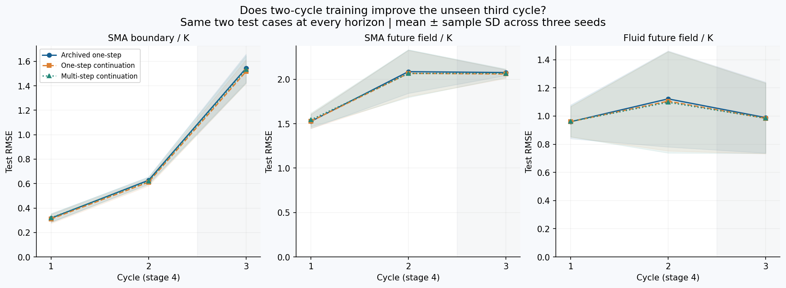

Eight two-cycle training cases supervise a differentiable nine-transition chain. Three seeds compare archived weights with **300-update one-step and multi-step continuations**, keeping the field decoders frozen. Third-cycle SMA-state RMSE is **1.5432 → 1.5334 K** with multi-step training; the matched one-step continuation reaches **1.5163 K**. Shading denotes seed SD, with the same two test cases at every horizon.

八个两循环训练工况监督完整可微九步链，三个种子比较原模型、**300 次单步续训和多步续训**，场解码器始终冻结。多步训练将第三循环 SMA 状态 RMSE 从 **1.5432 降至 1.5334 K**，同预算单步续训为 **1.5163 K**。各循环均使用相同两个测试工况，阴影为种子标准差。

### 16 · Training fit versus long-horizon error / 训练拟合与长时误差

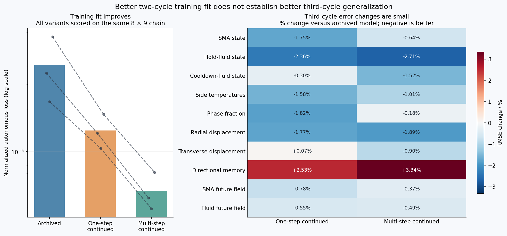

Multi-step training lowers the common autonomous training loss by **87.3%**, while third-cycle SMA-field RMSE falls only **0.37%** and directional-memory error increases **3.34%**. All eight state blocks and both fields are reported. The experiment establishes a working cross-step training path and identifies a remaining generalization problem; it does not establish multi-step superiority.

多步训练使统一评价的自主推进训练损失下降 **87.3%**，但第三循环 SMA 场 RMSE 只降低 **0.37%**，方向记忆误差反而增加 **3.34%**。图中完整展示八个状态块和两类温度场。跨步训练链已实现并验证，长期泛化问题仍待解决，当前结果不支持宣称多步训练更优。

### 17 · Every case and seed / 逐工况、逐种子结果

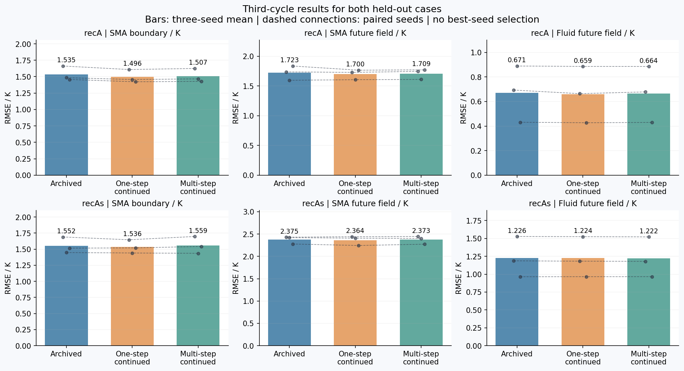

Both three-cycle cases are shown, without selecting the best seed. Multi-step SMA-state error improves for recA but worsens slightly for recAs; these are two specific cases, not material-transfer evidence. All new weights, predictions, protocols and bilingual model details are included in the [multi-cycle study](docs/MULTICYCLE_MULTISTEP.md).

展示两个三循环工况及全部种子，不挑选最优结果。多步训练改善 recA 工况的 SMA 状态误差，但使 recAs 工况略有退化；这不构成材料迁移结论。新增权重、预测数组、协议和中英文模型说明均已保存，见[多循环研究报告](docs/MULTICYCLE_MULTISTEP.md)。

<a id="run"></a>

## Run the project / 运行项目

Python 3.12 · CPU · PyTorch / scikit-learn. The bundled examples do not require MATLAB or a GPU.  
推荐 Python 3.12，CPU 即可运行；随仓库提供的示例不需要 MATLAB 或 GPU。

```bash
python -m venv .venv
# Windows PowerShell: .venv\Scripts\Activate.ps1
# macOS / Linux: source .venv/bin/activate
python -m pip install -r requirements.txt
python -m examples.showcase --output demo-output
python -m examples.train_scalar --output run-output --epochs 200
python -m examples.research_gallery --output demo-output-research
python -m examples.multicycle_multistep --verify-only
python -m examples.multicycle_gallery --output demo-output-multicycle
```

`showcase` loads saved weights and produces six figures, a temperature animation and numerical summaries. `train_scalar` fits a new three-member, six-output ensemble on the bundled training cases. Use new output directories for each run.  
`showcase` 加载已有权重，生成六张图、温度动画与数值摘要；`train_scalar` 使用已打包训练工况新训三成员六输出集成。每次运行使用新的输出目录。

`research_gallery` generates the nine additional figures in PNG and editable SVG from archived results and the completed diversity experiment. To rerun that experiment, see the [protocol and command](docs/ACQUISITION_DIVERSITY.md).
`research_gallery` 根据归档结果及本次多样性实验生成九组新增 PNG 与可编辑 SVG；重新运行新实验的方法见协议说明。

`multicycle_multistep --verify-only` replays the nine model/decoder combinations and recomputes saved metrics. `multicycle_gallery` generates three additional PNG/SVG figures. Six continuation fits can be rerun with `python -m examples.multicycle_multistep --output run-output-multicycle`, using only bundled data.

`multicycle_multistep --verify-only` 回放九组模型/解码组合并重算指标；`multicycle_gallery` 生成三组多循环 PNG/SVG。使用 `python -m examples.multicycle_multistep --output run-output-multicycle` 可仅依靠仓库数据重新完成六次续训。

| Resource / 资源 | Contents / 内容 |
|---|---|
| [Results / 成果展示](docs/SHOWCASE.md) | Architectures, comparisons and research questions / 架构、对照结果与研究问题 |
| [Model details / 模型参数](docs/MODELS.md) | Dimensions, losses and training budgets (Chinese) / 维度、损失与训练预算 |
| [Quickstart / 使用说明](docs/QUICKSTART.md) | Commands and verification / 运行命令与验证 |
| [Interview brief / 中文面试汇报](docs/INTERVIEW_ZH.md) | Technical narrative and detailed discussion / 项目主线与技术问答 |
| [Roadmap / 后续路线](docs/ROADMAP.md) | Experimental priorities and working conventions / 实验优先级与开发约定 |
| [Latest evidence / 最新验证记录](evidence/portable_multicycle_validation_20261121.json) | 28 local tests and nine model/decoder replays; current CI in Actions / 28 项本地测试、九组模型回放，最新 CI 见 Actions |

Code is organized under `SciML/`; `checkpoints/`, `data/`, `assets/` and `evidence/` hold weights, compact data, figures and experiment records. Full raw MAT/HDF5 archives and the complete MATLAB/Simulink project remain outside this distribution.  
代码位于 `SciML/`，权重、轻量数据、展示图和实验记录分别位于 `checkpoints/`、`data/`、`assets/` 和 `evidence/`。完整原始 MAT/HDF5 与 MATLAB/Simulink 工程未包含在本分发中。

**Repository status / 仓库状态:** private; GitHub Pages is disabled. Public release requires owner approval and the [release checklist](docs/PUBLIC_RELEASE_CHECKLIST.md). No open-source license is currently granted.  
仓库继续保持私有，未启用 GitHub Pages；公开需所有者批准并完成检查清单，当前未授予开源许可证。
