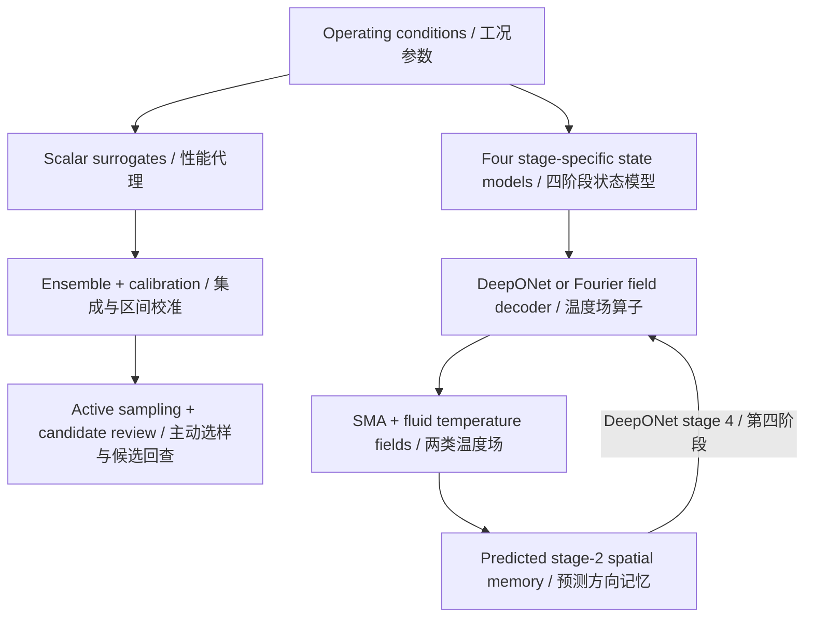

# SMA SciML

### Scientific Machine Learning for Elastocaloric Cooling
### 面向弹热制冷的科学机器学习

**Hybrid dynamics · Neural operators · Inverse modeling · Uncertainty-aware design**  
**混合动力学模型 · 神经算子 · 参数反演 · 不确定性驱动设计**

[English](#english) · [中文](#chinese) · [Results / 成果展示](docs/SHOWCASE.md) · [Run / 运行](#run) · [Technical details / 架构参数](docs/MODELS.md)


*DeepONet prediction versus the numerical reference for a fixed test case: SMA and heat-transfer-fluid temperatures during stage 4, conditioned on the observed stage-entry fields.*  
*固定测试工况第四阶段的 SMA 与传热流体温度预测；以已知阶段入口场为条件，与数值解对照。*

<a id="english"></a>

## Overview

SMA SciML is a computational research project that connects multiphysics simulation with machine learning for **pressure-driven NiTi shape-memory-alloy elastocaloric cooling**. The physical system is a clamped thin circular plate undergoing loading, heat rejection, unloading and heat absorption. Its coupled mechanical, phase-transformation and thermal states make it a useful setting for studying predictive models with physical structure.

The project addresses three linked questions: **How accurately can cycle performance be predicted from operating conditions? What state information is needed to propagate an entire cycle? How can predictive uncertainty guide the next simulation or design candidate?** The implemented workflow spans scalar surrogates, autonomous stage transitions, temperature-field operators, inverse problems and offline design decisions.

The main benchmark contains **63 simulated operating conditions**, split by complete case into **37 training / 13 calibration / 13 test cases**. Temperature-field evaluation uses 50 time points × 101 spatial points for each heat-exchange stage. An independent historical dataset supports additional two- and three-cycle rollout studies. COP denotes the coefficient of performance.

### Selected results

| Result | Measured outcome | Evaluation setting |
|---|---|---|
| Cycle-performance prediction | **69.3% lower COP RMSE:** 0.0627 → 0.0192 | Ridge → five-member neural ensemble; mean over three seeds |
| Autonomous state propagation | **36.3% lower final-stage SMA-state RMSE:** 0.1260 → 0.0802 K | Affine → Ridge + neural residual; three-seed mean; no future stage-state input |
| Directional memory transfer | **65.1% lower stage-4 SMA-field RMSE:** 1.6966 → 0.5927 K | Fixed-seed cascade comparison; transfer of predicted stage-2 spatial memory |
| Field-model comparison | POD/Ridge leads in **3 of 4** stage/field metrics; Fourier leads in stage-4 SMA temperature | Matched supervision; neural-model means over three seeds |

These are reductions in prediction error, not gains in physical cooling efficiency. [Results and evaluation context →](docs/SHOWCASE.md)

### Model architecture



The scalar/design and state/field paths share the simulation dataset. They are separately trained modules; field-to-performance energy readout and joint training are research extensions. PINN inversion is a complementary branch using manufactured diffusion data and local thermal-response curves.

| Module | Implemented architecture | Purpose |
|---|---|---|
| Performance surrogate | `7 → 32 → 32 → 5` SiLU MLP; five-member ensemble; Ridge/RF/HistGB baselines | Predict cooling energy, pumping work, COP, specific cooling power and temperature span |
| Hybrid state model | Four stage-specific Ridge + residual MLPs: `426 → 32 → 32 → d`, `d = 204 / 313 / 313 / 160` | Advance 414 state variables using 12 control features |
| DeepONet | Three branches `204 / 9 / 8 → 32 → 32 → 32`; fusion `96 → 48`; coordinate trunk `2 → 32 → 32 → 48`; **20,898 parameters** | Query two temperature fields with an exact initial-condition construction |
| Fourier / POD baselines | Spatial Fourier: width 12, two layers, eight modes, **7,886 parameters**; POD: four modes per field + Ridge | Compare spectral and low-rank representations under matched supervision |
| Inverse models | Diffusion PINN `2 → 24 → 24 → 1` + `log(a)`; local ODE network `1 → 24 → 24 → 1` + `log(k)` | Identify a diffusion coefficient or a local effective thermal-response rate |
| Uncertainty and design | Five-member, six-output ensemble; conformal calibration; three-member acquisition models | Compare `12 → 17 → 22` label budgets and review three candidates from a finite pool |

### Research direction

The strongest finding is that **state representation and interfaces can matter as much as network architecture**. A radial state representation discarded directional temperature information needed by a later stage; transferring the predicted antisymmetric component substantially improved the cascade without retraining the field network. The strong POD baseline also identifies where added neural complexity has yet to pay off.

The next research priorities are multi-step training for long-horizon stability, material-property inputs for transfer, diversity-aware batch acquisition, and energy-consistent field-to-performance readout. Each extends an implemented component and has a concrete comparison or validation target. [Research questions and milestones →](docs/SHOWCASE.md#potential)

### Evaluation scope

Results are numerical benchmarks on the current simulation domain. The test split has informed development; an independent confirmation set and experimental validation remain future work. The main field operators enforce initial conditions but do not yet enforce the full SMA governing equations or energy balance. PINN diffusion results use a manufactured problem. The finite-pool design study evaluates archived candidates, with engineering safety still unverified. Detailed data coverage and COP accounting are documented in the [data card](docs/DATA_CARD.md).

<a id="chinese"></a>

## 项目概述

SMA SciML 是一个将多物理仿真与机器学习结合的计算研究项目，面向**压力驱动 NiTi 形状记忆合金的弹热制冷**。研究对象为周边夹持薄圆板，经历加载、放热、卸载和吸热四个阶段。力学响应、相变与传热相互耦合，为研究具有物理结构的预测模型提供了具体问题。

项目围绕三个问题展开：**能否从工况准确预测循环性能？推进完整循环需要保留哪些状态信息？如何利用预测不确定性选择下一次仿真或设计候选？** 当前已实现性能代理、阶段自主推进、温度场算子、参数反演与离线设计决策的完整工作流程。

主数据集包含 **63 个数值工况**，按完整工况划分为 **37 个训练 / 13 个校准 / 13 个测试样本**。每个换热阶段在 50 个时刻 × 101 个空间点上评价温度场；独立的历史数据还支持两循环和三循环推演。COP 表示制冷性能系数。

### 关键结果

| 结果 | 定量表现 | 评价条件 |
|---|---|---|
| 循环性能预测 | **COP RMSE 降低 69.3%：**0.0627 → 0.0192 | Ridge → 五成员神经集成，三个种子均值 |
| 自主状态推进 | **末阶段 SMA 状态 RMSE 降低 36.3%：**0.1260 → 0.0802 K | 仿射基线 → Ridge + 神经残差，三个种子均值，不读取未来阶段状态 |
| 方向记忆传递 | **第四阶段 SMA 场 RMSE 降低 65.1%：**1.6966 → 0.5927 K | 固定种子级联对照，传递预测的第二阶段空间记忆 |
| 场模型对照 | POD/Ridge 在 **4 项指标中的 3 项**领先；Fourier 在第四阶段 SMA 温度上领先 | 相同监督数据，神经模型取三个种子均值 |

以上百分比指预测误差下降，不代表实体制冷效率提高。[查看图表与评价条件 →](docs/SHOWCASE.md)

### 模型架构

上方架构图展示两条共用仿真数据的路径：**工况 → 性能代理 → 不确定性与设计决策**，以及**工况 → 四阶段状态模型 → 温度场算子**。各模块分别训练；场到性能的能量读出与联合训练属于后续研究。PINN 反演作为补充支线，分别处理制造扩散问题和局部温度响应曲线。

| 模块 | 已实现架构 | 解决的问题 |
|---|---|---|
| 性能代理 | `7 → 32 → 32 → 5` SiLU MLP、五成员集成，配套 Ridge/RF/HistGB 基线 | 预测冷量、泵功、COP、比制冷功率与温差 |
| 混合状态模型 | 四个阶段专属 Ridge + 残差 MLP：`426 → 32 → 32 → d`，`d = 204 / 313 / 313 / 160` | 由 414 维状态和 12 维控制推进循环状态 |
| DeepONet | 三个 branch：`204 / 9 / 8 → 32 → 32 → 32`；融合 `96 → 48`；trunk：`2 → 32 → 32 → 48`；**20,898 参数** | 查询 SMA/流体温度场，通过输出构造严格满足初值 |
| Fourier / POD 对照 | 一维空间 Fourier：宽度 12、两层、8 个模式、**7,886 参数**；POD：每场 4 模态 + Ridge | 在相同监督下比较频域表示与低秩表示 |
| 反演模型 | 扩散 PINN：`2 → 24 → 24 → 1` + `log(a)`；局部 ODE：`1 → 24 → 24 → 1` + `log(k)` | 识别扩散系数或局部有效热响应率 |
| 不确定性与设计 | 五成员六输出集成、conformal 校准、三成员选样模型 | 比较 `12 → 17 → 22` 标签预算，并回查有限池中的三个候选 |

### 项目潜力

一个核心发现是：**状态表示和模块接口，与网络架构同样重要。** 原径向状态丢失了后续阶段需要的方向温度信息；传递预测场的反对称分量后，无需重训场网络即可明显改善级联误差。POD 的强基线表现也明确了神经模型在哪些任务上尚未体现优势。

下一阶段将围绕长期稳定性开展多步训练，引入物性特征研究迁移，加入批次多样性改进主动选样，并建立满足能量核算要求的场到性能读出。这些方向均对应已有模块和可检验的研究问题。[查看研究问题与验收目标 →](docs/SHOWCASE.md#potential)

### 评价范围

当前成果来自既有仿真范围内的数值基准。测试集已参与开发，新的独立确认集和实物验证仍待完成。主场算子已满足硬初值，但尚未加入完整 SMA 控制方程与能量闭合；扩散 PINN 使用制造问题。设计研究采用有限候选池的归档回查，工程安全尚待验证。数据覆盖和 COP 功分母口径见[数据说明](docs/DATA_CARD.md)。

<a id="run"></a>

## Run the project / 运行项目

Python 3.12 · CPU · PyTorch / scikit-learn. The bundled examples do not require MATLAB or a GPU.  
推荐 Python 3.12，CPU 即可运行；随仓库提供的示例不需要 MATLAB 或 GPU。

```bash
python -m venv .venv
# Windows PowerShell: .venv\Scripts\Activate.ps1
# macOS / Linux: source .venv/bin/activate
python -m pip install -r requirements.txt
python -m examples.showcase --output demo-output
python -m examples.train_scalar --output run-output --epochs 200
```

`showcase` loads saved weights and produces six figures, a temperature animation and numerical summaries. `train_scalar` fits a new three-member, six-output ensemble on the bundled training cases. Use new output directories for each run.  
`showcase` 加载已有权重，生成六张图、温度动画与数值摘要；`train_scalar` 使用已打包训练工况新训三成员六输出集成。每次运行使用新的输出目录。

| Resource / 资源 | Contents / 内容 |
|---|---|
| [Results / 成果展示](docs/SHOWCASE.md) | Architectures, comparisons and research questions / 架构、对照结果与研究问题 |
| [Model details / 模型参数](docs/MODELS.md) | Dimensions, losses and training budgets (Chinese) / 维度、损失与训练预算 |
| [Quickstart / 使用说明](docs/QUICKSTART.md) | Commands and verification / 运行命令与验证 |
| [Interview brief / 中文面试汇报](docs/INTERVIEW_ZH.md) | Technical narrative and detailed discussion / 项目主线与技术问答 |
| [Roadmap / 后续路线](docs/ROADMAP.md) | Experimental priorities and working conventions / 实验优先级与开发约定 |
| [Evidence / 验证记录](evidence/portable_validation_20261121.json) | Local checks; current CI in the repository Actions tab / 本地检查，最新 CI 见 Actions |

Code is organized under `SciML/`; `checkpoints/`, `data/`, `assets/` and `evidence/` hold weights, compact data, figures and experiment records. Full raw MAT/HDF5 archives and the complete MATLAB/Simulink project remain outside this distribution.  
代码位于 `SciML/`，权重、轻量数据、展示图和实验记录分别位于 `checkpoints/`、`data/`、`assets/` 和 `evidence/`。完整原始 MAT/HDF5 与 MATLAB/Simulink 工程未包含在本分发中。

**Repository status / 仓库状态:** private; GitHub Pages is disabled. Public release requires owner approval and the [release checklist](docs/PUBLIC_RELEASE_CHECKLIST.md). No open-source license is currently granted.  
仓库继续保持私有，未启用 GitHub Pages；公开需所有者批准并完成检查清单，当前未授予开源许可证。
