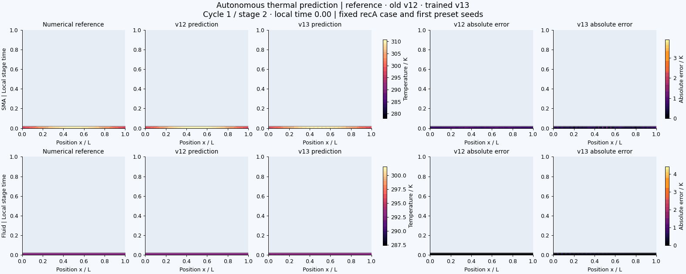
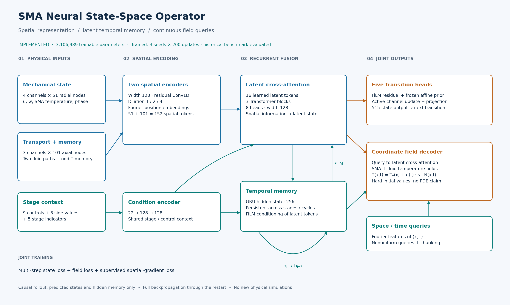
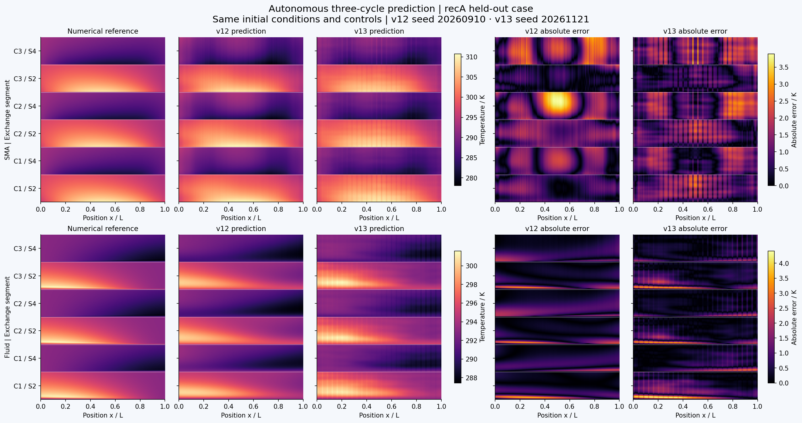

# SMA SciML
### Neural state-space operators for elastocaloric cooling
### 面向弹热制冷的神经状态空间算子

**Spatial encoding · Latent attention · Recurrent dynamics · Continuous temperature fields**

[Architecture / 架构](docs/HIERARCHICAL_OPERATOR.md) · [New benchmark / 新模型结果](docs/V13_FORMAL_BENCHMARK.md) · [Demos / 演示](#demos) · [Run / 运行](#run)

SMA SciML models the coupled mechanical, phase-transformation and thermal dynamics of pressure-driven shape-memory-alloy cooling. The current development centers on a **hierarchical recurrent operator** that advances physical states and decodes temperature fields within one differentiable model.

SMA SciML 面向压力驱动形状记忆合金制冷中的力学、相变与传热耦合。当前核心为**分层循环神经算子**，在同一个可微模型中推进物理状态、保留历史记忆并解码温度场。



*Actual predictions from the first formal v13 training run. Six exchange segments, fixed recA test case, v12 seed 20260910 and v13 seed 20261121. Temperature and error limits are shared across models. Case and seeds were fixed before training.*

*新模型首次正式训练后的真实预测。六段换热、固定 recA 测试工况，旧模型种子 20260910、新模型种子 20261121；模型间共用温度及误差色标。工况与种子在训练前固定。*

## Architecture / 模型架构



**3.11 million trainable parameters · 515 explicit state variables · 256 recurrent memory variables · two temperature fields**

**311 万可训练参数 · 515 维显式状态 · 256 维循环记忆 · SMA/流体双温度场**

| Layer / 层级 | Implemented design / 已实现设计 | Purpose / 作用 |
|---|---|---|
| Spatial representation / 空间表示 | Separate radial and axial residual CNN encoders, width 128, dilations 1/2/4 / 独立径向与轴向残差编码器 | Preserve mechanical, phase and transport structure / 保留力学、相变及输运结构 |
| Information fusion / 信息融合 | 152 spatial tokens → 16 latent tokens; three Transformer blocks, eight heads / 152 空间 token 压缩至 16 潜 token | Combine spatial information without flattening everything into a small MLP / 融合结构化空间信息 |
| Cycle dynamics / 循环动力学 | GRU memory + FiLM-conditioned stage heads + frozen affine prior / GRU 记忆、FiLM 阶段头与冻结仿射先验 | Carry history through exchange and mechanical restart / 跨换热与力学重启传递历史 |
| Field prediction / 场预测 | Fourier coordinate features + query-to-latent attention; exact initial values / 傅里叶坐标特征、交叉注意力与硬初值 | Query two continuous-coordinate temperature fields / 查询两类连续坐标温度场 |
| Joint training / 联合训练 | Multi-step state + field + supervised spatial-gradient losses / 多步状态、场值与空间梯度监督 | Backpropagate field errors through the state and memory chain / 将场误差回传至状态与记忆链 |

**Formal training and historical comparison are complete: three seeds × 200 updates.** The model learns complete two-cycle sequences, then predicts up to three cycles using its own states and recurrent memory. Training took **6.7 CPU minutes**; training plus evaluation took **7.1 minutes**, with zero new physical simulations. All three saved checkpoints replay exactly in the recorded environment.

**已完成正式训练与历史基准对照：三个种子，每个 200 次更新。** 模型学习完整两循环序列，再使用自身状态与循环记忆预测至第三循环。训练合计 **6.7 CPU 分钟**，含评价 **7.1 分钟**，未新增物理仿真；三个保存的检查点均在记录环境中精确回放。

[Architecture: dimensions, equations and losses / 架构、维度、公式与损失](docs/HIERARCHICAL_OPERATOR.md) · [Editable SVG / 可编辑架构图](assets/v13_formal_v1/architecture.svg)

## Third-cycle results / 第三循环结果

Eight whole two-cycle training cases; four held-out test cases, including **two three-cycle cases**. Values below are cycle-3/stage-4 RMSE in K, pooled over those two cases per seed, then reported as **mean ± sample SD over three seeds**. Field errors exclude the initial frame.

八个完整两循环训练工况，四个留出测试工况，其中 **两个为三循环工况**。下表为第三循环第四阶段 RMSE（K）：每个种子先汇总两工况，再计算三种子的**均值 ± 样本标准差**；场误差排除初始帧。

| Model / 模型 | SMA state / 状态 | SMA field / 场 | Fluid field / 流体场 |
|---|---:|---:|---:|
| v12 original one-step / 原单步 | 1.543 ± 0.116 | 2.076 ± 0.032 | 0.989 ± 0.252 |
| v12 one-step continuation / 单步续训 | 1.516 ± 0.097 | 2.060 ± 0.050 | 0.984 ± 0.251 |
| v12 multi-step continuation / 多步续训 | 1.533 ± 0.113 | 2.069 ± 0.048 | 0.985 ± 0.249 |
| **v13 joint operator / 联合算子** | **1.120 ± 0.061** | **1.600 ± 0.118** | **0.775 ± 0.020** |
| Frozen affine state baseline / 冻结仿射状态基线 | 1.176 | — | — |

Relative to the original v12, v13 reduces these errors by **27.4%, 22.9% and 21.7%**. Improvements come with tradeoffs: first/second-cycle SMA state errors and some fluid/phase state errors increase; visible spatial oscillations remain. The SMA-state gain over the strong affine baseline is **4.8%**. This is a system comparison with different training recipes, not an isolated architecture ablation or independent confirmation.

相比原 v12，三项误差分别下降 **27.4%、22.9%、21.7%**。同时存在取舍：前两循环 SMA 状态及部分流体/相分数状态误差上升，场预测仍有可见空间振荡。相对强仿射基线，SMA 状态改善为 **4.8%**。这里比较的是不同训练方案下的完整系统，不将其视为架构单因素消融或独立确认。

[Protocol, per-case results, regressions and saved weights / 协议、逐工况结果、退步项与权重](docs/V13_FORMAL_BENCHMARK.md)

<a id="demos"></a>
<a id="gallery"></a>

## Numerical demonstrations / 数值演示

<details>
<summary><strong>Inspect both three-cycle test cases / 展开两个三循环测试工况</strong></summary>




Each band is one exchange segment with normalized local time. The bands omit mechanical-stage durations and are not a continuous wall-clock axis. These are 1-D space × time fields, not 2-D plate measurements. / 每条带为一个换热阶段的局部时间，未包含力学阶段时长，不能作为连续实际时间轴；图中为一维空间 × 时间，并非二维板面测量。

</details>

### Offline field explorer / 离线交互场演示

[Open the trained-v13 demo file / 查看已训练 v13 演示文件](assets/v13_formal_v1/explorer.html)

After cloning, open `assets/v13_formal_v1/explorer.html` locally. Switch reference/prediction/error, select an exchange segment and play the saved fields. It needs no server, MATLAB, network connection or API key. GitHub renders the GIF directly; the interactive HTML runs locally.

克隆后在浏览器打开上述 HTML，可切换参考/预测/误差、选择六个换热段并播放场演化。文件自包含，不需要服务器、MATLAB、联网或 API 密钥。GitHub 直接显示上方 GIF，交互 HTML 在本地运行。

Logic checks use a mock DOM/canvas; actual browser QA remains pending because this environment blocks local-file previews. / 已校验模拟 DOM/canvas 下的交互逻辑；本环境禁止本地文件预览，真实浏览器验收待完成。

## Established results and evaluation scope / 已有结果与评价范围

The project also includes performance ensembles, DeepONet/Fourier/POD comparisons, inverse PINNs, calibrated uncertainty and offline acquisition/design studies. On the main **63-case numerical benchmark**, the five-member performance ensemble reduces COP prediction RMSE **0.0627 → 0.0192** relative to Ridge. Transferring predicted directional memory reduces stage-4 field error **1.6966 → 0.5927 K** in a fixed-seed cascade comparison.

项目还包含性能集成、DeepONet/Fourier/POD 对照、逆问题 PINN、区间校准和离线选样/设计支线。在主 **63 工况数值基准**上，五成员性能集成将 COP 预测 RMSE 相比 Ridge 从 **0.0627 降至 0.0192**；固定种子级联对照中，传递预测方向记忆使第四阶段场误差从 **1.6966 降至 0.5927 K**。

These 63-case results belong to a separate profile from the historical multi-cycle comparison above. The joint operator creates a basis for studying temporal extrapolation and coupled state/field learning; module ablations, full physical energy closure, independent confirmation and experimental validation remain open.

这组 63 工况结果与上方历史多循环比较属于不同配置。联合算子为时间外推及状态/场耦合学习提供了可运行基础；模块消融、完整物理能量闭合、独立确认与实物验证仍待完成。

[Complete result gallery / 完整结果图集](docs/RESULTS_GALLERY.md) · [Multi-step comparison / 多步对照](docs/MULTICYCLE_MULTISTEP.md) · [Data and provenance / 数据来源](docs/DATA_CARD.md)

<a id="run"></a>

## Run / 运行

Python 3.12 · CPU · PyTorch. No new physical simulations are needed.

```bash
python -m pip install -r requirements.txt
python -m examples.validate_bundle
# Replay the three trained checkpoints and recompute scores / 回放三个权重并重算指标
python -m examples.formal_hierarchical --verify-only
# Optional: repeat the fixed training protocol in a NEW directory / 可选：新目录重做固定预算训练
python -m examples.formal_hierarchical --output run-output-v13-formal
# Generate figures, animation and offline explorer from saved predictions / 从保存预测生成演示
python -m examples.formal_gallery --output demo-output-v13
```

| Resource / 资源 | Contents / 内容 |
|---|---|
| [Architecture report / 新架构报告](docs/HIERARCHICAL_OPERATOR.md) | Implemented modules, parameter counts, equations and training contract / 模块、参数、公式与训练合同 |
| [Model source / 模型代码](SciML/models/v13/hierarchical_operator.py) | Spatial encoding, latent attention, recurrence and coordinate decoder / 空间编码、注意力、递推与场解码 |
| [Formal result / 正式训练结果](evidence/experiments/v13_formal_v1/summary.json) | Three seeds, all test metrics, runtime and artifact hashes / 三种子、全部测试指标、用时与文件哈希 |
| [Research portfolio / 项目支线](docs/SHOWCASE.md) | Prior models, experiments and research questions / 已有模型、实验与研究问题 |
| [Quickstart / 使用说明](docs/QUICKSTART.md) | Environment, commands and validation / 环境、命令与验证 |

**Private repository.** GitHub Pages remains disabled. Public release requires owner approval. Historical reports, comparisons and failed evidence are preserved.

**仓库继续保持 private，未启用 GitHub Pages。** 公开发布需所有者批准，历史报告、对照与失败证据均保留。
