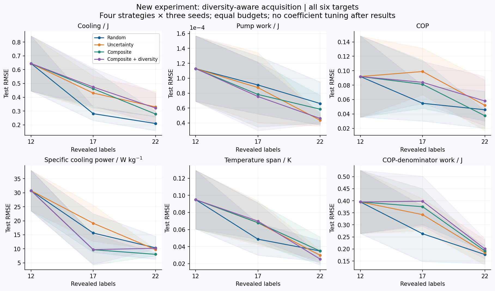

# Diversity-aware acquisition / 多样性选样实验

This extension completes the first diversity experiment on the existing 63-case dataset. It compares four acquisition strategies using fixed budgets, without running the physics solver or changing the historical experiments.

本次完成了已有 63 工况上的首组多样性选样扩展。在固定预算下比较四种策略，不调用物理求解器，也不修改历史实验。



## Protocol / 实验协议

- **Data / 数据：**37 training-pool cases, 13 protected calibration cases, 13 test cases. Test cases have previously informed project development; this remains exploratory evaluation. / 37 例训练池、13 例受保护校准集、13 例测试集；该测试集已有开发使用历史。
- **Matched budget / 相同预算：**12 initial labels, two batches of five, total 22. Seeds 701/702/703; each fit uses three independently initialized `7→32→32→6` SiLU networks, 200 AdamW updates per member, lr .002, weight decay 1e-4. / 12 个初始标签、两批各 5 个、总计 22；三个种子，每次拟合三个独立网络。
- **New score / 新分数：**0.5 × original composite score + 0.5 × percentile rank of minimum input distance to revealed cases and the selected batch. Distances use the scaler fitted on revealed training cases. Greedy selection updates distances after each chosen point; ties use case ID. / 复合分数与最近距离排名各占 0.5；只用已揭示训练样本拟合归一化器，每选一个点后更新距离。
- **Input permissions / 输入权限：**the selector receives candidate inputs, predictions and already revealed targets through the existing composite score; it never receives unrevealed targets or test/calibration observations. Each decision is written before label queries and test evaluation. / 选样器不读取未揭示标签或测试、校准观测，决策先落盘，再查询标签与评价测试集。
- **Fixed analysis / 固定分析：**the 0.5 coefficient, budgets and seeds were fixed before execution. No post-result coefficient search, selective seed removal or early stopping. / 权重、预算和种子运行前固定，没有事后搜索权重、删除种子或提前停止。

## Results at 22 labels / 22 标签结果

Three-seed mean test RMSE; lower is better. The figure shows between-seed standard deviations. / 三个种子平均测试 RMSE，越低越好；图中展示种子间标准差。

| Strategy / 策略 | Cooling / 冷量 J | Pump / 泵功 J | COP | SCP W/kg | Temperature span / 温差 K | COP work / 功分母 J |
|---|---:|---:|---:|---:|---:|---:|
| Random / 随机 | **0.20920** | 6.6087e-5 | 0.04583 | 10.37020 | 0.03481 | **0.17716** |
| Uncertainty / 不确定性 | 0.32984 | **4.3728e-5** | 0.05201 | 9.72973 | 0.02977 | 0.18536 |
| Composite / 复合 | 0.27804 | 5.8512e-5 | **0.03751** | **8.04512** | 0.03480 | 0.19224 |
| Composite + diversity / 复合与多样性 | 0.32140 | 4.6079e-5 | 0.05794 | 10.19659 | **0.02534** | 0.20062 |

**Interpretation.** Input diversity helps temperature-span prediction and improves pumping-work error relative to composite, while worsening the other four targets. It is a measurable multi-objective trade-off, not a uniformly better acquisition policy. The next study should define its primary objective and selection rule before further evaluation, then test on independent data when available.

**结论。** 输入多样性改善温差预测，相比复合策略也降低泵功误差，但其余四个目标更差。这是一组可量化的多目标权衡，不能称为全面更优的选样策略。后续应先明确主要优化目标和选样规则，再在可获得的独立数据上验证。

## Verification and rerun / 验证与复跑

All three original strategy curves and their queried case sequences matched the archived runs. Twelve final checkpoints passed reload checks. Total execution: 12 seed/strategy experiments, 108 small-network fits, zero new physics simulations. The new selector tests cover input-only geometric selection, permutation-invariant tie handling and rejection of malformed data.

三个原策略的曲线和查询工况序列均与归档一致，12 个最终检查点均通过重载核对。本次共 12 组种子/策略实验、108 次小网络拟合，新增物理仿真为零。新选样器测试覆盖输入几何选点、排列无关的平局处理和非法数据拒绝。

```bash
python -m examples.active_diversity --output run-output-diversity
python -m examples.research_gallery --output demo-output-research
python -m unittest SciML.tests.test_acquisition_diversity -v
```

Use fresh output paths. The gallery command plots the committed experiment, not an arbitrary rerun; inspect the new run's summary separately. / 输出路径必须不存在；绘图命令使用已提交实验，任意新运行需另行检查其摘要。

[Protocol / 协议](../evidence/experiments/acquisition_diversity_v1/protocol.json) · [All metrics and artifact hashes / 全部指标与产物哈希](../evidence/experiments/acquisition_diversity_v1/summary.json) · [Selector and runner / 选样与训练代码](../examples/active_diversity.py)
