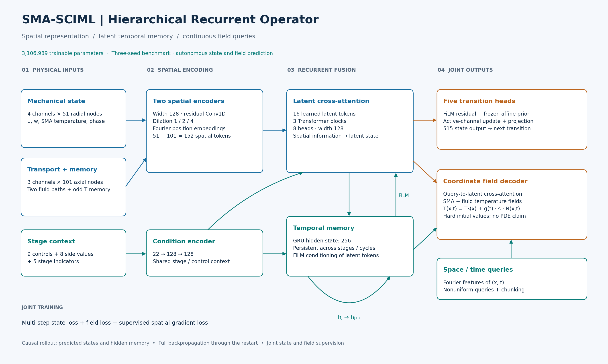

# Hierarchical Recurrent Operator (HRO) / 分层循环算子

## Architecture / 架构

**A 3,106,989-parameter model combines spatial encoding, latent attention, recurrent memory, five stage-specific transition heads and a continuous-coordinate temperature decoder.** The fixed-budget benchmark uses three seeds × 200 updates and 6.7 minutes of CPU training. Third-cycle SMA state RMSE is **1.120 K**, versus **1.543 K** for the original neural reference. Early-cycle and some state-component errors increase; see the [full benchmark](MULTICYCLE_BENCHMARK.md) for the fixed protocol, all comparisons and limitations.

**3,106,989 参数的模型整合空间编码、潜变量注意力、循环记忆、五个阶段转移头和连续坐标温度场解码器。** 固定预算基准采用三种子各200次更新，CPU训练用时6.7分钟。第三循环 SMA 状态 RMSE 为 **1.120 K**，原神经参考为 **1.543 K**；早期循环及部分状态分量退步，完整协议、对照与限制见正式报告。



## Why this structure / 为什么采用这套结构

The residual-cascade baseline uses five independent `529 → 32 → 32 → d` residual MLPs and a separately trained field decoder. The HRO uses spatial encoders and recurrent latent memory to represent and propagate these variables.

残差级联基线采用五个独立的 `529 → 32 → 32 → d` 残差 MLP，场解码器单独训练。HRO改变了信息表示与传递方式，同时保留原状态合同和仿射先验。

| Component / 模块 | Implemented structure / 实现 | Intended role / 设计目的 |
|---|---|---|
| Mechanical encoder / 力学编码 | Four channels × 51 radial nodes; Conv1D lift to 128; three residual blocks, dilations 1/2/4 / 4×51 输入、128 通道、三层膨胀残差块 | Preserve radial neighborhood structure in displacement, phase and SMA temperature / 保留位移、相分数和温度的径向邻域 |
| Transport encoder / 输运编码 | Three channels × 101 axial nodes; independent encoder with the same widths / 3×101 输入，独立同宽编码器 | Preserve separate fluid paths and directional thermal memory without conflating radial and axial coordinates / 分别保留两条流路和方向记忆，避免混用径向与轴向坐标 |
| Latent attention / 潜变量注意力 | 152 spatial tokens → 16 latent tokens; width 128; eight heads; three pre-norm Transformer blocks; FFN width 512 | Fuse spatial information through a fixed-size representation / 用固定大小的潜变量融合空间信息 |
| Stage context / 阶段条件 | Nine controls + eight side values + five stage indicators → `22 → 128 → 128` GELU | Condition a shared backbone on stage, operating conditions and carried side state / 按阶段、工况和侧状态调制共享主干 |
| Temporal memory / 时间记忆 | GRUCell input256 / hidden256; memory projection and FiLM modulation | Carry learned history across loading, exchange, unloading and mechanical restart / 在加载、换热、卸载及重启间携带历史 |
| Transition heads / 状态转移头 | Five FiLM-conditioned heads; active sizes 414/414/414/261/204 | Preserve stage ownership while learning corrections on top of the frozen affine maps / 在冻结仿射映射上修正活动状态，保留阶段归属 |
| Field decoder / 场解码器 | 18 Fourier coordinate features →128→128; query-to-latent attention; `128→128→2` output | Query SMA and fluid temperature at nonuniform space/time points / 查询非均匀时空坐标上的两类温度 |
| Hard constraints / 硬约束 | Exact stage-entry field values; phase range, displacement endpoints, antisymmetric memory | Preserve known interface constraints by construction / 通过输出构造保留已知接口约束 |

These are design motivations, not demonstrated accuracy benefits. With only eight historical training cases, a larger model has substantial overfitting risk. Model capacity must be assessed with training-only validation and subsequent independent data, not inferred from the parameter count.

以上是设计动机，不是已证实的精度收益。历史训练集只有八个工况，更大模型有明显过拟合风险；能力应通过训练集内部验证及后续独立数据评价，不能由参数量推断。

## State, recurrence and outputs / 状态、递推与输出

The explicit state stays at **515 dimensions**: 51 radial displacements, 51 transverse displacements, 51 SMA temperatures, 51 phase fractions, two 101-point fluid fields, eight side temperatures and 101 odd temperature-memory values. The learned **256-dimensional hidden state is additional**, not a replacement for the physical state. The two coordinate systems are encoded separately before attention fusion.

显式状态仍为 **515 维**：径向位移 51、横向位移 51、SMA 温度 51、相分数 51、两条 101 点流体温度、侧温度 8，以及反对称温度记忆 101。**256 维学习隐状态**独立存在，不替代物理状态。径向和轴向坐标分别编码后再融合。

For transition j at stage k, with known control u and normalized state/control features z:

$$Z_j=\operatorname{AttentionEncoder}(x_j,u,k),\qquad h_{j+1}=\operatorname{GRU}([\operatorname{mean}(Z_j),c_j],h_j).$$

$$\widetilde Z_j=(1+\gamma(h_{j+1}))\odot Z_j+\beta(h_{j+1}).$$

$$x_{j+1}=P\!\left(x_j+S_k\!\left[A_kz_j+b_k+0.1\,\sigma_k\odot R_k(\widetilde Z_j,h_{j+1},c_j)\right]\right).$$

Here c is the encoded condition, S inserts active increments, and σ is the frozen train-only input scale for the active channels. **The HRO residual uses input scales instead of the baseline's residual-RMS amplitude**, allowing a different correction range; this is an architectural change, not a claim of improvement. The scale multiplier is fixed at 0.1. A and b remain unchanged. P enforces phase fraction in [0,1], the three zero displacement endpoints and antisymmetric memory; temperatures are not clipped.

c 为条件编码，S 写入活动增量，σ 为活动通道的原训练输入尺度。**HRO 残差采用输入尺度，不沿用残差基线的残差 RMS 幅值**，因此修正范围发生变化；这是结构变化，尚未证明带来收益。倍率固定为 0.1，A、b 不更新。P 保留相分数 [0,1]、三个位移零端点和反对称记忆，不裁剪温度。

The first allowed state combines the very first observed mechanical frame with declared thermal conditions. Autonomous rollout subsequently consumes only predicted states, known controls and persistent hidden memory. At every new cycle, the learned fifth transition performs the mechanical restart. Two cycles contain nine transitions; three cycles contain fourteen. No future observations enter inference.

允许的初态由最早已观测力学帧和声明热初值组成。之后自主推进仅使用预测状态、已知控制和持续传递的隐状态。每个新循环先执行第五类力学重启转移；两循环九步、三循环十四步，推理不读取未来观测。

For exchange stages 2 and 4, the decoder receives the latent context and the **predicted entry state**, reconstructing the SMA entry as mirrored radial temperature plus directional memory. It returns:

$$\widehat T_f(x,\tau)=T_{f,0}^{\mathrm{interp}}(x)+s_f(1-e^{-4\tau})\,D_f(x,\tau;\widetilde Z_j),\qquad f\in\{\mathrm{SMA},\mathrm{fluid}\}.$$

换热阶段 2、4 的解码器从**预测入口状态**重构初始场：镜像径向 SMA 温度加方向记忆，流体温度采用对应路径。τ=0 时输出严格等于插值初场。输入支持 [0,1] 内非均匀坐标，超过 1,024 个查询时分块执行；坐标可查询并不等于已通过新网格泛化验证。

The field and state branches share encoders and recurrent context and are jointly differentiable. The decoded field is **not fed back into the explicit state**. Complete thermodynamic closure, end-of-stage mechanical re-equilibration consistency and PDE residual enforcement are not implemented. The historical side-state carry rules are retained.

场与状态分支共享编码和循环上下文，并可联合反向传播；**解码温度场不直接反馈显式状态**。完整热力学闭合、阶段末力学重平衡一致性及 PDE 残差约束尚未实现，历史侧状态传递规则继续保留。

## Training system / 训练系统

The runnable trainer uses complete two-cycle sequences from the original eight training cases. The training-field snapshot contains **32 training exchange segments**, taken from the same sealed HDF5 and checked against the existing state-entry reconstruction. Test labels are not exported into this training snapshot or used in the objective. The raw MAT availability limitation remains unchanged; see the [data card](DATA_CARD.md).

训练入口使用原八个训练工况的完整两循环序列。训练场快照包含同一封存 HDF5 中的 **32 段训练换热场**，并核对其初场与原状态入口重构一致。测试标签没有进入这份训练快照或训练目标。原始 MAT 可用性限制保持不变，详见数据说明。

$$L=L_{\mathrm{state}}+L_{\mathrm{field}}+0.01L_{\nabla_x\mathrm{field}}.$$

State loss equally weights the eight state blocks after train-only normalization. Field loss normalizes each field using RMS temporal changes estimated from training fields and omits time zero. The gradient term compares finite spatial differences of prediction and target on the sampled grid; it is **supervised gradient matching, not a governing-equation residual**. Gradients traverse the entire state/memory chain and field decoder without detach or teacher forcing.

状态损失按训练尺度归一化后对八个状态块等权。场损失用训练场时间变化 RMS 归一化，排除零时刻。梯度项比较采样网格上的预测/真值空间差分，是**有监督梯度匹配，不是控制方程残差**。梯度贯穿状态、记忆和场解码器，不截断、不读取中间真值推进。

| Setting / 设置 | Benchmark configuration / 基准配置 |
|---|---|
| Precision / 精度 | CPU float64, one compute thread / 单计算线程 |
| Optimizer / 优化器 | AdamW, lr=3e-4, weight decay=1e-4, gradient clip=1 |
| Budget / 预算 | Three seeds ×200 updates; two complete cases per batch / 三种子各200次、每批两个完整工况 |
| Schedule / 调度 | 20-update linear warmup, cosine decay to10% / 20次线性预热，余弦衰减至10% |
| Supervision / 监督 | Eight times including0/1 and26 spatial positions per exchange / 每段8个时间及26个空间点 |
| Selection / 选择 | Fixed final update; no test-based stopping / 固定末次更新，不依测试分数停止 |

Training records include optimizer/scheduler/RNG state, query indices, source/data hashes and every loss component. All nine major modules receive finite nonzero gradients. Self-contained checkpoints reproduce saved predictions exactly in the recorded environment; cross-platform replay uses an absolute tolerance of1e-8. The complete benchmark evaluates fields on50×101 grids.

训练记录包含优化器、调度器、随机数状态、查询索引、源码与数据哈希及全部损失分量。九个主要模块均收到有限非零梯度。自包含检查点在记录环境中精确重现保存预测，跨平台回放使用1e-8绝对容差；完整基准在50×101网格上评价温度场。

## Code and usage / 代码与运行

```bash
# Existing weights + execution evidence / 已保存权重与运行证据
python -m examples.verify_hierarchical
# Formal trained weights + all test scores / 正式训练权重与全部测试指标
python -m examples.formal_hierarchical --verify-only
# Short joint-training execution check, new directory / 新目录联合训练检查
python -m examples.train_hierarchical --output run-output-hro-check --updates 3 --batch-cases 2 --lr 0.0001
# Full default training recipe; no accuracy claim until evaluated / 完整默认训练配置
python -m examples.train_hierarchical --output run-output-hro-training
# Figures + offline interactive page / 绘图与离线交互页面
python -m examples.field_showcase --output demo-output-fields
```

```python
from SciML.models.v13.hierarchical_operator import HierarchicalStateOperator
model = HierarchicalStateOperator.load("evidence/experiments/v13_formal_v1/s20261121/model.pt")
# initial: [B,515], control: [B,9], times/positions: 1-D float64 tensors in [0,1]
prediction = model(initial, control, cycles=3, times=times, positions=positions)
```

[Model implementation / 模型实现](../SciML/models/v13/hierarchical_operator.py) · [Trainer / 训练器](../examples/train_hierarchical.py) · [Execution protocol / 实际运行协议](../evidence/architecture/v13_execution_v1/protocol.json) · [Execution summary / 运行验证结果](../evidence/architecture/v13_execution_v1/summary.json) · [Contract tests / 接口验证](../SciML/tests/test_hierarchical_operator.py)

## Demonstrations / 演示

The [field explorer](../assets/showcase/explorer.html) displays stored HRO temperature fields. The comparison animation and atlases show the residual cascade and HRO against the same numerical references, with fixed cases/checkpoints and shared color limits. Grid coordinates are normalized within each exchange stage.

场浏览器展示保存的 HRO 温度场。对照动画和图谱将残差级联与 HRO 对照同一数值参考，工况与检查点固定，色标共用；坐标在各换热阶段内归一化。

## Research basis and next evaluation / 方法依据与后续评价

The latent bottleneck draws on the cross-attention approach in [Perceiver](https://arxiv.org/abs/2103.03206); conditional affine modulation follows [FiLM](https://arxiv.org/abs/1709.07871). These are component inspirations, not claims of reproducing those models or of methodological novelty. Attention is implemented with [PyTorch MultiheadAttention](https://docs.pytorch.org/docs/stable/generated/torch.nn.MultiheadAttention.html).

潜变量压缩参考 Perceiver 的交叉注意力思路，条件仿射调制采用 FiLM 思路。这里只说明模块依据，不声称复现原论文完整模型或已证明方法创新。

The formal benchmark evaluates the complete system, without isolating each module's contribution. Next work should address the observed spatial oscillations and state/field tradeoffs, and compare spatial encoding, memory and joint supervision with case-level validation inside the eight training cases. The historical test cohort is already studied; repeated tuning on it must not be presented as independent confirmation. Strong affine/POD references remain important.

正式基准评价了整体系统，未隔离各模块贡献。后续先处理空间振荡及状态/场取舍，在八个训练工况内部按工况验证空间编码、记忆与联合监督；历史测试集已分析过，不能反复依其调参后称独立确认。继续保留仿射/POD 强基线。
