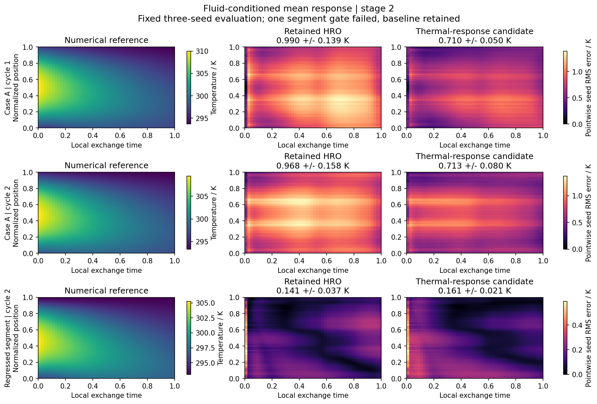

# HRO：流体条件热响应读出

**固定候选降低了主要 SMA 均温偏差，但尚未替换已验证基线。** 它通过两组内部验证，将历史开发基准的整体 SMA 场 RMSE 从 **0.900 降至 0.816 K（9.3%）**，并保留第三循环第四阶段结果。然而，一个换热段的三种子平均 RMSE 从 0.141 增至 0.161 K，未通过预先记录的逐段门限。全部结果及失败证据均保留，未根据历史测试继续调整该候选参数。

## 结构与训练

保留约 311 万参数的模态 HRO、共享残差读出和第二阶段空间读出。增加 **fluid-conditioned thermal relaxation readout（流体条件热松弛读出）**，使用 HRO 自主预测的流体均温轨迹驱动 SMA 均温：

$$\frac{d m}{d\tau}=\lambda(u)\,[\bar T_f(\tau)-m(\tau)],\qquad m(0)=\bar T_s(0),$$

$$\lambda(u)=\theta\,\frac{t_{ex}}{2.4\,\mathrm{s}}\,\frac{0.20\,\mathrm{mm}}{h}\left(\frac{40\,\mathrm{mm}}{R}\right)^2,\qquad \theta>0.$$

其中 τ 为局部归一化时间，R、h、tₑₓ 分别为半径、厚度与换热时长。相邻 50 个原生时间点之间假定流体均温线性变化，对该松弛方程解析积分。单步响应是上一步 SMA 均温与两端流体均温的凸组合，避免显式积分的步长稳定性限制。θ 是学习得到的有效松弛参数，不直接解释为真实换热系数。

| 部分 | 设置 |
|---|---|
| 输入 | 自主预测的入口 SMA 均温、完整 50 点流体均温轨迹、几何与时长 |
| 拟合参数 | 每个冻结主干仅拟合一个正参数 θ |
| 拟合样本 | 内部划分 6 工况 × 2 循环；最终 8 工况 × 2 循环，均只取第二阶段 |
| 目标 | 未来 49 个时刻的 SMA 均温 MSE，不使用历史测试标签拟合 |
| 数值求解 | 对 log θ 有界标量优化，θ 范围 0.001–1000；命中边界即拒绝 |
| 三种子最终参数 | 1.57170、1.56469、1.57898；不是三个独立数据集 |
| 输出融合 | 原 SMA 场加 **0.5 ×（响应均温 − 原读出均温）**，空间均匀修正 |
| 固定路径 | 初始场、空间差分、第四阶段、流体场与传播状态保持；修正不反馈循环状态 |

完整流体轨迹由同一次自主预测产生，不是未来观测。原生网格上的修正按时间插值到查询点，其定义不依赖请求哪些空间位置。当前只支持既有恒定热物性、既有场定义的数据契约，不能据此声称任意材料、分辨率或更长循环的泛化。

## 为什么需要体积缩放

最初按时长/厚度缩放速率，两种拟合方式均未通过第一内部划分。误差分解显示，松弛响应自身的系统偏差比流体预测误差传播更突出。单独对八个训练工况作诊断性拟合时，曲线误差仅约 **0.003–0.025 K**，但有效速率随几何明显变化。这些逐工况诊断参数不用于预测。

只读检查与历史指纹逐字节匹配的 Simulink 文件，确认其 **101 个 SMA 动态节点使用相同质量表达式和相同比热**，两条换热路径包含 202 个内部管段。动态热容的均温对应算术平均；圆盘弦长权重和径向环带权重属于另一层压缩/状态重建计算。前序[热增量一致性结果](HRO_MEAN_TEMPERATURE.md)验证的是该映射关系，不能代替完整的 Simscape 热平衡。

由此引入与体积成反比的名义响应速率，仍从训练数据辨识有效系数。它使第一划分真实入口拟合的均温误差从 **0.402 降至 0.049 K**。体积缩放有原模型布局与数据支持，但不等于所有管路传热细节已被辨识。[容量布局审查](../evidence/local_studies/sma_relaxation_readout/capacity_audit/analysis.json)保存节点参数、来源哈希和诊断范围；没有修改或重跑物理模型。

## 验证结果与未通过项

完全替换均温时，第二内部划分有一段过度修正。随后只检验固定半幅修正，未扫描混合系数。两组内部验证均要求第二阶段平均 RMSE 严格下降、每个验证段不退步：

| 内部划分 | 固定基线 / K | 半幅热响应 / K |
|---|---:|---:|
| 第一划分 | 1.02232 | **0.71525** |
| 第二划分 | 0.87735 | **0.75243** |

方案固定并通过真实推理接口复核后，才拟合三个完整训练集参数并评估历史基准。下表为三种子均值，场 RMSE 排除初始时刻：

| 指标 | 固定基线 / K | 固定候选 / K |
|---|---:|---:|
| 全部 20 个测试换热段 | 0.89992 ± 0.07542 | **0.81635 ± 0.05816** |
| A，第 1 循环、第二阶段 | 0.99025 | **0.70979** |
| A，第 2 循环、第二阶段 | 0.96799 | **0.71265** |
| A，第 3 循环、第二阶段 | 0.33092 | **0.29484** |
| B，第 1 循环、第二阶段 | 1.55203 | **1.32703** |
| B，第 2 循环、第二阶段（最差段） | 1.89909 | **1.59345** |
| B，第 3 循环、第二阶段 | 1.01227 | **0.94921** |
| 第三循环第四阶段，两工况合并 | 1.17562 ± 0.16483 | **完全相同** |
| 数据编号 02，第 2 循环、第二阶段 | **0.14136** | 0.16076 |

± 为样本种子标准差，不是独立工况的置信区间。最差种子的整体 RMSE 从 0.95312 降至 0.85795 K。20 段中，9 段的三种子平均误差下降，10 个第四阶段完全不变，1 段退步。六个单种子段退步，最大增加 **0.11656 K**，位于 B 第三循环第二阶段的首个种子；该段的三种子均值仍改善。不能将“第三循环第四阶段保持”扩大成“所有第三循环单种子均不退步”。



图中误差为逐像素跨三个种子的 RMS，每行的两种预测使用相同误差色标；行间色标不同。标题中的均值及标准差是逐种子先算场 RMSE 后汇总，和逐像素色值的聚合顺序不同。图保留原生网格、未做平滑，包含完整退步段。

原始逐段/逐种子数据、选择规则和通过项见[固定评估](../evidence/local_studies/sma_relaxation_readout/formal/summary.json)与[预先记录的协议](../evidence/local_studies/sma_relaxation_readout/formal/protocol.json)。因逐段门限失败，当前正式基线仍为分阶段空间读出 HRO。内部划分参与过失败诊断，历史测试集也已经反复查看；这些是开发证据，不是独立泛化确认。

对唯一均值退步段作固定参数的事后分解：原均温偏差仅 **+0.009 K**，修正后为 **+0.082 K**。未混合的松弛响应误差中，入口偏差传播贡献约 **+0.160 K**，响应模型偏差和流体传播分别为 −0.030、+0.025 K。修正平方项为 0.00655 K²，抵消原误差的交叉项仅 −0.00132 K²，因此净 MSE 增加。这里用真实入口/流体替换来区分来源，属于[诊断性干预](../evidence/local_studies/sma_relaxation_readout/fixed_regression_diagnosis/analysis.json)，未计入预测成绩或回用于拟合。它表明物理响应可以改善大偏差，却可能破坏原读出已形成的误差抵消。

## 验证、成本与使用

**81 项测试通过**；三个自包含模型、七项内部评分、训练参数重新拟合均精确回放，最大差异为 0。基线权重与受保护输出完全保持。首次回放发现历史协议字段与浮点计算顺序的兼容问题，已按封存源码解释旧实验，未覆盖原始结果、重跑实验或放宽门限。[回放记录](../evidence/local_studies/sma_relaxation_readout/verification.json)、[测试记录](../evidence/local_studies/sma_relaxation_readout/unit_tests.json)保留证据。

三组内部研究的计算段合计约 **7.40 秒**，三个完整训练集拟合约 **2.54 秒**；不含解释器启动、测试、审查和图表处理。所有循环主干冻结，神经训练更新与物理仿真调用均为零。

```bash
python -m examples.verify_relaxation_readout
python -m unittest SciML.tests.test_relaxation_readout -v
python -m examples.relaxation_report --output demo-output-relaxation
```

候选使用 `RelaxationReadoutOperator.load` 加载归档内 `formal/s20261121/model.pt` 等检查点。[实现](../SciML/models/v13/relaxation_readout.py)与[完整归档](../evidence/local_studies/sma_relaxation_readout/archive_manifest.json)可追溯全部失败、修复与评估。保持本地 Git 管理，未推送 GitHub。

后续应研究如何仅用训练工况估计修正可靠性、处理入口误差与跨循环误差抵消，并重新固定验证协议。该候选的参数与历史成绩保持封存；不能通过测试段专属开关或后验改动混合系数消除这一个退步。

## English summary

A fluid-conditioned thermal relaxation readout adds one fitted positive response rate to each frozen HRO backbone. Volume scaling is motivated by the hash-verified solver's equal-mass SMA nodes and shared pipe layout. Exact integration with piecewise-linear predicted fluid temperature supplies a stable mean response; a fixed half blend preserves spatial differences, initial fields, state recurrence, fluid predictions and stage 4.

The fixed candidate passes both internal segment gates and lowers overall historical SMA-field RMSE from **0.900 to 0.816 K**. Case A's first two stage-2 errors decrease to **0.710 and 0.713 K**; third-cycle stage-4 output remains exact. However, one segment mean increases from **0.141 to 0.161 K**, and six individual seed-segments regress. The candidate is therefore **not promoted**. All results are retained, 81 tests pass, and three checkpoints replay exactly. The repeatedly examined historical benchmark is not independent confirmation. No physical simulation or neural backbone training was performed.
