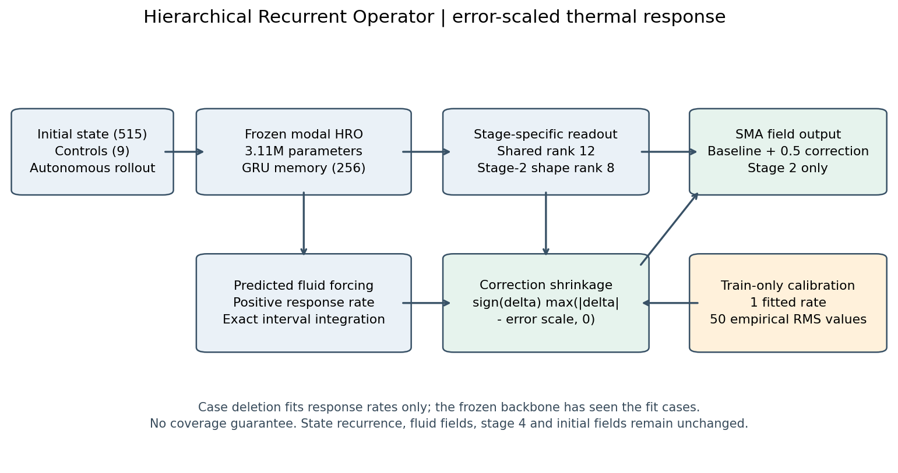
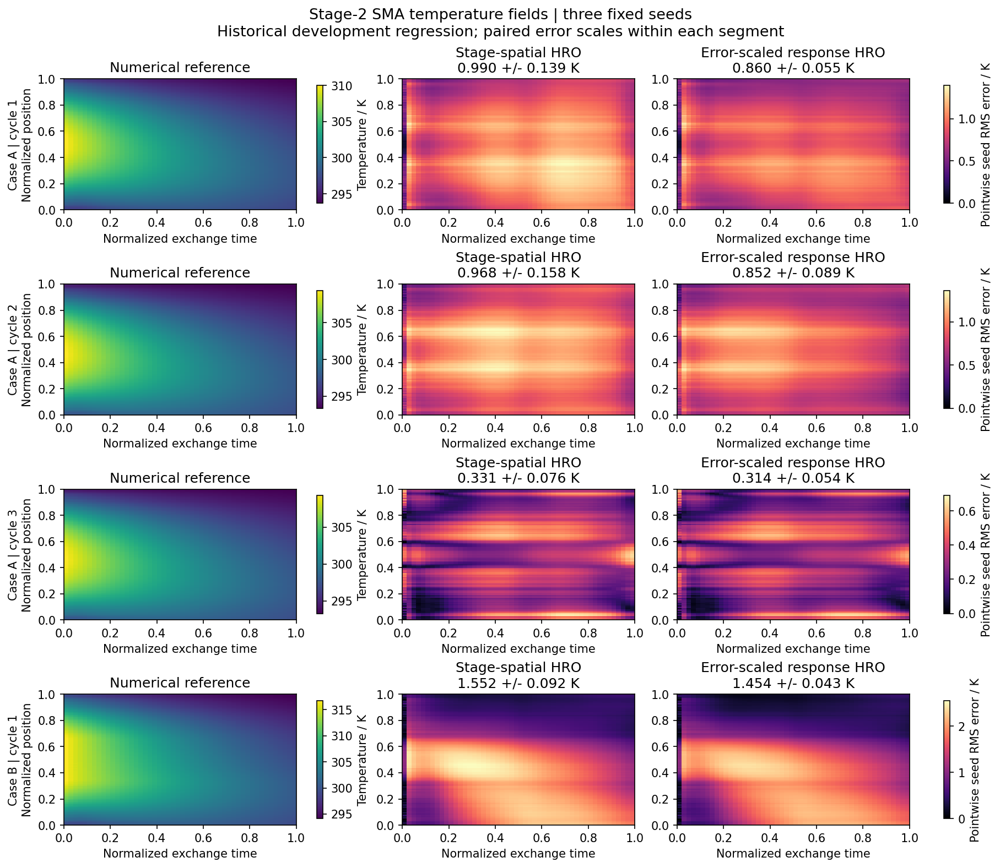

# HRO with error-scaled thermal response / 误差收缩热响应 HRO

**SMA 场总体 RMSE 从 0.89992 降至 0.85653 K。** 工况 A 前两循环的第二阶段优于未加残差读出的模态 HRO，第三循环第四阶段保持 1.17562 K。方案通过预先固定的晋升门限，作为当前本地推荐配置。原基线和未采用候选均可查阅。

**Overall SMA field RMSE decreases from 0.89992 to 0.85653 K.** Stage-2 predictions in case A's first two cycles now outperform the modal HRO reference, while cycle-3/stage-4 RMSE remains 1.17562 K. The configuration passes the fixed promotion criteria and is recommended locally. Previous checkpoints and rejected candidates remain available.

## Diagnosis / 误差诊断

工况 A 前两循环的第二阶段以空间均温偏热为主。基线均温偏差为 **+0.968、+0.948 K**，分别由入口偏差 **+0.431、+0.638 K** 与换热期间的演化偏差 **+0.537、+0.310 K** 叠加而成。分阶段空间读出已改善空间形状，共享读出仍决定均温。两组三循环工况的冲洗比为 1.230，高于训练区间 0.923–1.077，同时存在循环数外推。现有数据无法单独辨识二者的影响。[均温分解](HRO_MEAN_TEMPERATURE.md) · [分阶段读出](HRO_STAGE_READOUT.md)

Case A's early stage-2 exchanges show warm bias from both the predicted entry state and the ensuing thermal evolution. The stage-specific spatial branch improves shape while the shared readout still determines the mean. Both three-cycle cases also lie above the training range for flush ratio, so the available cases cannot isolate the effect of cycle horizon from that of operating conditions.

## Architecture and fitting / 架构与拟合



冻结已有的 **311 万参数模态 HRO**（515 维状态、9 维控制、16 × 128 潜变量、256 维 GRU 记忆），沿用共享秩 12 残差读出及第二阶段秩 8 空间分支。新增部分只校正第二阶段的空间平均温度，不回写循环状态。

The existing 3.11M-parameter modal HRO and its shared rank-12 and stage-specific rank-8 readouts remain frozen. The added head corrects only the stage-2 spatial mean, without feeding the decoded correction back into the recurrent state.

以预测流体的 101 点算术平均温度 F 驱动 SMA 平均温度响应 m：

**dm/dτ = λ(F − m)**，其中 **λ = θ(tₑ/2.4 s)(0.2 mm/h)(40 mm/r)²**。

τ 是归一化换热时间，r、h、tₑ 分别为半径、厚度与换热时长。响应从自主预测的阶段入口温度起步，在 50 个原生时间点间对线性流体强迫精确积分。θ 是有效响应速率，不能解释为已辨识的物理换热系数。等节点热容量的历史求解器依据见[热响应审计](HRO_COUPLED_THERMAL_RESPONSE.md)；该近似响应不证明整体热量闭合。

The positive response rate incorporates exchange duration and inverse plate volume. Exact interval integration uses linearly interpolated predicted fluid forcing on 50 native times. The fitted rate is an effective coefficient, not an identified physical heat-transfer coefficient or evidence of coupled energy closure.

令 δ 为响应均温与基线均温之差。依次从响应速率拟合中删除一个训练工况，在被删除工况上计算预测误差，以各循环平方误差先在工况内平均、再对工况平均的平方根得到时间尺度 σ(τ)。最终输出为：

**T̂(τ, x) = T̂基线(τ, x) + 0.5 sign(δ) max(|δ| − σ(τ), 0)**。

初始修正强制为零，第四阶段走原路径。σ 较大的时刻抑制较弱的修正。删除工况仅适用于响应速率拟合，冻结主干仍见过这些训练工况，**这不是完整流水线的交叉拟合，也不是具有覆盖率保证的预测区间**。

The correction is soft-thresholded by a training-case empirical RMS error scale, then multiplied by the fixed blend 0.5. Case deletion applies only to response-rate fitting; the frozen backbone has seen the fit cases. The error scale has no calibrated coverage guarantee. The projection cannot enlarge or reverse the proposed correction, but it does not guarantee accuracy improvement for each case.

| Setting / 设置 | Value / 数值 |
|---|---|
| Fitting data / 拟合数据 | 8 two-cycle training cases; 16 stage-2 exchanges / 8 个两循环训练工况、16 段 |
| Rate optimization / 速率优化 | Bounded scalar minimization of future-mean MSE in log θ; θ ∈ [0.001, 1000], xatol 10⁻⁹, maxiter 100 |
| Fitted θ, three seeds / 三种子速率 | 1.5717043, 1.5646874, 1.5789841 |
| Error-scale ranges / 误差尺度范围 | 0.16091–0.61227 / 0.17424–0.62169 / 0.17576–0.61208 K |
| Fixed settings / 固定设置 | Blend 0.5; error-scale multiplier 1; no threshold search / 无阈值搜索 |
| Additional fitted quantities / 新增拟合量 | One rate and 50 empirical RMS values per checkpoint / 每个模型一个速率、50 个误差尺度 |

## Evidence and exceptions / 结果与例外

八个训练工况的两组内部划分，均以六工况拟合、两工况验证。第二阶段逐段 RMSE 的平均值分别从 **1.02232 → 0.81546 K**、**0.87735 → 0.80761 K**，八个内部验证段均不退步。候选及参数固定后，才在完整训练集拟合三个读出并评价四个历史测试工况。内部划分和历史测试都已参与开发；结果不属于独立泛化确认。

Both six-case/two-case internal splits pass strict segment-level nonregression. The recipe is fixed before full-training fits and historical evaluation. Both the internal splits and historical test set have informed development; these are development regression results, not independent confirmation.

以下均排除初始帧；总体指标先在每个种子内合并网格求 RMSE，再取三种子均值。逐段行同样先计算各种子 RMSE；± 为种子间样本标准差。

All field metrics exclude the initial frame. Pooled RMSE is computed within each seed before averaging across three seeds; ± denotes sample SD across seeds.

| SMA field metric / 场指标 | Stage-spatial HRO / 空间读出基线 | Error-scaled response / 误差收缩响应 |
|---|---:|---:|
| All four historical cases / 全部四工况 | 0.89992 ± 0.07542 | **0.85653 ± 0.06153** |
| A, cycle 1, stage 2 | 0.99025 | **0.86006** |
| A, cycle 2, stage 2 | 0.96799 | **0.85210** |
| A, cycle 3, stage 2 | 0.33092 | **0.31354** |
| B, cycle 1, stage 2 | 1.55203 | **1.45442** |
| B, cycle 2, stage 2; worst segment / 最差段 | 1.89909 | **1.72849** |
| B, cycle 3, stage 2 | 1.01227 | **0.95861** |
| B, full trajectory; worst case / 最差工况全轨迹 | 1.28842 ± 0.07605 | **1.21939 ± 0.06368** |
| Cycle 3, both exchange stages / 第三循环两换热阶段 | 0.98869 ± 0.16632 | **0.97257 ± 0.14176** |
| Cycle 3, stage 2; pooled / 合并 | 0.75312 ± 0.19180 | **0.71322 ± 0.12082** |
| Cycle 3, stage 4; pooled / 合并 | 1.17562 ± 0.16483 | **1.17562 ± 0.16483** |

A 前两段对应的模态 HRO 参考误差为 0.95810／0.92587 K，收缩后仍分别有 +0.842／+0.829 K 的均温偏热。十个第二阶段换热段的三种子均值全部改善，十个第四阶段换热段的输出逐元素相同。最差种子的总体 RMSE 从 0.95312 降至 0.89206 K。

The modal-only references for A's first two stage-2 exchanges are 0.95810 and 0.92587 K. A residual warm bias of 0.842 and 0.829 K remains. All ten stage-2 segment means improve, all ten stage-4 field predictions match the reference exactly, and the worst seed's overall RMSE decreases from 0.95312 to 0.89206 K.



每行误差图共用色标，显示三种子的逐点均方根误差；标题显示逐种子 RMSE 的均值与标准差，两种聚合不可混同。原生网格不平滑。图示原先四个目标段，完整 20 段和 60 个种子—段结果见[正式结果](../evidence/local_studies/sma_risk_limited_readout/formal/summary.json)。

Each row shares its error color scale. Maps show pointwise RMS across seeds, whereas titles report mean ± SD of per-seed RMSE. Native grids are unsmoothed. All 20 segment groups and 60 seed-segment results are retained in the linked evidence.

**仍有两个单种子例外**，均为首个固定种子的第三循环第二阶段。A 的误差增加 **0.00004475 K**，B 增加 **0.01950766 K**。B 的校正与已有偏热误差同向，MSE 的交叉项为 +0.03335 K²、修正平方项为 +0.00182 K²。两段的三种子均值仍改善。前一固定半混合响应使另一个两循环工况的第二阶段段均值由 0.14136 增至 0.16076 K，未通过逐段门限。采用误差收缩后该段为 0.13690 K。[剩余退步分解](../assets/sma_risk_limited_readout/analysis.json) · [未采用的热响应及诊断](HRO_COUPLED_THERMAL_RESPONSE.md)

Two individual seed-segments still regress: A and B at cycle 3/stage 2 in the first fixed seed, by 0.00004475 and 0.01950766 K. B's correction reinforces an existing warm bias. Their three-seed means improve, but uniform per-seed improvement is not established. The earlier unshrunk response remains a rejected candidate because it worsened another segment's seed mean.

## Verification, cost and extension / 验证、成本与扩充

三个种子的预测回放及训练数据重拟合差异均为 **0**。状态、流体场、初始场、第四阶段与基线逐元素相同，空间差分检查容差为 10⁻¹² K。60 个换热段的初始场均与相应预测入口状态重建的温度场逐元素相同。换热段末态与后续状态的物理一致性仍待验证。**86 项测试通过**，覆盖标签隔离、保存加载、查询子集、循环前缀及扩充接口。内部验证曾因缓存与实时参考路径的 2.27 × 10⁻¹³ K 舍入差异误报退步。改为相同推理路径比较，沿用原有门限。[配对回放](../evidence/local_studies/sma_risk_limited_readout/acceptance_verification.json) · [比较器诊断](../evidence/local_studies/sma_risk_limited_readout/comparator_diagnosis/diagnosis.json)

All three checkpoints reproduce archived forecasts, response rates and empirical scales exactly in the local environment. Each of the 60 exchange entry fields matches the reconstruction from its predicted entering state. Coupled consistency at the exchange exit remains open. All 86 tests pass. Matched reference and candidate inference resolves the prior comparator rounding error under the same scientific gate. [Paired replay](../evidence/local_studies/sma_risk_limited_readout/acceptance_verification.json) · [Test log](../evidence/local_studies/sma_risk_limited_readout/unit_tests.log)

内部试验计算 **3.47 秒**，三种子完整拟合 **3.01 秒**，测试 **15.89 秒**；这些是各程序记录的计算时间，不包含全部启动、评估、绘图和整理时间。物理仿真与神经网络更新均为 **0**。后续真实数据若改变物理实现或材料参数，仍须先核对兼容性。

Recorded compute times are 3.47 s for internal development, 3.01 s for full three-seed fitting, and 15.89 s for tests, excluding other startup, evaluation and documentation work. No physical simulations or neural updates were performed.

```bash
python -m examples.verify_risk_limited_readout
python -m unittest SciML.tests.test_risk_limited_readout -v
python -m examples.risk_limited_report --output demo-output-response
```

用 `RiskLimitedRelaxationOperator.load` 加载[推荐模型索引](../checkpoints/hro_recommended.json)中的任一固定种子检查点；不按测试成绩选种子。每个检查点包含完整主干和读出。场修正不改变显式状态，因此仍须分别报告状态和场精度。

Load a listed checkpoint with `RiskLimitedRelaxationOperator.load`; each is self-contained. The recommendation preserves all three fixed seeds and does not select a best test seed. Field accuracy must remain distinct from state accuracy.

扩充入口接受 NPZ，包含一维 Unicode 数组 `case_ids[N]` 和数值数组 `initial[N,515]`、`control[N,9]`、`states[N,5C-1,515]`、`fields[N,2C,2,50,101]`。N 为工况数，C 为该批共同循环数。在每个循环内，场按第二、第四阶段排列，通道依次为 SMA、流体。控制量依次为半径 m、厚度 m、压力 Pa、冲洗比、换热时长 s、两种材料标识、加载温度 K 和卸载温度 K。以 JSON 字符串列表选择至少三个独立拟合工况。[控制量定义](../SciML/models/v12/learning_historical_rollout.py)

```bash
python -m examples.fit_risk_limited_readout --dataset aligned_cases.npz --fit-ids training_ids.json --reference evidence/local_studies/sma_stage_readout/formal/s20261121/model.pt --output run-output-response-expanded
```

命令行入口在八个原训练工况上重现了首个固定种子的读出权重和全部八组删除工况拟合值。可变循环数及留出标签隔离通过合成三循环接口测试。扩充数据上的预测精度仍需独立评估。[训练入口核验](../evidence/local_studies/sma_risk_limited_readout/fit_interface_verification.json)

The expansion entry point accepts whole cases of a common cycle horizon, fits the response head with the pretrained backbone frozen, and records dataset, selection, source and reference hashes. With the eight original training cases the command reproduces the first fixed seed's weights and all eight deletion fits exactly. A synthetic three-cycle case set exercises the input contract and held-out-label isolation. Accuracy on new physical cases and coupled energy validation remain open. [Fit interface verification](../evidence/local_studies/sma_risk_limited_readout/fit_interface_verification.json)
