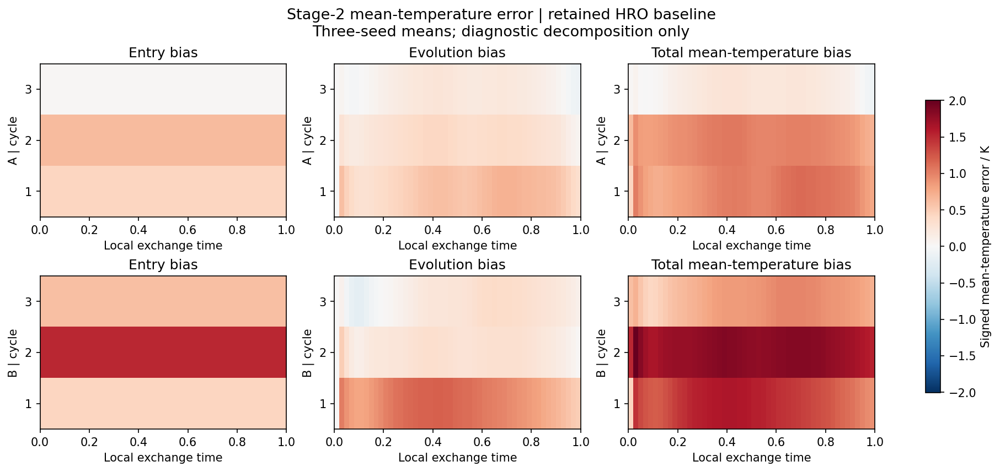

# HRO：平均温度误差与热增量一致性

这份报告记录均温修正的前期实验。后续通过逐段验证的配置及结果见[误差收缩热响应 HRO](HRO_ERROR_SCALED_RESPONSE.md)。

后续[流体条件热响应审查](HRO_COUPLED_THERMAL_RESPONSE.md)区分了 Simulink 等质量动态节点与圆盘投影权重。下文的加权增量恒等式属于压缩/状态重建映射，不代表完整动态热平衡；原实验和结果保留。

**当前采用的模型仍为分阶段空间读出 HRO。** 平均温度修正尚未同时通过两组内部验证，因此没有替换模型，也没有计算这些候选的历史测试成绩。已验证基线的全部测试 SMA 场 RMSE 为 **0.89992 K**，第三循环第四阶段为 **1.17562 ± 0.16483 K**。这里的 ± 是三个种子的样本标准差。

## 误差来源

工况 A 前两个循环的第二阶段仍主要整体偏热。按原生 101 点算术平均，未来时刻的平均偏差可以拆成入口偏差与后续演化偏差：

| 工况 A、循环 | 入口偏差 / K | 演化偏差 / K | 合计 / K |
|---|---:|---:|---:|
| 1 | +0.431 | +0.537 | +0.968 |
| 2 | +0.638 | +0.310 | +0.948 |
| 3 | +0.021 | +0.143 | +0.164 |



图为三个种子的平均带符号误差，使用原生时间点、共同色标、不做平滑。其他工况存在入口与演化误差相互抵消的情况，不能统一减去一个温度偏置。

热容加权后的 A 前两循环偏差为 **+0.995、+0.981 K**。与算术平均的差异仅为 +0.028、+0.033 K，偏热结论不变。加权平均只用于物理诊断，未替换原有评价指标。

## 已检验的改进与取舍

冻结循环主干、流体与状态路径，仅在第二阶段增加空间均匀的时间修正。POD/Ridge 分支使用秩 3 的时间基，比较残差回归与直接温升回归；输入从入口场统计量扩展到完整入口场、8 个热状态变量及已有潜在 token。正则、特征集合和候选在各次试验开始前写入配置。热状态包括热/冷端、芯片、缓冲体和管路温度，推理时全部来自模型预测。

| 方案 | 第一划分 / K | 第二划分 / K | 未采用原因 |
|---|---:|---:|---|
| 固定基线 | 1.02232 | 0.87735 | — |
| 完整入口场的均温残差 | 0.83895 | 0.89419 | 第二划分整体退步 |
| 完整入口场的直接温升 | 0.50290 | 0.79205 | 一个验证段退步 |
| 增加热状态上下文 | 0.50091 | 0.79310 | 一个验证段退步 |
| 按删去一个拟合工况的敏感性逐时刻收缩 | 0.86531 | 0.85989 | 两个验证段仍退步 |
| 增加潜在 token 特征 | 0.71842 | 0.89152 | 第二划分整体退步 |
| 无拟合参数的热增量投影 | 0.72734 | 0.89229 | 第二划分两个验证段退步 |

表中指标为第二阶段逐段 RMSE 的均值。验收始终要求均值严格下降，且**每个第二阶段验证段不退步**。例如逐时刻收缩的两个退步分别约为 0.000003、0.002325 K，仍判为失败。对于完整入口场温升方案，一个失败段的误差与修正交叉项为正，因此任何正的统一缩放系数都不能使该段不退步；单纯继续缩小幅度没有解决方向错误。

另有紧凑输入、交互特征、真实入口监督、整段敏感性收缩和几何条件热响应核等方案。11 组均温方案共回放 32 项内部评分，完整结果与失败证据见[归档汇总](../evidence/local_studies/sma_mean_readout/summary.json)。这些方案是根据先前失败逐步提出的，内部划分已反复参与开发，不能视为独立确认。核分支在全部热输入等于 293 K 时严格给出零温升，但这一性质不代表完整能量守恒。

## 找到了可用的物理关系，但硬约束尚不可靠

圆盘条带的热容权重来自弦长乘条带宽度，径向状态使用环带面积权重。在已封存的恒定比热设定下，32 个训练换热段均满足：

**径向热容加权温升 = 条带热容加权温升。**

最大差异为 **1.28 × 10⁻¹³ K**。但径向末状态重建场与条带末场的加权绝对温度最多相差 **4.736 K**，因此不能强制两种绝对末温相等。该结果细化了此前的[状态—场接口限制](HRO_RESEARCH_DESIGN.md)：增量关系成立，绝对温度关系不成立。

据此检验一个固定的、无需拟合的方案：用预测径向温升约束条带末温升，并加一个从零线性增长的空间均匀修正。该时间形状是固定端点条件下使修正的时间梯度平方积分最小的解，没有搜索形状或幅度。初始场、空间差分、第四阶段、流体与传播状态保持原路径。

它在第二划分失败。工况索引 5 的两个循环中，入口加权偏差分别为 **+2.351、+1.705 K**，预测温升误差分别为 **−1.158、−0.711 K**。投影后的末温偏差变为两者之和：**+1.193、+0.994 K**，大于原读出的 **+0.761、+0.231 K**。物理关系本身成立，但把两个有偏预测强制结合，并不保证精度提高。[诊断与回放](../evidence/local_studies/sma_increment_consistency/verification.json)保留逐段分解。

历史 hook 与参数构建文件逐字节匹配已有运行指纹。几何、映射与压缩辅助文件来自同一恢复包，已保存检查时的哈希，但原始运行未逐文件记录这些辅助文件；其证据强度与受指纹绑定的文件不同。数值增量关系另由实际训练数据直接核验。[几何审查](../evidence/local_studies/sma_mean_geometry/analysis.json)记录完整范围。这里没有审计所有热流，也不声称完成系统能量闭合验证。

## 实现、验证与下一步

平均温度分支支持自包含检查点、固定原生网格上的均值以及任意区间内查询；敏感性只表示删除拟合工况造成的输出变化，未校准成置信区间。验证门限现在按工况、循环、阶段核对记录，拒绝缺失、重复和非有限值。缓存支持相互匹配的更多循环状态与场；当前历史数据加载器仍固定为八个两循环训练工况，扩充实际数据时仍需更新数据清单和加载入口。

全部 **74 项测试通过**，包括新增物理关系测试；最终检查结果见[阶段检查点](../evidence/local_studies/sma_mean_readout/stage_checkpoint.json)。保留基线的三组权重与预测精确回放；[基线验证](../evidence/local_studies/sma_mean_readout/retained_baseline_verification.json)确认状态、流体、初始场及第四阶段完全不变。11 组均温试验记录的计算段合计约 **32.25 秒**，热增量投影约 **3.03 秒**，不包括解释器启动、测试及证据整理。神经训练更新和物理仿真调用均为零。

```bash
python -m examples.verify_mean_development
python -m examples.verify_increment_consistency
python -m unittest SciML.tests.test_mean_thermal_readout SciML.tests.test_thermal_geometry -v
```

下一步应利用已验证的热增量关系，区分入口状态预测误差与温升预测误差，检验经过训练校准的软一致性目标或增量条件输入。不得直接把当前预测径向温升作为无误差真值，也不宜继续围绕反复使用的验证段扫描收缩阈值。目标仍未完成：A 前两循环的平均温度精度尚未获得可采用的进一步提升。代码与结果仅作本地 Git 管理。

## English summary

The retained HRO has **0.900 K** overall SMA-field RMSE and **1.176 K** third-cycle stage-4 RMSE. Mean-temperature candidates have not passed both internal segment-level nonregression gates and have not been evaluated on historical test cases. Case A remains warm under both arithmetic and heat-capacity-weighted means. All 32 training exchanges satisfy a radial/strip **heat-increment identity** to 1.28 × 10⁻¹³ K, although their absolute reconstructed endpoint temperatures differ. A parameter-free projection enforcing that identity fails on two validation segments because entry-state and increment prediction errors combine unfavorably. The identity supports further calibrated consistency research; enforcing it on biased predictions is insufficient. Baseline weights, third-cycle predictions and all failed evidence are retained. No physical simulations or neural training updates were performed.
