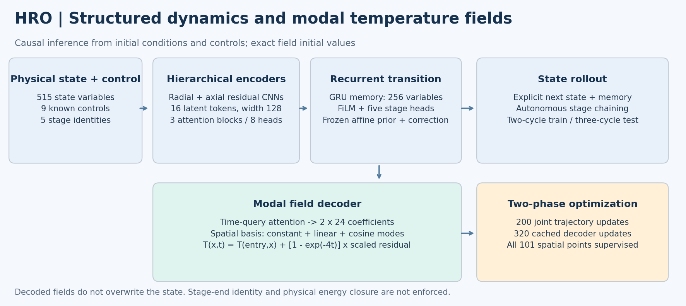
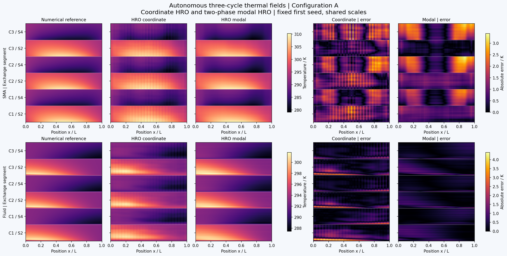
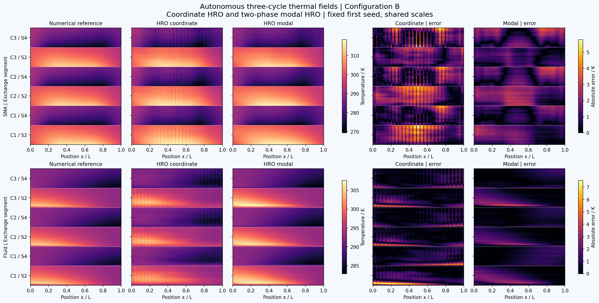

# HRO: modal fields and two-phase training / HRO：模态场与双阶段训练

**3,111,771 parameters · 515 physical variables · 256 recurrent variables · 24 spatial modes per temperature field.**

**3,111,771 个参数 · 515 维物理状态 · 256 维循环记忆 · 每个温度场 24 个空间模态。**



HRO retains the [radial/axial encoders, latent Transformer, GRU memory and five residual state transitions](HIERARCHICAL_OPERATOR.md). Modal HRO replaces spatial coordinate attention with time-query attention that predicts two coefficient vectors. A shared spatial basis contains a constant, a linear term and 22 cosine modes. The decoder evaluates

HRO 保留[径向／轴向编码器、潜变量 Transformer、GRU 记忆及五个残差状态转移](HIERARCHICAL_OPERATOR.md)。模态 HRO 改用时间查询注意力预测两组系数，空间基由常数、线性项及 22 个余弦模态构成：

$$\widehat T_f(x,\tau)=T_{f,0}(x)+s_f\left(1-e^{-4\tau}\right)\sum_{m=1}^{24}a_{f,m}(\tau;Z,h)\phi_m(x).$$

Here $f$ identifies SMA or fluid, $s_f$ is fitted on training fields only, and $Z,h$ are the causal latent representation and memory. The initial value is exact. The finite basis constrains spatial complexity without imposing an unsupported final-state identity. Decoder attention uses one query per time rather than per space–time coordinate. The state remains autonomous; decoded fields do not overwrite it.

其中 $f$ 表示 SMA 或流体，$s_f$ 仅由训练场拟合，$Z,h$ 为因果潜变量表示及记忆。初始值严格满足，有限基约束空间复杂度，但不强制未经数据支持的末态恒等关系。解码注意力对每个时间查询一次，而非对每个时空点查询。状态自主推进，解码场不回写状态。

## Training and development / 训练与开发验证

| Setting / 设置 | Value / 数值 |
|---|---|
| Encoder / 编码器 | Width 128; radial/axial residual convolutions at dilations 1/2/4 |
| Latent dynamics / 潜变量动力学 | 16 tokens, three Transformer blocks, eight heads; GRU256 |
| State prior / 状态先验 | Stage-specific Ridge, alpha 1; frozen after fitting training cases |
| Joint phase / 联合阶段 | 200 updates; batch 2 whole trajectories; AdamW lr 0.0003; weight decay 0.0001 |
| Joint supervision / 联合监督 | All nine transitions of two cycles; eight sampled times; all 101 positions |
| Objective / 目标 | Eight equally weighted normalized state blocks + normalized future-field MSE + 0.01 spatial-gradient MSE |
| Decoder phase / 解码阶段 | 320 updates; batch 8 cached exchange segments; 16 sampled times; AdamW lr 0.0008 |
| Frozen in decoder phase / 解码阶段冻结项 | Both encoders, latent attention, GRU, transition heads, affine priors and normalizers |
| Scheduling / 调度 | 20-update warmup, cosine decay toward 10%; gradient norm clipped at 1 |
| Final runs / 正式运行 | Seeds 20261121/20261122/20261123; fixed final checkpoints; CPU float64, one thread |
| Training cost / 训练成本 | 473.6 s total: 459.8 s joint training + 13.8 s decoder refinement; no solver calls |

The eight original training cases are separated into **six fit cases and two inner validation cases**, one per material. All affine priors and normalizers are refitted on the six cases. Fixed-budget comparisons first test sparse coordinate, dense coordinate and dense modal variants. The first modal variant fails the predeclared total-loss gate; all failed evidence is retained. A training-only basis-fit diagnosis indicates that representation capacity is sufficient, motivating the cached decoder phase. This phase passes the unchanged gate. Inner validation was therefore used adaptively for development, not as an independent final test.

八个原训练工况划分为**六个拟合工况及两个内部验证工况**，验证覆盖两种材料。仿射先验和归一化参数全部仅由六个拟合工况重新估计。固定预算比较稀疏坐标、全网格坐标和全网格模态方案。首次模态方案未通过预设综合损失门限，失败证据完整保留；仅用训练数据进行基函数拟合诊断后，增加缓存解码器训练阶段，并通过未修改的门限。内部验证用于自适应开发，不作为独立终测。

| Inner validation / 内部验证 | State loss / 状态损失 | Field loss / 场损失 | Spatial-gradient loss / 空间梯度损失 | Total / 总损失 |
|---|---:|---:|---:|---:|
| Coordinate, 26 positions / 坐标，26 点 | 0.03484 | 0.06322 | 82.48510 | 0.92291 |
| Coordinate, 101 positions / 坐标，101 点 | 0.03476 | 0.05238 | 1.19484 | 0.09909 |
| Modal, joint phase / 模态，联合阶段 | 0.03146 | 0.07254 | 0.86095 | 0.11261 |
| Modal, two phases / 模态，双阶段 | 0.03146 | 0.02246 | 0.59161 | 0.05983 |

The total is state + field + 0.01 × gradient. Formal training then refits on all eight training cases. Every fixed-seed fit finishes before evaluation of the four historical test cases. No third-cycle target is used for fitting; the historical test cases have been examined in earlier work and cannot serve as untouched confirmatory data.

总损失为状态损失 + 场损失 + 0.01 × 梯度损失。随后使用全部八个训练工况重新拟合，全部预设种子完成训练后才评价四个历史测试工况。拟合不使用第三循环标签；历史测试工况已在此前工作中被分析，不能视为未接触过的确证数据。

## Results / 结果

Cycle 3, stage 4; pooled RMSE over two cases per seed, then mean ± sample SD across three seeds. Future fields exclude time zero. Seed SD does not quantify uncertainty over independent cases.

第三循环第四阶段：每个种子汇总两个工况的 RMSE，再计算三种子均值 ± 样本标准差。未来场排除初始时刻；种子标准差不代表独立工况之间的不确定性。

| Model / 模型 | SMA state K / 状态 | SMA field K / 场 | Fluid field K / 流体场 |
|---|---:|---:|---:|
| Coordinate HRO / 坐标 HRO | 1.120 ± 0.061 | 1.600 ± 0.118 | 0.775 ± 0.020 |
| Modal HRO / 模态 HRO | 1.040 ± 0.068 | 1.627 ± 0.148 | 0.619 ± 0.112 |
| Change / 变化 | −7.2% | +1.7% | −20.1% |

Across **all four test cases and 20 exchange segments**, SMA-field RMSE decreases from **1.336 to 1.087 K**, and fluid-field RMSE from **1.003 to 0.638 K**. Third-cycle spatial-gradient RMSE decreases from **97.12 to 13.65 K** for SMA and **52.64 to 2.02 K** for fluid, measured per unit normalized position. These are derivative-error metrics, not temperature errors or energy residuals. Smoothness does not guarantee better SMA temperature accuracy at the third-cycle endpoint.

汇总**全部四个测试工况及 20 个换热段**，SMA 场 RMSE 从 **1.336 降至 1.087 K**，流体场从 **1.003 降至 0.638 K**。第三循环空间梯度 RMSE 从 SMA 的 **97.12 降至 13.65 K**、流体的 **52.64 降至 2.02 K**，均按单位归一化位置计算。这是导数误差指标，不是温度误差或能量残差；更平滑的预测不保证第三循环 SMA 温度误差同步降低。

| Case / 工况 | Model / 模型 | SMA state K | SMA field K | Fluid field K |
|---|---|---:|---:|---:|
| A | Coordinate HRO | 1.013 | 1.440 | 0.474 |
| A | Modal HRO | 1.159 | 1.684 | 0.413 |
| B | Coordinate HRO | 1.218 | 1.739 | 0.988 |
| B | Modal HRO | 0.904 | 1.567 | 0.771 |

The pooled SMA-state gain is driven by configuration B; configuration A deteriorates. Earlier-cycle SMA-state RMSE on this same two-case cohort changes from **0.549/0.894 K to 0.484/0.631 K** for cycles 1/2. Side-state temperature and radial displacement also retain regressions relative to coordinate HRO. These remain part of the evaluation rather than being excluded from presentation.

汇总后的 SMA 状态提升主要来自配置 B，配置 A 存在退步。同一双工况群中，前两循环 SMA 状态 RMSE 从 **0.549/0.894 K 降至 0.484/0.631 K**。侧部温度状态及径向位移相对坐标 HRO 仍有退步，完整评价保留这些结果。





Each horizontal band is the local time of one exchange segment. These are one-dimensional space × time fields, not two-dimensional plate measurements. Figures use the first preset seed; neither predictions nor errors are smoothed. Training differs in spatial supervision and decoder updates, so the comparison does not isolate architecture alone.

每条横带表示一个换热段的局部时间。图中是一维空间 × 时间场，并非二维板面测量。使用首个预设种子，预测与误差均未平滑。空间监督及解码器更新次数不同，因此该比较不能单独归因于架构。

## Use and evidence / 使用与证据

```python
import torch
from SciML.models.v13.modal_operator import ModalStateOperator

model = ModalStateOperator.load(
    'evidence/experiments/hro_modal/formal/s20261121/refined/model.pt')
# initial: B x 515; control: B x 9. All inputs are CPU float64 tensors.
with torch.no_grad():
    prediction = model(initial, control, cycles=3,
        times=torch.linspace(0, 1, 50, dtype=torch.float64),
        positions=torch.linspace(0, 1, 101, dtype=torch.float64))
```

```bash
python -m examples.verify_modal_evidence
python -m examples.modal_showcase --output demo-output-modal
python -m unittest SciML.tests.test_modal_operator -v

# Development and training are explicit commands; each output must be fresh.
python -m examples.modal_hierarchical probe --output run-output-development
python -m examples.refine_modal --development run-output-development --output run-output-refinement
python -m examples.refine_modal --formal --development run-output-refinement --output run-output-formal
```

[Development](../evidence/experiments/hro_modal/development/summary.json) · [Refinement](../evidence/experiments/hro_modal/refinement/summary.json) · [Formal protocol](../evidence/experiments/hro_modal/formal/protocol.json) · [Formal results](../evidence/experiments/hro_modal/formal/summary.json) · [Derived diagnostics](../evidence/experiments/hro_modal/diagnostics.json) · [Research design and data expansion](HRO_RESEARCH_DESIGN.md)

The portable bundle includes all three final checkpoints, prediction arrays, training histories and formal source snapshots. Intermediate checkpoints and optimizer/RNG states remain in complete local run bundles; their original hashes and omission reasons are recorded in the export manifests. Replay verifies final predictions and metrics, training-case membership and the recorded exact backbone tensor hashes. The portable export alone is not a training-resume bundle.

便携包包含三组最终检查点、预测数组、训练记录及正式训练源码快照。中间检查点和优化器／随机状态完整保留在本地运行包，导出清单记录原始哈希及未纳入原因。回放核验最终预测与指标、训练工况成员及记录的精确主干张量哈希；便携导出包本身不支持直接恢复训练。
