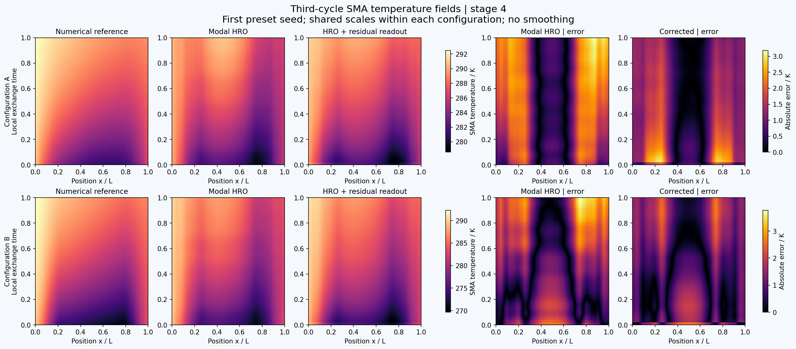

# HRO: SMA 温度场误差诊断与条件残差读出

**结论：第三循环的主要退步出现在温度演化读出，而不是入口状态变差。** 在退步工况 A 中，模态 HRO 的后半段温度预测偏冷，与入口偏差同向叠加。保留循环主干，在 SMA 输出端增加由物理输入驱动的低秩残差读出后，两个三循环工况的第四阶段误差均下降。这里使用已有数值数据，未调用物理求解器。

## 1. 退步发生在哪里

三组固定随机种子的平均 RMSE，单位 K；场误差均排除初始时刻。

| 第三循环、第四阶段 | 坐标 HRO | 模态 HRO | 模态 HRO + 条件残差读出 |
|---|---:|---:|---:|
| 工况 A | 1.440 | 1.684 | **1.232** |
| 工况 B | 1.739 | 1.567 | **1.116** |
| 两工况合并 | 1.600 | 1.627 | **1.176** |
| 全部测试换热段 | 1.336 | 1.087 | **0.918** |

两工况合并的第三循环误差下降 **27.7%**，全部测试场误差下降 **15.6%**。合并行先在每个种子内合并网格计算 RMSE，再对种子取平均，因此不等于上方两个工况 RMSE 的算术平均。修正后的第三循环合并结果为 **1.176 ± 0.165 K**；± 为三个种子的样本标准差，不是泛化置信区间。



图中使用预先固定的首个种子。每个工况内温度共用色标，误差共用色标；参考为数值求解结果。完整三种子统计见 [analysis.json](../assets/sma_readout_local/analysis.json)。

工况 A 对应 `confirm_temporal12_06_confirm50_reca_011_r38_t190_p0972_v1230_t2p4_1c_3c`；工况 B 对应 `confirm_temporal12_12_confirm50_recas_031_r38_t190_p1752_v1230_t2p4_1c_3c`。

## 2. 为什么总体进步，第三循环却退步

将每个未来场误差拆成入口误差与随后温度变化的误差：

**场 MSE = 入口 MSE + 演化 MSE + 2 × mean(入口误差 × 演化误差)。**

入口误差沿局部时间轴广播；所有项先逐种子计算再平均。工况 A 的证据如下：

| 误差项 | 坐标 HRO | 模态 HRO | 增加残差读出后 |
|---|---:|---:|---:|
| 入口 RMSE / K | 1.279 | 1.208 | 1.208 |
| 演化 RMSE / K | 0.583 | 0.771 | 0.526 |
| 入口 MSE / K² | 1.639 | 1.463 | 1.463 |
| 演化 MSE / K² | 0.340 | 0.601 | 0.281 |
| 交叉项 / K² | 0.099 | 0.789 | −0.206 |

模态 HRO 的入口误差实际略小，但边缘平均偏差从 −1.528 K 增至 −2.087 K，最后三分之一时间的 RMSE 从 1.399 K 增至 1.895 K。修正后两者分别为 −1.402 K 和 1.057 K，符合温度场图中边缘与后半段改善的表现。

退步在联合训练结束时已经存在：工况 A 的第三循环误差为 1.657 K，缓存解码器继续训练后为 1.684 K。因此不能只归因于额外的 320 次更新。诊断性地替换为真实入口状态可以降低误差，但这属于使用真值的干预，不能计入预测成绩。循环记忆幅值未呈现失控增长，直接去掉记忆条件反而更差，现有证据不足以认定 GRU 是根因。

工况 B 也说明仅看总 RMSE 不够：模态 HRO 的入口与演化 MSE 均比坐标 HRO 大，但负交叉项更强，部分误差互相抵消。修正后演化 MSE 从 4.459 降至 3.465 K²，仍存在明显抵消，不能把总误差下降解释为每个误差来源都已解决。

两测试工况的冲洗比均为 **1.230**，高于八个训练工况的最大值 **1.077**，同时从训练的两循环推进至三循环。这里兼有参数外推与时间外推，训练集平均损失改善并不保证这些工况改善。

## 3. 模型和训练改了什么

保留约 **311 万参数**的模态 HRO：卷积场编码、潜在 token 注意力、GRU 循环状态与模态场解码器均冻结。增加 **conditional POD/Ridge residual readout（条件 POD/Ridge 残差读出）**：

| 部分 | 设置 |
|---|---|
| 输入 | 自主预测的入口 SMA 温度 101 点、流体温度 101 点、半径、厚度、冲洗比、换热时长、阶段 2/4 独热编码，共 208 维 |
| 学习目标 | 训练工况数值 SMA 场减去 HRO 自主预测场；初始时刻残差强制为零 |
| 低秩表示 | 对训练残差的 50 × 101 网格做 POD，固定秩 12 |
| 条件回归 | 标准化物理输入 → 12 个模态系数；Ridge 正则系数固定为 1，含截距共 2,508 个回归系数 |
| 预处理 | 均值、尺度、POD 均只使用拟合工况；温度尺度下限 0.1 K，几何/工况下限在实现中固定 |
| 输出 | HRO SMA 场加预测残差；原始状态、流体场与初始场完全保持 |
| 查询 | 原生 POD 网格在空间与时间上做线性插值，支持区间内查询 |

该分支不读取工况 ID、材料标签或循环编号。材料热参数沿用封存数据的共同热物性设定，不能直接推广到改变热物性的材料。修正场**不反馈**到下一阶段状态，因此这里验证的是场读出改善，不代表循环动力学、能量守恒或更长时间稳定性已改善。插值查询也不构成分辨率收敛证明。

首先尝试四种低成本神经解码器微调：绝对温度继续训练、温度增量训练、真实/自主入口配对训练及配对增量训练。它们均未通过内部验证，予以保留而未采用。直接用 POD/Ridge 替代 SMA 场的两个方案也未通过；只有对 HRO 残差建模的方案通过。

| 六工况拟合、两工况验证 | 验证 SMA 均值 RMSE / K | 第二循环第四阶段 / K |
|---|---:|---:|
| 第一划分：主干 → 残差读出 | 0.970 → **0.934** | 0.708 → **0.672** |
| 第二划分：主干 → 残差读出 | 0.787 → **0.759** | 0.642 → **0.568** |

通过条件固定为：上述两项均下降，每个验证工况 SMA 误差不超过主干的 1.05 倍，流体误差完全相同。第二划分重新拟合了只使用六个工况的主干，并仅检查已选定的残差方案；未再搜索秩、正则系数或变体。最终使用八个训练工况的 32 个换热段，分别为三个已训练主干拟合读出。

## 4. 尚未解决的误差与验证边界

20 个测试换热段中，16 段改善，4 段退步，均位于第二阶段：

| 工况、循环 | 模态 HRO / K | 增加残差读出后 / K | 增量 / K |
|---|---:|---:|---:|
| A，第 1 循环 | 0.95810 | 0.99704 | +0.03894 |
| A，第 2 循环 | 0.92587 | 0.97229 | +0.04642 |
| A，第 3 循环 | 0.41019 | 0.41183 | +0.00163 |
| B，第 1 循环 | 1.57995 | 1.58020 | +0.00026 |

没有依据测试误差额外关闭某个阶段的修正。工况 A 第三循环早段误差也略增，改善主要位于中后段。下一步低成本优先项是使用训练工况内部划分验证阶段相关的正则或收缩系数，并检查连续多步温度变化约束；尚未执行新的搜索。

历史测试工况已经用于失败诊断，属于反复查看过的开发基准。虽然方案选择与拟合只使用训练工况，当前数字仍是探索性改进证据，不能替代独立数据评估。只有两个三循环工况，也不足以证明普遍的三循环泛化能力。

## 5. 验证、成本与本地使用

51 项测试通过。三个自包含模型均完成预测回放和仅用训练数据的重新拟合，最大差异为 0；两组内部划分用最终缓存实现重新检查后均通过。状态、流体温度与初始场逐元素完全相同。测试曾暴露冻结主干前后缓存计算存在约 10⁻¹⁴ 的差异，已统一为先冻结再生成缓存；未放宽精确一致性测试。

三组最终读出拟合合计约 **2.9 秒**，包含模型加载与保存。主要额外成本是第二内部划分的主干训练，约两分钟。未增加数值仿真，也未进行大规模超参数扫描。所有失败实验、源代码快照与结果哈希均保留。

```bash
# 回放已保存模型，验证训练数据隔离与证据完整性
python -m examples.verify_thermal_readout

# 从保存的预测重新生成诊断图；输出目录必须尚不存在
python -m examples.sma_readout_report --output demo-output-sma-readout

# 定向单元测试
python -m unittest SciML.tests.test_selective_sma SciML.tests.test_thermal_readout -v
```

最终模型位于 `evidence/local_studies/sma_readout/formal/s20261121/model.pt` 等三个种子目录。使用 `ThermalReadoutOperator.load` 加载，无需另外寻找主干权重。完整本地运行目录以 `run-output-sma-` 开头；Git 证据归档保留最终模型、预测、失败实验指标及源代码快照，中间训练权重留在本地运行目录。外部副本缺少这些中间权重时，验证器明确标记内部划分的运行时重拟合不可用，仍验证最终模型。

实现：[条件残差读出](../SciML/models/v13/thermal_readout.py)、[拟合流程](../examples/fit_thermal_readout.py)、[验证器](../examples/verify_thermal_readout.py)。证据：[归档索引](../evidence/local_studies/sma_readout/archive_manifest.json)、[正式比较](../evidence/local_studies/sma_readout/formal/summary.json)、[失败微调记录](../evidence/local_studies/sma_readout/decoder_development/summary.json)。

## English summary

The regressed third-cycle case has a slightly better entry state but a colder predicted thermal evolution, particularly near the edges and late in the exchange. Entry and evolution errors reinforce each other. A frozen modal HRO with a conditional rank-12 POD/Ridge residual readout reduces third-cycle stage-4 SMA RMSE from **1.627 to 1.176 K** across three seeds. Both three-cycle cases improve; four of twenty exchange segments regress slightly, with a maximum increase of **0.046 K**. State, fluid and initial-field outputs remain exactly unchanged. Selection uses two internal training-case splits; the historical test set has already informed diagnosis and is not an untouched external evaluation. No additional physical simulations were performed. This study is retained locally pending further model development.
