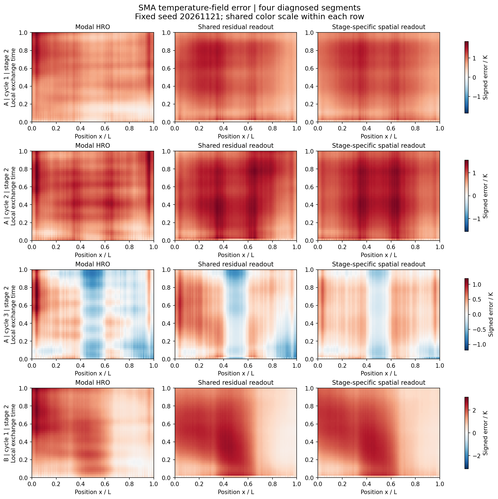

# HRO：分阶段空间残差读出

**原先四个退步换热段的三种子平均误差均下降；第三循环第四阶段的提升完整保留。** 有效方案是第二阶段独立学习空间变化，同时保留共享读出预测的空间平均温度。直接增大正则、统一缩小修正量，或完全独立拟合第二阶段，都没有通过全部内部检查。

## 结果与仍然存在的差距

以下为 SMA 温度场 RMSE，排除初始时刻，单位 K。每行先逐种子计算，再取三个种子的平均；工况 A、B 的完整标识见[前序诊断](HRO_SMA_DIAGNOSIS.md)。

| 第二阶段换热段 | 模态 HRO | 共享残差读出 | 分阶段空间读出 |
|---|---:|---:|---:|
| A，第 1 循环 | 0.95810 | 0.99704 | **0.99025** |
| A，第 2 循环 | 0.92587 | 0.97229 | **0.96799** |
| A，第 3 循环 | 0.41019 | 0.41183 | **0.33092** |
| B，第 1 循环 | 1.57995 | 1.58020 | **1.55203** |

相对共享读出，10 个第二阶段换热段的三种子平均误差全部下降，10 个第四阶段换热段完全不变。全部测试温度场 RMSE 从 **0.91789 降至 0.89992 K**。第三循环第四阶段维持 **1.17562 ± 0.16483 K**，其中 ± 是种子间样本标准差。

A 的前两个循环仍未优于模态 HRO，不能将四段全部描述为已消除退步。单独查看每个种子时，另一个两循环工况的第二循环第二阶段在种子 `20261123` 下增加 **0.00338 K**；其三种子均值仍改善。完整逐段和逐种子记录见 [analysis.json](../assets/sma_stage_readout/analysis.json)。



图示固定种子 `20261121`，红色表示偏热，蓝色表示偏冷；每行共用色标，使用原生网格且不平滑。它展示误差位置，数值结论来自三种子统计。

## 四段退步并非同一种原因

共享读出的残差修正记为 δ，模态 HRO 的误差记为 e，则：**MSE 变化 = mean(δ²) + 2 mean(eδ)**。两个项分别表示修正量的平方和修正与原误差的方向关系。

| 换热段 | 修正平方项 / K² | 交叉项 / K² | 含义 |
|---|---:|---:|---|
| A，第 1 循环 | 0.09574 | −0.02535 | 有一定抵消，但修正量过大 |
| A，第 2 循环 | 0.04946 | +0.03791 | 修正整体上与原误差同向 |
| A，第 3 循环 | 0.03283 | −0.03405 | 种子平均 MSE 略降，平均 RMSE 略升 |
| B，第 1 循环 | 0.22203 | −0.22678 | 种子平均 MSE 略降，平均 RMSE 略升 |

后两段不能简单解释为所有种子都退步。先开平方再平均，与先平均再开平方并不相同，微小差异反映了种子间表现不一致。[诊断记录](../evidence/local_studies/sma_stage_readout/diagnosis/diagnosis.json)保留了每个种子的分解。

进一步拆为“空间平均温度误差”和“去均值后的空间误差”后，A 前两循环主要是整体偏热。分阶段空间读出把其空间误差 MSE 分别从 **0.03991 降至 0.02689 K²**、从 **0.03570 降至 0.02740 K²**，但保留的平均温度误差仍占总 MSE 的约 **97%**，因此总误差只能小幅下降。A 第三循环的空间误差从 **0.11009 降至 0.05200 K²**，改善更明显。

## 模型结构与选择依据

共享读出原来使用阶段标识，但两个阶段仍共享物理输入的回归系数。增加第二阶段专用 POD/Ridge 分支：

| 项目 | 设置 |
|---|---|
| 主干 | 冻结模态 HRO，复用三个已有权重，不进行神经网络更新 |
| 输入 | 原有 208 维物理特征：入口 SMA/流体场、几何、冲洗比、时长、阶段标识 |
| 第二阶段分支 | 仅使用第二阶段训练残差；POD 秩 8，Ridge 正则系数 1，共 1,672 个回归系数 |
| 拟合样本 | 内部划分为 6 工况 × 2 循环 = 12 段；最终为 8 工况 × 2 循环 = 16 段 |
| 第四阶段 | 原共享读出路径逐元素保持 |
| 传播状态与流体场 | 完全保持；场修正不反馈循环状态 |

第二阶段使用的修正为：

**δ₂(t, x) = meanₓ[δ共享(t, x)] + δ独立(t, x) − meanₓ[δ独立(t, x)]。**

空间平均在固定的 101 点原生网格上计算，与调用者查询哪些位置无关。初始修正仍为零。这个约束保留的是离散温度平均值，不等价于验证热量守恒。

先固定 11 个低成本候选：修正幅度为 0、0.5、0.75；共享读出 Ridge 系数为 10、100；独立第二阶段的 POD 秩为 4、8，分别使用 Ridge 系数 1、10、100。第一内部划分选出的独立秩 8、正则 1 方案虽降低平均误差，却使第二划分一个段从 **0.59297 增至 0.70219 K**，因此未获采用，也没有计算它的历史测试成绩。

该失败提示需要限制平均温度漂移。随后仅检查上式这一项修复，保持选定秩与正则不变。两组内部验证均要求第二阶段平均误差降低，且**每个第二阶段验证段均不退步**：

| 内部验证 | 共享残差读出 / K | 分阶段空间读出 / K |
|---|---:|---:|
| 第一划分 | 1.04242 | **1.02232** |
| 第二划分 | 0.88914 | **0.87735** |

最终方案固定后才拟合三个完整训练集读出并评估历史测试。第二划分参与了失败分析与修复，属于开发验证，不是独立确认；历史测试集也已用于前序诊断。因此结果支持现有数据上的改进，尚不能证明对独立三循环工况的普遍泛化。

## 验证、成本与使用

三个模型完成回放及仅用训练数据的重新拟合，最大差异均为 **0**。第四阶段、传播状态、流体场、初始场逐元素相同。空间平均温度最大差异为 **1.14 × 10⁻¹³ K**。两组内部验证同时通过真实推理接口复核。

全部 57 项单元测试通过，包括第二阶段拟合不使用第四阶段标签、不使用未选工况、查询位置子集不改变空间平均约束，以及模型自包含保存和加载。[验证 JSON](../evidence/local_studies/sma_stage_readout/verification.json)保存实际结果。

首轮候选检查计算约 **3.17 秒**，带平均温度约束的检查约 **2.87 秒**，三个最终读出拟合约 **2.59 秒**；以上为程序记录的计算段，不含所有解释器启动、验证和文档处理时间。物理仿真调用和神经网络训练更新均为 **0**。

```bash
python -m examples.verify_stage_readout
python -m unittest SciML.tests.test_stage_thermal_readout -v
python -m examples.stage_readout_report --output demo-output-stage-readout
```

使用 `StageThermalReadoutOperator.load` 加载 `evidence/local_studies/sma_stage_readout/formal/s20261121/model.pt` 等三个模型；每个检查点包含完整参考模型与第二阶段分支。前序模型、失败候选、源代码快照与原始运行目录均保留。实现：[模型](../SciML/models/v13/stage_thermal_readout.py)、[拟合与门限](../examples/stage_readout_study.py)、[归档索引](../evidence/local_studies/sma_stage_readout/archive_manifest.json)。变更仅在本地 Git 管理，未上传 GitHub。

下一步若继续降低 A 前两循环误差，需要专门处理平均温度预测及其跨工况稳定性。当前内部数据已被多次使用，不宜再根据这四个测试段反复选择正则参数。

## English summary

A stage-specific rank-8 POD/Ridge readout improves all four previously regressed segments in three-seed mean RMSE. The effective constraint preserves the shared readout's native-grid spatial mean and replaces only the second-stage spatial variation. All ten second-stage segment means improve; fourth-stage predictions remain exactly unchanged, retaining the third-cycle stage-4 RMSE of **1.176 K**. Overall SMA field RMSE decreases from **0.918 to 0.900 K**. Two segments still underperform the modal HRO without residual correction, and one individual seed-segment increases by **0.0034 K**. No physical simulations or neural training updates were used. Internal folds informed development; independent generalization remains unverified.
