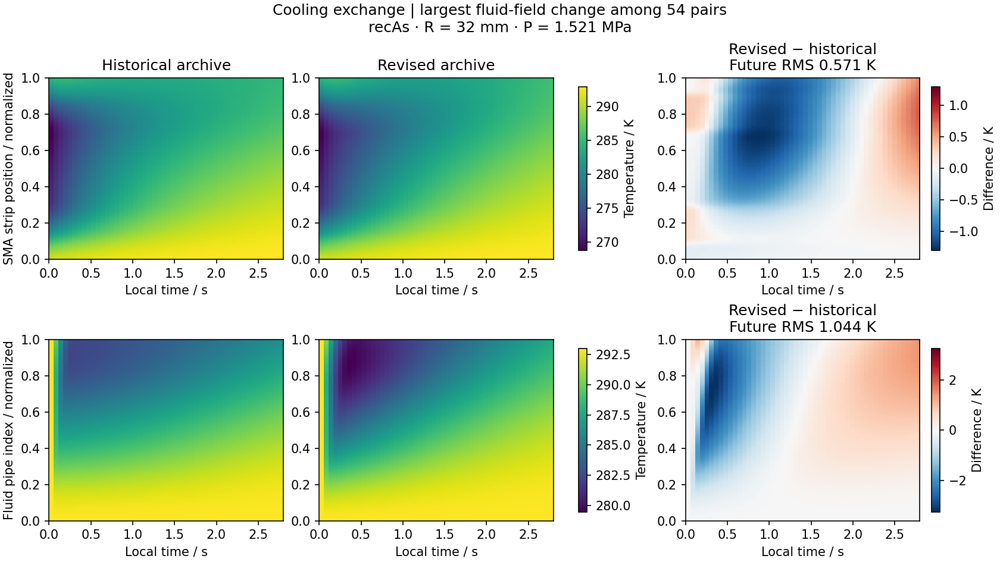
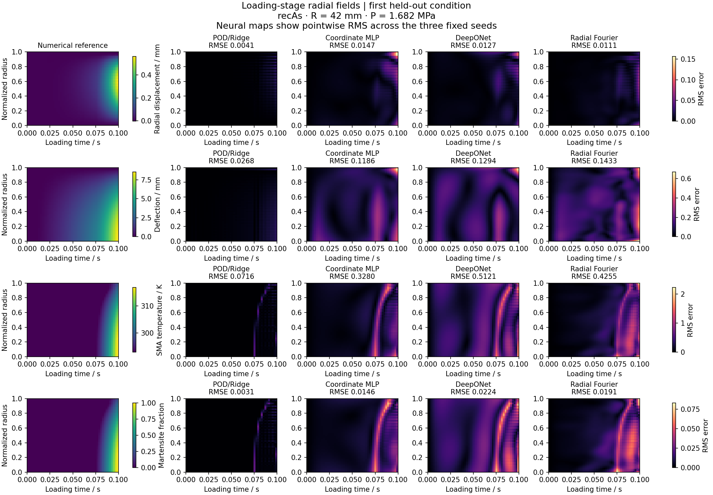

# Solver-version audit and loading-field benchmark / 求解器版本核验与加载场基准

The two solver archives agree exactly during first loading on 54 matched conditions. The largest differences develop during cooling exchange. On 200 historical loading conditions, an eight-mode POD/Ridge surrogate leads all four fields under the fixed benchmark protocol. / 两版求解器在 54 对同工况的首循环加载阶段逐点一致，最大差异出现在冷却换热。基于历史归档 200 个加载工况建立的固定基准中，八模态 POD/Ridge 的四个场误差均最低。

## Matched solver archives / 同工况版本对照

The audit matches registered conditions and archived case requests across the historical development and revised single-cycle archives. The 54 pairs include 49 recA and 5 recAs conditions. All 108 request and export sidecar hashes, both dataset artifact manifests, and the time, radial, strip and fluid-index coordinates were checked. / 按注册工况和运行请求匹配历史开发归档与修订后的单循环归档。54 对中有 49 对 recA、5 对 recAs。已核验两套数据的产物清单、108 份运行请求及其导出侧车哈希，以及时间、径向、条带和管内流体索引坐标。 [Aggregate diagnostics / 汇总诊断](../evidence/local_studies/solver_version_pairs_20261121/summary.json) · [All pairs / 逐对数据](../evidence/local_studies/solver_version_pairs_20261121/pairs.json)

| Archived output / 归档输出 | Median absolute change / 绝对变化中位数 | Maximum absolute change / 最大绝对变化 | Mean signed change / 平均有符号变化 |
|---|---:|---:|---:|
| Cooling heat / 制冷量 (J) | 0.0800 | 0.8336 | +0.00669 |
| COP | 0.0138 | 0.1575 | +0.00684 |
| SCP (W/kg) | 2.29 | 42.96 | +1.45 |
| Maximum hot–cold temperature span / 最大冷热端温差 (K) | 0.00794 | 0.1327 | +0.0187 |
| Pumping work / 泵功 (J) | 0.000116 | 0.001990 | −0.000593 |
| Recovered unloading work quantity / 卸载回收功量 (J) | 0.0000821 | 0.04947 | +0.000119 |
| Loading work / 加载功 (J) | 0 | 0 | 0 |

Signed differences are revised minus historical. Cycle duration also agrees exactly. The archived COP denominator is the sum of loading work, the recorded recovered-work magnitude and pump work. SCP is cooling heat divided by SMA mass and cycle duration. An exact symmetric decomposition of the mean COP change gives +0.00639 from the cooling-heat term and +0.00045 from the work term. / 有符号变化按修订归档减历史归档计算，循环时长也完全一致。COP 采用归档的加载功、回收功量和泵功之和作分母，SCP 为制冷量除以 SMA 质量和循环时长。对 COP 平均变化进行对称代数分解，制冷量项为 +0.00639，功项为 +0.00045。

| Stage / 阶段 | SMA temperature / SMA 温度 (K) | Heat-transfer fluid / 换热流体温度 (K) |
|---|---:|---:|
| 1. Loading / 加载 | 0 / 0 | — |
| 2. Hold exchange / 保载换热 | 0.0023 / 0.0836 | 0.0162 / 0.1347 |
| 3. Unloading / 卸载 | 0.0008 / 0.1403 | — |
| 4. Cooling exchange / 冷却换热 | 0.0348 / 0.5707 | 0.0378 / 1.0437 |

Cells show the median and maximum of the per-condition RMS difference after the entry sample. Loading pressure, displacement, deflection and martensite fraction also agree exactly. In the largest cooling fluid-field case, entry RMS is 0.0011 K, the subsequent trajectory difference RMS is 1.0437 K, and the largest nodal change is 3.256 K. Outlet temperature differs by 1.232 K RMS and integrated throughput rises from 0.509 to 0.520 g. / 表内为去掉入口帧后的逐工况 RMS 差异的中位数与最大值。加载压力、位移、挠度和马氏体相分数也完全一致。冷却流体差异最大的工况在入口仅差 0.0011 K，后续场 RMS 差为 1.0437 K，最大节点差为 3.256 K。同一工况的出口温度版本差为 1.232 K RMS，累计流过质量由 0.509 g 增至 0.520 g。



The median absolute change in archived SMA–fluid exchange heat is 0.00087 J in hold exchange and 0.07996 J in cooling exchange. The latter is the archived cooling-performance label. Integrating the recorded mass flow and inlet–outlet temperature difference over the 50 exported samples gives a corresponding median absolute change of 0.08173 J in cooling. The archived cold-end heat is a separate quantity, with a 0.03707 J median absolute change. The median absolute cooling system residual is 1.556 J historically and 1.555 J after revision. Each version passes all stored energy gates for all 54 cases. / 保载与冷却阶段的 SMA–流体交换热绝对变化中位数分别为 0.00087 J 和 0.07996 J，后者对应归档制冷量。用 50 帧导出的质量流量和进出口温差重新积分，冷却端口热量的绝对变化中位数为 0.08173 J。归档冷端换热量采用独立口径，其绝对变化中位数为 0.03707 J。冷却阶段系统能量残差的绝对值中位数从 1.556 J 变为 1.555 J。两版各 54 例均通过记录的能量门限。

The requests record concurrent changes in exchange initialization, valve startup, flush-pressure control and solver tolerances. Loading refinement was enabled in the revised requests, with the recorded loading step parameter `solver_Nt` still 960 in both archives. The agreement at entry and divergence during exchange localize the change. The paired study measures the combined effect of the changes. The sampled port integral is an export-level cross-check. The original MAT outputs at the recorded paths were unavailable for fresh integration. Full-cycle targets should retain solver-version provenance. / 运行请求同时变更了换热初始化、阀门启动、冲洗压力控制和求解器容差。修订请求开启加载细化，两套归档记录的加载步数参数 `solver_Nt` 均为 960。入口与后续轨迹的对比定位了差异出现的阶段，配对分析衡量的是这些改动的合并影响。端口积分属于导出数据复核，记录路径下的原始 MAT 文件未能用于重新积分。完整循环标签应保留求解器版本来源。

## Loading-field prediction / 加载力热场预测

The operator maps radius, thickness, prescribed peak pressure and material indicator to four radial trajectories over the fixed 0.1 s loading stage. It predicts radial displacement $u$, transverse deflection $w$, SMA temperature $T$ and martensite fraction $\xi$. All methods receive the same declared starting fields $u=w=\xi=0$ and $T=293\,\mathrm{K}$. The benchmark checks the endpoints of the archived pressure trajectory and evaluates the four predicted histories. / 模型以半径、厚度、规定峰值压力和材料标识为输入，预测固定 0.1 s 加载阶段的径向位移、横向挠度、SMA 温度及马氏体相分数。各方法共用规定的初始场。数据读取时核对归档压力轨迹的首末值，评价覆盖四个预测场。 [Frozen protocol / 冻结协议](../evidence/local_studies/loading_field_benchmark_20261121/protocol.json)

We used 200 distinct single-cycle conditions from the historical archive, with splits of 140 training, 30 validation and 30 test cases, stratified by material and radius. Fitted methods use the same $26\times26$ supervision grid and training-only scales. The loss and error metrics cover times after the fixed initial frame. Validation and test use the $50\times51$ native grid. / 使用历史归档中 200 个独立单循环工况，按材料与半径分层为 140 训练、30 验证、30 测试。各拟合方法共用 $26\times26$ 监督网格和训练集尺度，损失和误差指标针对固定初帧之后的预测。验证和测试均使用 $50\times51$ 原生网格。

| Method / 方法 | Architecture and settings / 架构与配置 | Trainable neural parameters / 神经参数量 |
|---|---|---:|
| PCA/POD + Ridge | Centered SVD, 8 modes per field, Ridge $\alpha=1$, bilinear reconstruction / 中心化 SVD，每场 8 模态，双线性重建 | — |
| Coordinate MLP / 坐标 MLP | Concatenated controls and normalized $(t,r)$, three 44-wide GELU layers / 控制量与归一化坐标拼接，3 层宽 44 的 GELU 隐层 | 4,448 |
| DeepONet | Separate condition and coordinate networks, two 32-wide GELU hidden layers each, 8 terms per field / 条件与坐标分别编码，每支 2 层宽 32 的 GELU 隐层，每场 8 项 | 4,484 |
| Radial Fourier / 径向 Fourier | Two width-12 spectral layers, 6 radial modes, quarter-domain padding, time as a coordinate / 2 层宽 12 的径向谱层，6 个谱模态，四分之一域长填充，时间作为坐标 | 4,140 |

Each neural fit uses 24 epochs, 14 cases per batch, 240 updates, AdamW at $2\times10^{-3}$ with weight decay $10^{-4}$ and gradient clipping at 3. Three fixed seeds share the same case order across neural families. POD/Ridge uses one deterministic fit on the same supervision grid. The full benchmark took 18.3 s on one CPU thread, including 2,160 neural updates. / 每个神经模型训练 24 轮，每批 14 工况，共更新 240 次。三个固定种子在各神经架构间共用批次顺序。POD/Ridge 在相同监督网格上做一次确定性拟合。CPU 单线程下整个对照耗时 18.3 秒，神经网络共更新 2,160 次。

### Held-out results / 留出工况结果

| Method / 方法 | $u$ RMSE (mm) | $w$ RMSE (mm) | $T$ RMSE (K) | $\xi$ RMSE | $\xi$ outside bounds / 相分数越界 |
|---|---:|---:|---:|---:|---:|
| Persistence / 初态持久性 | 0.07855 | 1.95199 | 3.71762 | 0.15954 | 0% |
| **POD/Ridge** | **0.00208** | **0.02546** | **0.10686** | **0.00467** | **1.20%** |
| Coordinate MLP | 0.00998 ± 0.00040 | 0.10738 ± 0.00396 | 0.30703 ± 0.02148 | 0.01334 ± 0.00195 | 31.63% |
| DeepONet | 0.00880 ± 0.00043 | 0.11108 ± 0.00221 | 0.46006 ± 0.06079 | 0.02012 ± 0.00204 | 36.44% |
| Radial Fourier | 0.00685 ± 0.00155 | 0.12536 ± 0.01932 | 0.28990 ± 0.03260 | 0.01274 ± 0.00159 | 31.91% |

Neural RMSE is averaged across seeds with sample standard deviation. The final column counts raw pointwise violations of $[0,1]$ beyond $10^{-6}$. POD/Ridge was selected by validation RMSE and retains more than 99.99% of centered training variation in each field. Its maximum deflection error on the fixed outer edge is at numerical roundoff, and the neural families reach 0.67–0.77 mm there across tests and seeds. Clipping the phase fraction and setting outer-edge displacement to zero lowers POD/Ridge's normalized test RMSE from 0.02138 to 0.02122. The table reports the unprojected models. / 神经模型的误差为三种子均值和样本标准差。末列按 $10^{-6}$ 容差统计原始相分数越界比例。POD/Ridge 按验证集误差选定，每个场的训练集中心化方差保留率超过 99.99%。外缘挠度误差处于舍入量级，神经模型的逐方法跨工况及种子最大值约为 0.67–0.77 mm。限制相分数范围并将外缘位移置零后，POD/Ridge 的归一化测试 RMSE 从 0.02138 降至 0.02122。表中保留原始结果。 [All metrics / 完整指标](../evidence/local_studies/loading_field_benchmark_20261121/summary.json) · [Per-case errors and timings / 逐工况误差与耗时](../evidence/local_studies/loading_field_benchmark_20261121/runs.json)



POD/Ridge is the reference for first loading at this budget and within the archived material–geometry range. The charts show where the neural models lose accuracy near the transformation front and the mechanical boundary. Different loading protocols, independent material or aspect-ratio coverage, and transfer from loading to unloading and cycle rollout remain open. / 在当前数据范围和预算下，以 POD/Ridge 作为首循环加载阶段的参考基线。图中可见神经模型在相变前沿和力学边界附近的误差。跨加载协议、独立材料或厚径比，以及向卸载和跨循环推进的迁移仍待核验。

## Verification / 验证

The source HDF5 fields match the loading snapshot. All ten saved checkpoints reproduced their stored test predictions exactly in the recorded local environment. The replay checks the fixed split, the train-only POD refit, paired field and energy identities and all initial fields. / 加载快照与来源 HDF5 完全一致。10 个保存的检查点在记录的本地环境中逐点复现测试预测。回放还校验了固定工况划分、仅用训练集重建的 POD、跨版本场与能量恒等关系和全部首帧。 [Verification record / 验证记录](../evidence/local_studies/loading_field_benchmark_20261121/verification.json) · [Artifact hashes / 产物哈希](../evidence/local_studies/loading_field_benchmark_20261121/manifest.json) · [Figure provenance / 图表来源](../assets/loading_field_study/manifest.json)

Run from the repository root in the recorded numerical environment. The first replay command uses the included snapshot and checkpoints. The `--dataset` replay also checks the archived HDF5. The audit, refit and figure commands use the adjacent historical solver repository and write to fresh directories. / 从仓库根目录在记录的数值环境中运行。第一个回放命令使用所附快照和检查点，带 `--dataset` 的回放同时核对归档 HDF5。配对核验、重新拟合和绘图命令读取相邻求解器仓库，并写入新目录。

```bash
python -m unittest SciML.tests.test_loading_field_operator -v
python -m examples.verify_loading_field_benchmark
python -m examples.verify_loading_field_benchmark --dataset ../../gx101r1/SciML/datasets/v1.1-paper220
python -m tools.compare_solver_archives --solver-repo ../../gx101r1 --output run-output-paired-study
python -m examples.loading_field_benchmark --dataset ../../gx101r1/SciML/datasets/v1.1-paper220 --output run-output-loading-study
python -m examples.loading_field_report --solver-repo ../../gx101r1 --output demo-output-loading-fields
```

The refit and figure commands are bound to the checked-in paired evidence. The figure command renders the saved benchmark predictions. Solver calls for this study were zero. / 拟合与绘图命令以仓库所附配对证据为基准，绘图使用保存的预测，整个对照没有调用物理求解器。
