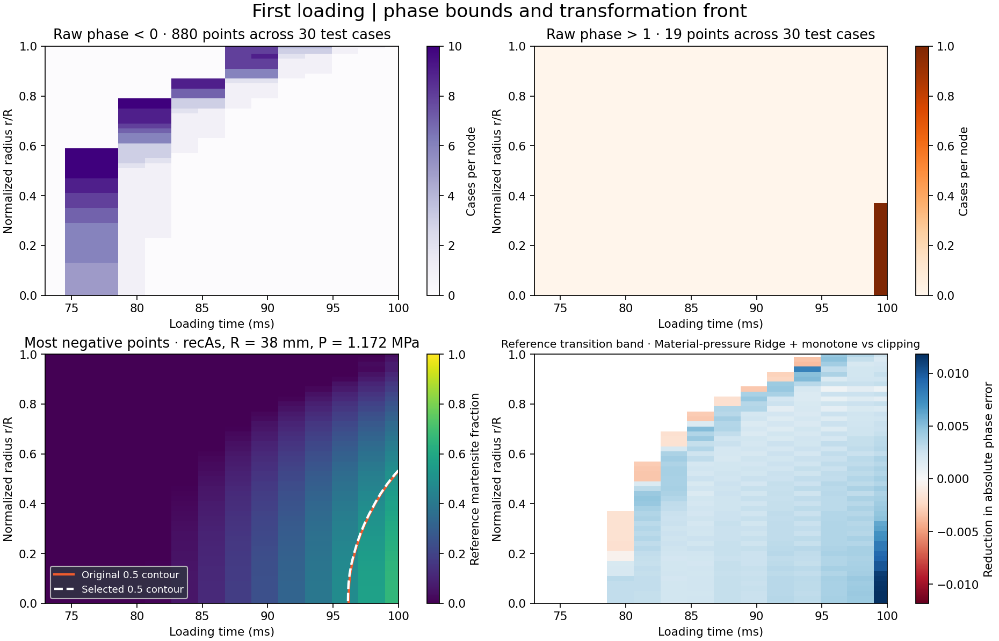

# Phase bounds and transformation fronts / 加载相分数约束与相变前沿

The original POD/Ridge has 899 out-of-range phase predictions among 74,970 future test-grid points. The material-conditioned phase fit with bounded monotone reconstruction eliminates those violations and reduces transition-band RMSE from 0.00884 to 0.00447. Temperature, radial displacement and deflection are preserved at every grid point. / 原 POD/Ridge 在 74,970 个测试预测点中有 899 个相分数越界点。材料条件相分数拟合与有界单调重建将越界点降至零、将相变带 RMSE 从 0.00884 降至 0.00447。温度、径向位移和挠度逐点一致。

## Where the violations occur / 越界集中在哪里

| Original phase / 原始相分数 | Points and cases / 点数与工况数 | Time and position / 时空位置 | Reference / 参考真值 |
|---|---:|---|---|
| $\hat\xi<-10^{-6}$ | 880 points, 12 cases / 880 点，12 工况 | 75.51–97.96 ms. 692 points by 85 ms. Median $r/R=0.56$ / 85 ms 以内 692 点，径向中位位置 $r/R=0.56$ | Exactly zero at all 880 nodes / 全部为零 |
| $\hat\xi>1+10^{-6}$ | 19 points, 1 case / 19 点，1 工况 | Final loading frame at 100 ms, $r/R=0$–0.36 / 加载末帧，靠近盘中心 | 18 of 19 within $10^{-6}$ of full transformation / 19 点中 18 点已接近完全相变 |

The three recAs cases with the most negative points have 195 at $R=38$ mm and $P=1.172$ MPa, 121 at 38 mm and 1.282 MPa, and 115 at 42 mm and 1.290 MPa. The above-one points all occur at $R=35$ mm and $P=1.773$ MPa in recAs. The minimum and maximum raw predictions are −0.02756 and 1.05854. Every violation lies outside the reference transition band $0.1\leq\xi\leq0.9$. / 负值最多的三个工况均为 recAs，分别为 38 mm、1.172 MPa 的 195 点，38 mm、1.282 MPa 的 121 点，以及 42 mm、1.290 MPa 的 115 点。超上限点全部出现在 recAs 的 35 mm、1.773 MPa 工况。原始预测最小为 −0.02756，最大为 1.05854。全部越界点均位于真值相变带 $0.1\leq\xi\leq0.9$ 之外。 [Point locations and case IDs / 逐点坐标与工况 ID](../evidence/local_studies/loading_phase_bounds_20261121/phase_violations.csv)

Interpolating the exact coarse reference data gives zero violations and a transition-band RMSE of 0.00280. Projecting the same reference onto the frozen eight-mode basis before interpolation gives 0.00283 and can produce out-of-range values. The original predictor gives 0.00884. This reference-assisted diagnosis shows where the basis can overshoot and how much front error remains when fitted coefficients are used. / 直接插值真实粗网格没有越界，相变带 RMSE 为 0.00280。将真实粗网格先投影到冻结的八模态基底上，再插值，RMSE 为 0.00283，且可能生成越界值。原预测的 RMSE 为 0.00884。该诊断借助参考标签识别基底过冲，并衡量拟合系数带来的额外前沿误差。 [Numerical diagnostics / 数值诊断](../evidence/local_studies/loading_phase_bounds_20261121/summary.json)

## Matched reconstruction comparison / 同预算重建对照

The comparison reuses the 140/30/30 case split, the $26\times26$ supervision grid, the $50\times51$ evaluation grid and the original eight-mode POD bases. Clipping and monotone interpolation use the original coefficients. The material-conditioned method makes one Ridge fit at $\alpha=1$ for the phase coefficients, using the same modal targets and four inputs. / 沿用 140/30/30 工况划分、$26\times26$ 监督网格、$50\times51$ 评价网格及原八模态 POD 基底。直接裁剪和单调插值使用原系数。材料条件方法以相同的模态目标和四维输入做一次 $\alpha=1$ 的相分数 Ridge 拟合。 [Protocol / 协议](../evidence/local_studies/loading_phase_bounds_20261121/protocol.json)

The archive has fixed $R/t=200$. The standardized radius and thickness are redundant, so the phase readout uses a scaled radius, a material indicator, peak pressure centered within each material, and their pressure–material interaction. Pressure centers for recA and recAs are 0.902 and 1.496 MPa, estimated from the training partition. The frozen phase basis reconstructs each trajectory. Bounded isotonic projection enforces $0\leq\xi\leq1$, the zero initial phase and nondecreasing phase along time at each radial anchor. Bilinear interpolation carries those constraints to the query grid. / 归档厚径关系固定为 $R/t=200$，标准化的半径与厚度含重复信息。相分数读出采用缩放半径、材料标识、按材料中心化的峰值压力及压力与材料交互项。recA、recAs 的压力中心仅用训练工况估计，分别为 0.902 和 1.496 MPa。冻结的相分数基底重建轨迹，有界保序回归在各径向锚点施加 $[0,1]$、零初始相分数及时间非下降约束，随后用双线性插值查询。

All 140 training cases have nondecreasing phase over first loading. The bounded candidates were selected on validation transition-band RMSE. The material-conditioned linear reconstruction scored 0.00560 on validation versus 0.00945 for direct clipping. Validation development also checked an uncentered pressure interaction and a phase-increment representation. / 140 个训练工况在首加载阶段的相分数均随时间非下降。按验证集相变带 RMSE 选择有界方法，材料条件线性重建为 0.00560，直接裁剪为 0.00945。开发时也在验证集检查了未分材料中心化的压力交互项与相分数增量表示。

| Method / 方法 | Phase RMSE / 相分数 RMSE | Transition-band RMSE / 相变带 RMSE | Outside bounds / 越界比例 | Mid-front arrival MAE / 中段前沿到达 MAE (ms) |
|---|---:|---:|---:|---:|
| Original POD/Ridge / 原始 POD/Ridge | 0.004669 | 0.008840 | 1.199% | 0.1730 |
| Direct clipping / 直接裁剪 | 0.004559 | 0.008840 | 0% | 0.1730 |
| Bounded monotone linear / 有界单调线性 | 0.004583 | 0.008840 | 0% | 0.1730 |
| Bounded monotone cubic in time / 有界单调时间三次插值 | 0.004222 | 0.008855 | 0% | 0.1685 |
| Material-conditioned fit before projection / 材料条件拟合，投影前 | 0.003436 | 0.004466 | 1.319% | 0.0848 |
| **Material-conditioned fit with bounded monotone reconstruction / 材料条件拟合与有界单调重建** | **0.003374** | **0.004466** | **0%** | **0.0848** |

Transition-band RMSE is computed on 10,833 reference points with $0.1\leq\xi\leq0.9$. Mid-front arrival is the first $\xi=0.5$ crossing at each radius. MAE uses the 943 radial trajectories that reach the threshold for the reference and all methods, with arrival estimated by interpolation between the 2.04 ms archive frames. The material-conditioned readout reduces front error. The projection enforces admissible phase values. The displacement, deflection and temperature test RMSEs remain 0.002085 mm, 0.025462 mm and 0.106856 K, respectively, with exactly the same three predicted fields. / 相变带 RMSE 使用真值相分数在 $[0.1,0.9]$ 的 10,833 个点。前沿到达定义为各半径首过 $\xi=0.5$ 的时刻，MAE 使用真值和所有方法均达到该阈值的 943 条径向轨迹，时刻通过 2.04 ms 帧间插值估计。材料条件读出降低前沿误差，投影负责保证相分数的范围和单调性。位移、挠度和温度的测试 RMSE 分别为 0.002085 mm、0.025462 mm 和 0.106856 K，三个预测场逐点一致。



The constrained fit improves 25 of 30 test cases on transition-band RMSE. The pooled recA error falls from 0.01172 to 0.00466, while recAs moves from 0.00422 to 0.00426. At $\xi=0.9$, arrival MAE rises from 0.149 to 0.187 ms on the 97 common crossings and the number of missed crossings rises from 9 to 12 out of 109 reference crossings. The fixed test split is a retest of the same numerical archive. These results support the constrained readout for the main transformation band during first loading. Near-saturation arrival, unseen materials, variable aspect ratio and unloading require separate evaluation. / 30 个测试工况中有 25 个相变带误差下降。recA 的汇总误差由 0.01172 降至 0.00466，recAs 由 0.00422 微升至 0.00426。$\xi=0.9$ 时，共同可达的 97 条轨迹到达 MAE 从 0.149 升至 0.187 ms，109 条真实可达轨迹中的漏判由 9 增至 12。结果来自同一数值归档的固定留出复测，支持将约束读出用于首加载的主相变带。近饱和到达、未见材料、不同厚径比和卸载需要单独评价。 [Per-material and per-case verification / 分材料与逐工况核验](../evidence/local_studies/loading_phase_bounds_20261121/verification.json)

## Verification / 验证

The Ridge head fitted in 0.014 s. The measured archive analysis and rendering took 0.98 s inside the process. Verification independently checks the original prediction replay, the 899 location and value records, the train-only fit and the unchanged mechanical and thermal channels. The study made zero solver calls. / 相分数 Ridge 拟合耗时 0.014 秒，程序内的归档分析与绘图耗时 0.98 秒。核验覆盖原预测回放、899 个越界点坐标和值、仅用训练集拟合及力热通道逐点一致。物理求解器调用为零。 [Saved phase readout / 相分数读出权重](../evidence/local_studies/loading_phase_bounds_20261121/phase_ridge.npz) · [Artifact hashes / 产物哈希](../evidence/local_studies/loading_phase_bounds_20261121/manifest.json)

```bash
python -m unittest SciML.tests.test_loading_phase_reconstruction SciML.tests.test_loading_field_operator -v
python -m examples.loading_phase_study --verify evidence/local_studies/loading_phase_bounds_20261121
python -m examples.loading_phase_study --output run-output-phase-study
```
