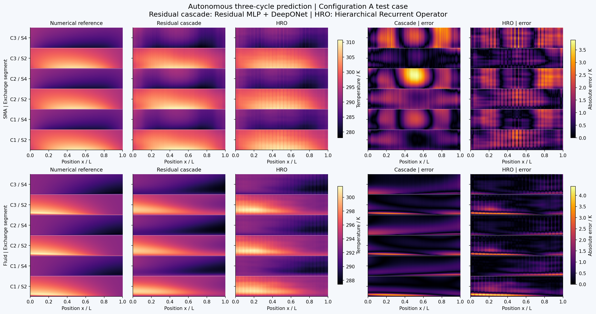
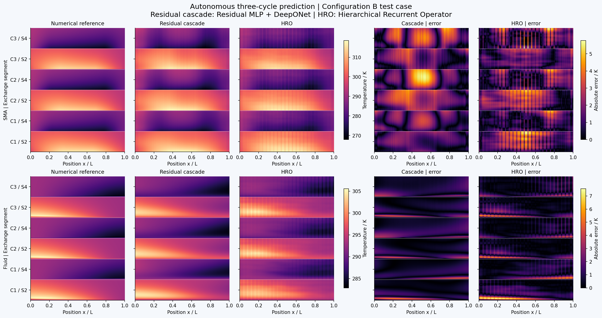

# Multi-cycle operator benchmark / HRO 正式多循环训练报告

**Fixed-budget HRO training improves all three third-cycle primary metrics over the three archived neural references. It also exposes early-cycle and state-component regressions.** Three seeds × 200 updates took **403.6 s for training, 426.4 s including evaluation**, on CPU float64 with one compute thread. No physical simulations were run and no test-based retraining was performed.

**HRO 固定预算训练在第三循环三项主要指标上均优于三种残差级联基线，同时暴露了早期循环及部分状态分量的退步。** 三种子各 200 次更新，CPU float64 单计算线程，训练 **403.6 秒**、含评价 **426.4 秒**。未运行物理仿真，也未根据测试结果追加训练。

## Model and protocol / 模型与训练协议

The **3,106,989-parameter** [hierarchical operator](HIERARCHICAL_OPERATOR.md) combines two spatial CNNs (width128; dilations1/2/4), 16 latent tokens, three eight-head attention blocks, GRU256, five FiLM state-transition heads and a coordinate-attention field decoder. The frozen Ridge prior and training scalers come from the residual cascade; all HRO neural weights start fresh. State and field branches are jointly supervised; decoded fields do not feed back into the explicit state.

**3,106,989 参数**的分层算子由双空间 CNN（宽度128、膨胀率1/2/4）、16 个潜 token、三层八头注意力、GRU256、五个 FiLM 状态头及坐标注意力场解码器构成。保留残差基线冻结的 Ridge 先验与训练归一化尺度，HRO 神经权重全部重新初始化。状态和场联合监督；解码场不直接回写显式状态。

| Item / 项目 | Fixed setting / 固定设置 |
|---|---|
| Data / 数据 | Original historical split: 8 training cases, all two-cycle; 4 test cases, two of them three-cycle / 原历史划分，训练8、测试4，其中三循环测试2 |
| Supervision / 监督 | 72 training transitions and 32 exchange fields; no future observed inputs during rollout / 72 个训练状态转移、32 段换热场；推进不读未来真值 |
| Seeds / 随机种子 | 20261121, 20261122, 20261123 |
| Budget / 预算 | 200 updates/seed, batch2 complete cases; all fits finish before test inference / 每种子200次、批次2个完整工况，全部训练后才测试 |
| Optimizer / 优化器 | AdamW, lr3e-4, weight decay1e-4, gradient clip1; 20-update warmup then cosine to10% |
| Queries / 查询 | Per exchange: 8 times (0,1 and six random interior times), 26 fixed spatial indices / 每段8个时间、26个固定空间采样点 |
| Objective / 目标 | Eight equally weighted normalized state-block MSEs + normalized field MSE + 0.01 supervised spatial-gradient MSE; full nine-step backpropagation / 八状态块等权、场值与空间梯度监督，九步完整反传 |
| Selection / 选择 | Final update only, all three seeds reported; no early stopping or test-based hyperparameter choice / 只取末次更新，报告全部种子，无测试集选参 |
| Test rollout / 测试推进 | Initial state +9 controls+horizon; 14 transitions for three cycles; 50×101 field grid, omit time0 in field RMSE / 初态、控制与长度，三循环14步，场误差排除零时刻 |

The initial state uses the observed first mechanical frame plus declared thermal defaults. Normalization and field scales use training data only. This **historical corpus is separate from the main63 profile** and has already been examined in earlier work; it is not a new untouched confirmation set. Residual-cascade references have different training budgets and separately trained field decoders. This is a practical system comparison, **not an equal-budget architecture ablation**.

初态使用首个力学观测帧及声明的热初值，归一化及场尺度仅来自训练数据。**本历史数据与主63工况配置分开**，此前已分析过，不能称新的独立确认集。残差基线的预算与场解码训练方式不同，该实验是完整系统对比，**不是同预算架构消融**。

## Third-cycle primary results / 第三循环主要结果

Cycle3/stage4; RMSE in K. Pool the two three-cycle cases within each seed, then take arithmetic mean and sample SD across three seeds. Seed SD does not measure uncertainty over independent physical cases.

第三循环第四阶段，单位K；每个种子先汇总两个三循环工况，再求三种子算术均值和样本标准差。种子标准差不等于独立物理工况的不确定性区间。

| Model / 模型 | SMA state / 状态 | SMA future field / 未来场 | Fluid future field / 流体未来场 |
|---|---:|---:|---:|
| Residual cascade · one-step training / 残差级联·单步训练 | 1.5432 ±0.1156 | 2.0764 ±0.0320 | 0.9893 ±0.2517 |
| Residual cascade · one-step fine-tuning / 残差级联·单步微调 | 1.5163 ±0.0974 | 2.0602 ±0.0496 | 0.9839 ±0.2512 |
| Residual cascade · multi-step fine-tuning / 残差级联·多步微调 | 1.5334 ±0.1126 | 2.0686 ±0.0483 | 0.9845 ±0.2494 |
| **Hierarchical Recurrent Operator / 分层循环算子** | **1.1200 ±0.0610** | **1.5999 ±0.1184** | **0.7750 ±0.0204** |
| Affine state only / 仅仿射状态 | 1.1761 | — | — |

HRO improves on the original neural reference by **27.4% /22.9% /21.7%**, and on the affine SMA state baseline by **4.8%**. The affine prior is identical across the three baseline seeds, verified numerically. Each HRO SMA-state score beats1.1761K, but two cases do not establish statistical significance or general superiority.

相比单步残差级联基线改善 **27.4% /22.9% /21.7%**，相比仿射 SMA 状态基线改善 **4.8%**。三个基线种子的仿射先验已核对完全一致；HRO 三个种子的 SMA 状态分数均低于1.1761K，但两个工况不足以证明统计显著性或普遍优势。

| HRO seed / 种子 | SMA state K | SMA field K | Fluid field K |
|---|---:|---:|---:|
| 20261121 | 1.1697 | 1.6478 | 0.7983 |
| 20261122 | 1.0519 | 1.4651 | 0.7661 |
| 20261123 | 1.1385 | 1.6868 | 0.7605 |

Per-case means over three seeds follow; they are not pooled RMSEs. The full case IDs are preserved in the [pre-training protocol](../evidence/experiments/v13_formal_v1/protocol.json).

下面为各工况三种子均值，不能直接当作汇总 RMSE；完整工况 ID 见训练前协议。

| Case / 工况 | Model | SMA state K | SMA field K | Fluid field K |
|---|---|---:|---:|---:|
| recA, historical06 | Residual MLP + DeepONet | 1.5346 | 1.7226 | 0.6711 |
| recA, historical06 | HRO | 1.0128 | 1.4405 | 0.4744 |
| recAS, historical12 | Residual MLP + DeepONet | 1.5515 | 2.3753 | 1.2260 |
| recAS, historical12 | HRO | 1.2176 | 1.7387 | 0.9878 |

## Multi-cycle tradeoffs / 多循环取舍

SMA state RMSE at each cycle end, **using the same two three-cycle cases throughout**:

各循环末 SMA 状态 RMSE，**始终使用同一组两个三循环工况**：

| Model | Cycle1 K | Cycle2 K | Cycle3 K |
|---|---:|---:|---:|
| Residual cascade · one-step training | 0.3171 | 0.6268 | 1.5432 |
| Residual cascade · one-step fine-tuning | 0.3105 | 0.6117 | 1.5163 |
| Residual cascade · multi-step fine-tuning | 0.3198 | 0.6214 | 1.5334 |
| HRO | 0.5489 | 0.8936 | 1.1200 |

The HRO starts less accurately but accumulates less additional SMA-state error from cycle2 to3. At the third-cycle endpoint, HTF2/HTF4 state RMSE rises **0.1334→0.2420K /0.1675→0.3340K**, phase RMSE rises **0.02379→0.03755**, and transverse displacement RMSE rises **2.180e-4→2.890e-4m** relative to one-step residual cascade. Directional-memory error decreases **0.1198→0.0946K**. Boundary state error and future-field error are different quantities; lower field error does not imply all boundary states improved.

HRO早期更不准确，但第二至第三循环的 SMA 状态误差增量更小。第三循环末，相比原 Residual MLP + DeepONet，HTF2/HTF4 状态误差升至 **0.1334→0.2420K /0.1675→0.3340K**，相分数误差 **0.02379→0.03755**，横向位移误差 **2.180e-4→2.890e-4m**；方向记忆误差则从 **0.1198降至0.0946K**。边界状态误差与未来场误差是不同指标，场改善不等于边界全部改善。

The atlases reveal spatial oscillations. Full-grid training diagnostics give gradient losses **89.68/86.36/141.44**, contributing **0.897/0.864/1.414** after the0.01 weighting, while full-grid state losses remain near0.01. This directly identifies spatial smoothness as unfinished. Fixed sparse spatial queries and the flexible coordinate decoder are plausible contributors, **not isolated causal findings**. A follow-up ablation adds 51-point supervision, a curvature error normalized by training-batch target curvature and optional channel weights. One-seed 200-update runs reduce third-cycle state and SMA-field error, while the HTF field remains above the reference. The default checkpoint is therefore unchanged. [Spatial-supervision study](HRO_SPATIAL_SUPERVISION.md)

图谱显示空间振荡。完整网格训练诊断的梯度损失为 **89.68/86.36/141.44**，乘0.01后贡献 **0.897/0.864/1.414**，而状态损失约0.01，说明空间平滑性仍待改善。后续消融加入 51 点监督、按训练批次目标曲率归一化的曲率误差和可选通道权重。单种子 200 次更新下第三循环状态和 SMA 场误差下降，HTF 场仍高于参考模型，因此默认检查点保持不变。[空间监督研究](HRO_SPATIAL_SUPERVISION.md)

## Visual evidence / 可视证据





[Animation / 动画](../assets/showcase/multicycle_comparison.gif) · [Offline explorer / 离线交互](../assets/showcase/explorer.html) · [Source hashes / 素材来源哈希](../assets/showcase/manifest.json)

Both cases use the first preset seeds, never the best seed. Each band covers one exchange segment's local time; mechanical-stage durations are omitted. Temperature limits and absolute-error limits are shared between models within each field/case. The HTML displays rounded stored arrays rather than live inference; full-precision predictions remain in the experiment record.

两个工况均使用预定首个种子，没有挑最佳种子。每条带为单段换热的局部时间，省略力学阶段时长；每个场/工况内两类模型共用温度及绝对误差色标。HTML 播放四位小数保存数据，不是实时推理；完整精度预测保留于实验记录。

## Evidence and reuse / 证据与后续使用

```bash
python -m examples.formal_hierarchical --verify-only
python -m examples.field_showcase --output demo-output-fields
# Optional new run: fixed 3 × 200 updates, no physics / 可选新训练，无物理仿真
python -m examples.formal_hierarchical --output run-output-hro
```

Each seed directory under [the experiment](../evidence/experiments/v13_formal_v1/summary.json) retains `model.pt`, optimizer/scheduler/RNG state, all200 update logs, `test_predictions.npz` and `evaluation.json`. Checkpoints are self-contained and can be loaded with `HierarchicalStateOperator.load(...)`. The parent's `summary.json` is the formal evaluation record; the nested trainer summaries describe training/execution only. The original three-update execution experiment and all historical reports remain unchanged.

实验各种子目录保留权重、优化器/调度器/随机数状态、全部200次训练日志、测试预测和逐工况评价。权重自包含，可用 `HierarchicalStateOperator.load(...)` 读取。父目录 `summary.json` 为正式评价记录，内部训练器摘要仅记录训练/运行检查。原三次更新检查和所有历史报告保留。

The verification command replays all12 HRO/case combinations, recomputes every saved test metric, checks the nine baseline prediction sets and confirms training-case membership. Local replay difference is exactly0. Cross-platform replay tolerance is1e-8. No independent experimental validation, PDE closure or energy-conservation guarantee is claimed.

核验覆盖12组HRO/测试工况组合，重算全部保存指标，检查9组基线预测及训练工况归属。本机回放差值为0，跨平台容差1e-8。尚未宣称独立实验验证、PDE 闭合或能量守恒保证。
