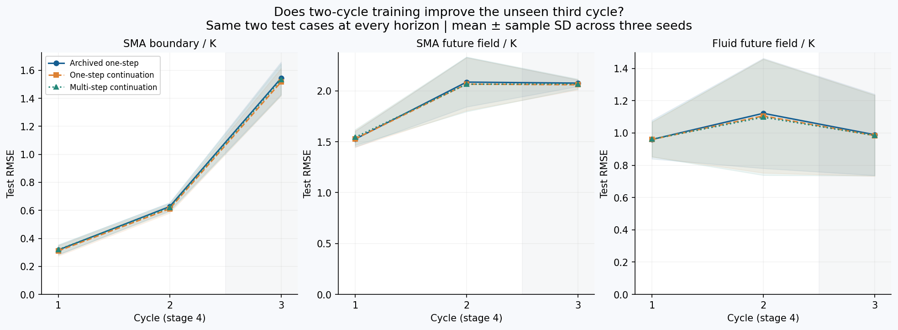
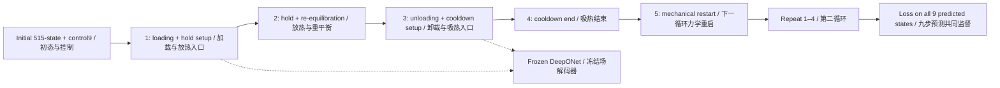
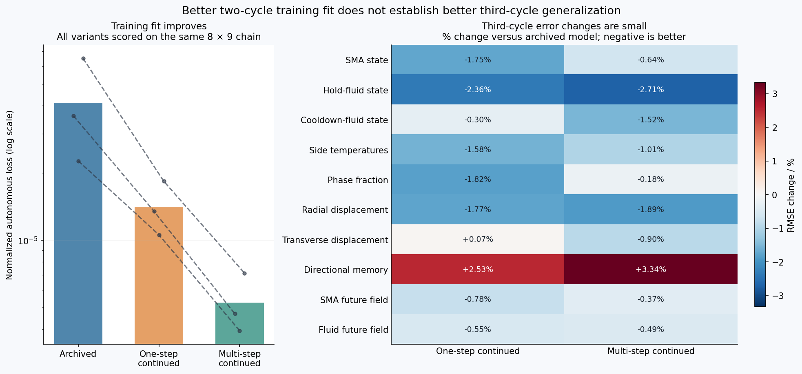
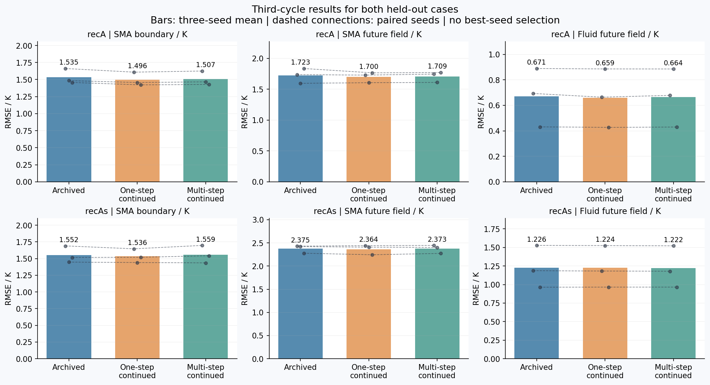

# Multi-cycle training study / 多循环训练对照

**Differentiable multi-step fine-tuning improves two-cycle training fit, but does not outperform matched-budget one-step fine-tuning on the three primary third-cycle metrics.** The comparison uses a fixed historical numerical dataset and frozen DeepONet field decoders.

**可微多步微调改善两循环训练拟合，但第三循环三项主要指标均未超过同预算单步微调。** 对照使用固定历史数值数据集，DeepONet 场解码器保持冻结。

## Main result / 主要结果

Third-cycle stage-4 RMSE, **mean ± sample SD over three seeds**. Each seed's RMSE pools the same two held-out three-cycle cases; fields omit the initial frame. Lower is better. These are numerical test errors, not physical performance gains or confidence intervals.

第三循环第四阶段 RMSE，**三个随机种子的均值 ± 样本标准差**。每个种子先合并相同两个三循环测试工况计算 RMSE，温度场排除初始帧。数值越低越好；这不是实体性能增益，也不是置信区间。

| Model / 模型 | SMA boundary / 状态 (K) | SMA future field / 温度场 (K) | Fluid future field / 流体场 (K) |
|---|---:|---:|---:|
| Archived one-step / 单步残差模型 | 1.5432 ± 0.1156 | 2.0764 ± 0.0320 | 0.9893 ± 0.2517 |
| One-step continuation / 单步续训 | **1.5163 ± 0.0974** | **2.0602 ± 0.0496** | **0.9839 ± 0.2512** |
| Multi-step continuation / 多步续训 | 1.5334 ± 0.1126 | 2.0686 ± 0.0483 | 0.9845 ± 0.2494 |

Multi-step changes versus the archived model are **−0.64%, −0.37% and −0.49%**. One-step continuation achieves **−1.75%, −0.78% and −0.55%**. The archived affine-only model also remains a strong reference: its third-cycle SMA boundary RMSE is **1.1761 K**, below all three neural variants; it was not retrained in this study.

相比残差基线，多步续训分别改善 **0.64%、0.37%、0.49%**，单步续训分别改善 **1.75%、0.78%、0.55%**。历史纯仿射模型的第三循环 SMA 状态 RMSE 为 **1.1761 K**，仍低于这三组神经模型；该基线该实验未重新训练。



## Architecture and gradient path / 架构与梯度路径

The historical branch is separate from the main 63-case, 414-state model. It carries **515 state variables**: radial displacement 51, transverse displacement 51, radial SMA temperature 51, phase fraction 51, two fluid paths 101 each, eight side temperatures and **101 antisymmetric temperature-memory values**. Nine known controls encode radius, thickness, pressure, flush ratio, exchange duration, two material indicators and loading/unloading durations.

历史支线与主 63 工况的 414 维模型分开：**515 维状态**由径向位移 51、横向位移 51、径向 SMA 温度 51、相分数 51、两条流体温度路径各 101、侧端温度 8，以及**反对称温度记忆 101**组成。九维已知控制包括半径、厚度、压力、冲洗体积比、换热时长、两个材料指示量和加载/卸载时长。

The allowed initial input combines the observed very first mechanical frame with declared thermal initial conditions. Later observed states are excluded from autonomous inference. Some restart side variables are carried rather than directly observed; this state interface is not certified as complete physical or energy closure.

允许的初始输入由最早的已观测力学帧和声明的热初值组成，自主推理不读取后续真实状态。部分重启侧变量采用传递值而非直接观测，因此该状态接口尚不能称为完整物理或能量闭合。



Every transition uses a standardized **529-vector = state515 + control9 + stage-one-hot5**, a frozen Ridge affine map and a SiLU residual MLP **529 → 32 → 32 → d**. The five output sizes are **414 / 414 / 414 / 261 / 204**; unchanged components are carried forward. The five MLPs have **146,411 trainable parameters** in total. This is a stage-specific residual state model, not an LSTM or Transformer.

每次转移输入为标准化的 **529 维向量 = 状态 515 + 控制 9 + 阶段独热 5**，由冻结的 Ridge 仿射映射和 **529 → 32 → 32 → d** 的 SiLU 残差 MLP 预测活动分量增量。五个接口的输出维度为 **414 / 414 / 414 / 261 / 204**，其余分量直接传递，神经网络共 **146,411 个可训练参数**。这是阶段专属残差状态模型，未使用 LSTM 或 Transformer。

For stage k, standardized input z and state x:

$$\hat{x}_{j+1}=P\left(\hat{x}_j+S_k\left[A_k z_j+b_k+r_k\odot N_k(z_j)\right]\right).$$

Here S inserts the active increments, r is the original training-residual RMS, and P preserves the original constraints: phase fraction in [0,1], zero displacement endpoints and antisymmetric memory. There is **no temperature clipping**. Ridge weights, normalization, r and P are unchanged. Gradients pass through all nine transitions, including the learned restart and the piecewise differentiable projection; no intermediate state is detached.

S 将增量写入活动分量，r 为原训练残差 RMS，P 保留原约束：相分数在 [0,1]、位移端点为零、记忆反对称，**不裁剪温度**。仿射权重、标准化、r 和 P 均不改变。梯度穿过九次转移、力学重启与分段可微投影，中间预测不截断梯度。

The same saved **20,898-parameter DeepONet** for each seed converts predicted exchange entries into SMA/fluid fields on the 50 × 101 evaluation grid. It is never trained here and does not feed back into the state chain. Its 221-vector branch uses reconstructed SMA and fluid entry fields plus stage, controls and side temperatures; the two-coordinate trunk queries space/time. Thus field differences isolate the effect of changing the state predictor.

每个种子使用同一个已保存的 **20,898 参数 DeepONet**，将预测换热入口解码成 50 × 101 网格的 SMA/流体场。该实验不训练场解码器，也不将场结果反馈给状态链。其 221 维 branch 使用重构 SMA/流体入口场及阶段、控制和侧端温度，二维 trunk 查询空间/时间；因此场误差变化来自状态预测器的改变。

## Fixed-budget experiment / 固定预算实验

| Setting / 设置 | Value / 实际配置 |
|---|---|
| Split / 切分 | Original 8 train / 4 test whole cases; both three-cycle cases stay in test / 原 8 训练、4 测试工况，两个三循环工况均留出 |
| Training sequence / 训练序列 | Eight two-cycle trajectories × nine transitions: 1,2,3,4,5,1,2,3,4 / 八条两循环轨迹，各九步 |
| Test / 测试 | 46 state transitions and 20 exchange fields; third-cycle cohort N=2 / 46 状态转移、20 段换热场，第三循环 N=2 |
| Seeds / 种子 | 20260910, 20260911, 20260912; paired original checkpoints / 同种子、同原始检查点起步 |
| Continued training / 续训 | 300 joint full-batch updates; AdamW lr=0.0005, weight decay=0.0001, gradient clip=10; CPU float64 |
| One-step control / 单步对照 | Uses true training before-states at each transition / 每一步读取训练集真实前态 |
| Multi-step / 多步 | Uses only the first initial state, then its own outputs / 只读取初态，随后自主推进 |
| Selection / 选择 | Fixed final update; no test-based checkpoint or hyperparameter selection / 固定末次权重，不按测试分数选模型或超参 |

Both continuation modes use the same loss, averaged equally over eight state blocks, eight cases and nine steps. Each channel is divided by its frozen, train-only input scale; each block is averaged over its own channels, so 101-channel blocks do not automatically dominate 8-channel blocks:

$$L=\frac{1}{8}\sum_{b=1}^{8}\operatorname{mean}_{i,j,q\in b}\!\left[\left(\frac{\hat{x}_{i,j,q}-x_{i,j,q}}{\sigma_q}\right)^2\right].$$

两种续训使用相同损失：八个状态块等权，每块内按工况、九个时间步及通道取平均，使用原训练集输入尺度归一化。损失包含所有预测状态；多步模型既不读取中间真值作为输入，也不读取第三循环标签训练。原单步检查点最初采用逐接口残差监督，此处的单步续训控制也采用上述统一损失，公平比较的是两种续训方式。

Both start from the archived model, originally fitted using per-interface residual supervision. The matched one-step continuation also adopts the block-balanced loss above. The comparison therefore isolates teacher forcing versus autonomous multi-step inputs **between the two continuation modes**, rather than attributing every change relative to the original model to multi-step training alone.

## What improved, and what did not / 改善与未解决的问题



The common autonomous training loss falls from **4.1232×10⁻⁵** to **1.4129×10⁻⁵** after one-step continuation and **5.2514×10⁻⁶** after multi-step continuation, averaged over seeds. Multi-step training reduces this loss by **87.3%**, but third-cycle directional-memory RMSE rises from **0.1198 to 0.1238 K (+3.34%)**. The numerical optimizer and cross-step gradient work; fitting the two-cycle trajectories more closely is insufficient evidence of better horizon extrapolation.

按同一自主推进训练损失评价，残差基线为 **4.1232×10⁻⁵**，单步续训为 **1.4129×10⁻⁵**，多步续训为 **5.2514×10⁻⁶**，均为种子均值。多步训练使该损失下降 **87.3%**，但第三循环方向记忆 RMSE 从 **0.1198 升至 0.1238 K（+3.34%）**。优化器和跨步梯度已正常工作；训练轨迹拟合更好，并不足以证明循环长度外推更好。



For the recA case, SMA boundary error decreases **1.5346 → 1.5067 K**; for recAs it increases **1.5515 → 1.5590 K** under multi-step continuation. These are case-specific observations, not general material-transfer conclusions. The field gains are similarly small and mixed by seed. No variant is promoted as a generally superior replacement.

多步续训下，recA 工况 SMA 状态误差为 **1.5346 → 1.5067 K**，recAs 工况为 **1.5515 → 1.5590 K**。这只是两个具体工况的观察，不能推广为材料泛化结论。场误差收益同样很小，且随种子变化；该实验不将任何版本宣称为全面优于残差基线的替代品。

The present evidence supports further **memory/restart error diagnosis and training-only case-level validation**, before considering another loss or regularization rule. It does not yet identify whether restricted residual correction, state representation or coverage is the dominant cause. The test cases have been inspected in prior work and this study, so subsequent tuning must not be described as independent confirmation. No third-cycle training labels, new simulations or unreported parameter searches were used.

后续应先定位**记忆/重启误差来源，并在八个训练工况内部进行工况级验证**，再决定是否改变损失或正则化。该实验尚未证实残差修正方式、状态表示或覆盖范围中哪项是主因。测试工况此前和该实验均已查看，后续调参不能称为独立确认。该实验未使用第三循环训练标签，未增加物理仿真，也未开展未报告的超参数搜索。

## Data, checks and use / 数据、验证与运行

The portable snapshot contains 118 state transitions, initial states, controls and 20 test field targets. Its source HDF5 manifest and 12 request hashes were verified, and **all 118 derived targets match the archived prediction arrays exactly**. The original raw MAT paths are currently unavailable; this is a verified sealed HDF5 snapshot, **not a fresh raw-MAT provenance audit**. Source fingerprints and availability are retained in [snapshot provenance](../data/historical12_state.json). Historical-profile results stay separate from current63.

便携数据含 118 个状态转移、初态、控制与 20 段测试场。源 HDF5 清单和 12 份请求哈希已核验，**118 个派生目标与历史预测文件中的目标逐项完全一致**。原始 MAT 路径目前不可用，因此这是封存 HDF5 快照核验，**不宣称重新完成原始 MAT 来源审核**。来源指纹和可用性记录保留，历史版本结果不混入当前 63 例结论。

All nine model/decoder combinations were replayed; saved RMSEs were independently recomputed. The differentiable adapter reproduces the old predictor within 10⁻⁸ absolute tolerance, and the original state/field scores are recovered. All six new residual checkpoints replay exactly in the training environment. Frozen buffers and source checkpoints are unchanged. Unit checks cover all five transitions, the cross-step gradient, projection behavior and inference input contract.

九组状态模型/场解码组合均已回放，保存的 RMSE 已独立重算。可微适配层在 10⁻⁸ 绝对容差内重现基线预测器，原状态/温度场指标均恢复；六个微调残差检查点在训练环境中精确回放。冻结张量和原检查点未变更，单元验证覆盖五类转移、跨步梯度、投影和推理输入权限。

```bash
# Check saved predictions and all checkpoints; no training / 仅验证
python -m examples.multicycle_multistep --verify-only
# New figures from saved results / 从保存结果重新绘图
python -m examples.multicycle_gallery --output demo-output-multicycle
# Repeat the fixed six continuation fits in a fresh directory / 新目录续训
python -m examples.multicycle_multistep --output run-output-multicycle
```

On the recorded machine, the timed training/evaluation sections totalled about **48 seconds**, excluding setup; this is not a cross-machine speed benchmark. Saved residual weights reference the original checkpoint by relative path and SHA256 rather than duplicating its frozen affine maps. Default published output directories are never overwritten.

本机记录的训练/评价段合计约 **48 秒**，不含初始化，并非跨机器速度基准。微调残差权重用相对路径和 SHA256 绑定原检查点，避免重复保存冻结仿射映射；已发布输出目录不覆盖。

[Protocol / 协议](../evidence/experiments/multicycle_multistep_v1/protocol.json) · [All metrics / 完整指标](../evidence/experiments/multicycle_multistep_v1/summary.json) · [Model code / 模型实现](../SciML/models/v12/multistep_historical.py) · [Experiment and replay / 训练与回放](../examples/multicycle_multistep.py) · [Figure inputs and hashes / 绘图来源](../assets/multicycle_v1/gallery_manifest.json)
