# Detailed results gallery / 详细结果图集

The complete statistical gallery is preserved here. The [project homepage](../README.md) focuses on the current architecture and field demonstrations; these plots retain the baselines, uncertainty definitions and negative results.

完整统计图集保留于此；项目首页聚焦当前架构与场演示。本页继续保留基线、不确定性定义与负结果，避免只展示有利指标。

**New formal v13 results / 新增 v13 正式结果:** [three-seed training report](V13_FORMAL_BENCHMARK.md), [comparison animation](../assets/v13_formal_v1/v13_comparison.gif), [recA atlas](../assets/v13_formal_v1/field_atlas_1.png), [recAS atlas](../assets/v13_formal_v1/field_atlas_2.png). Third-cycle gains and early-cycle/state-component regressions are reported together. / 第三循环改善与早期循环、部分状态分量退步一并报告。

## Results gallery / 图文成果汇报

**Seventeen result figures across the reference modeling pipeline.** The gallery includes completed diversity-acquisition and multi-step training experiments using existing data, without new physics simulations. Figures 15–17 show the v12 multi-cycle continuation comparison.

**17 组结果图覆盖参考模型全流程。** 本页汇集各支线研究，以及使用现有数据完成的多样性选样和多步训练实验，没有新增物理仿真。v12 多步续训对照见图 15–17。

[Figure index & editable SVG / 图表索引与可编辑 SVG](FIGURE_INDEX.md) · [Architecture and detailed results / 架构及详细结果](SHOWCASE.md)

### 01 · Performance surrogates / 性能代理

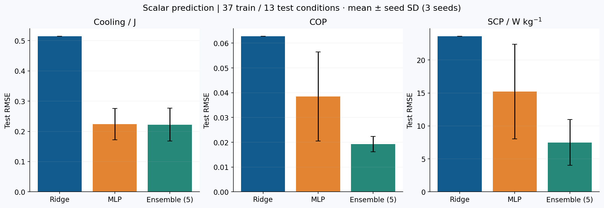

The five-member ensemble reduces COP RMSE from **0.0627 to 0.0192** and specific-cooling-power RMSE from **23.59 to 7.50 W/kg** versus Ridge. Bars show three-seed means, with seed standard deviations.

五成员集成相比 Ridge，将 COP RMSE 从 **0.0627 降至 0.0192**，比制冷功率 RMSE 从 **23.59 降至 7.50 W/kg**。图中为三个种子均值与种子间标准差。

### 02 · Autonomous stage dynamics / 四阶段自主推进

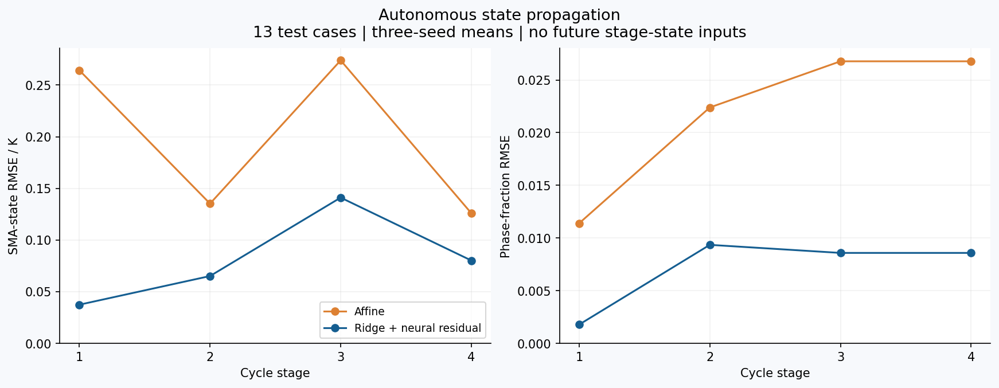

Ridge plus neural residuals improves both thermal-state and phase-fraction prediction over the affine baseline. Stage-3 errors reveal where mechanical unloading and re-equilibration make propagation harder. Inputs are requested conditions and predicted states.

Ridge 加神经残差同时改善温度状态与相变量预测。第三阶段误差较高，提示卸载与重平衡是状态推进中的难点；输入仅来自工况请求和自身预测状态。

### 03 · Neural operators versus low-rank models / 神经算子与低秩基线

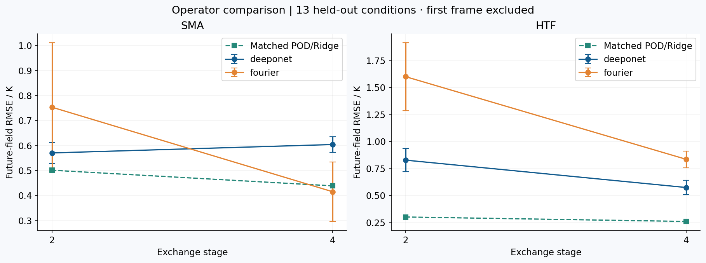

DeepONet, spatial Fourier and POD/Ridge are compared under matched supervision. POD leads in three of four field metrics, while Fourier leads for stage-4 SMA temperature; the result makes model selection depend on measured performance.

DeepONet、空间 Fourier 与 POD/Ridge 使用相同监督进行比较。POD 在四项场指标中的三项领先，Fourier 在第四阶段 SMA 温度上领先，模型选择以实际对照结果为依据。

### 04 · What the field model predicts / 温度场预测的实际输出

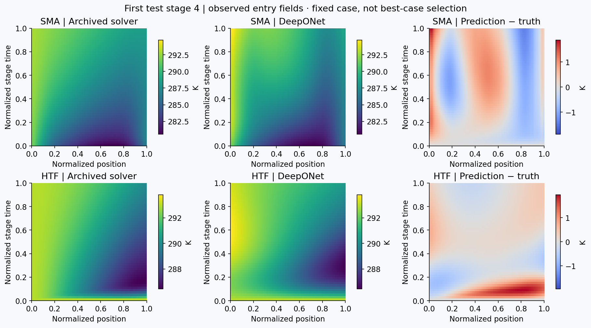

A fixed stage-4 test example shows reference fields, predicted fields and spatial error patterns. SMA/fluid RMSE is **0.6281 / 0.4891 K** for this example, conditioned on observed entry fields; aggregate performance is reported separately above.

固定第四阶段测试样本展示数值场、预测场与空间误差。该样本的 SMA/流体 RMSE 为 **0.6281 / 0.4891 K**，使用已知入口场；全测试集结果见上一图。

### 05 · Directional memory across stages / 跨阶段方向记忆

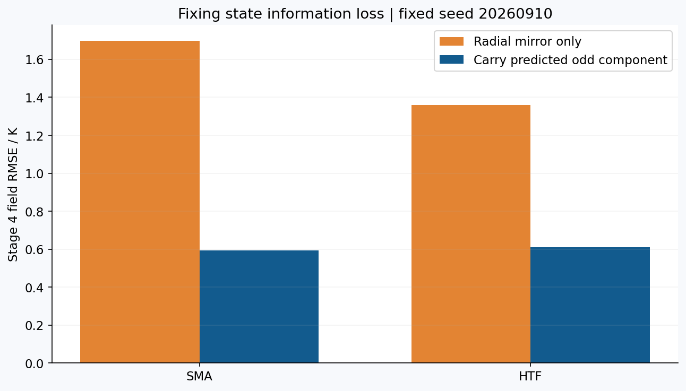

Carrying the odd component of the **predicted** earlier field lowers stage-4 SMA-field error by **65.1%** with fixed weights and seed. This isolates information loss at the state–field interface as a major source of cascade error.

在权重与种子固定时，传递前一阶段**预测场**的奇分量，使第四阶段 SMA 场误差下降 **65.1%**，明确了状态—场接口的信息损失是级联误差的重要来源。

### 06 · Architecture ablations / 架构消融与初值一致性

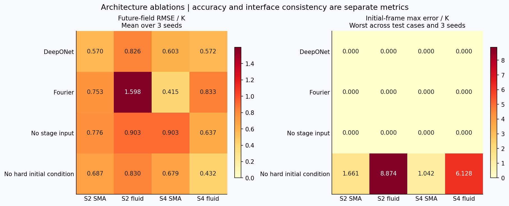

Removing the stage input increases several field errors. Removing hard initial conditions can reduce an individual future error while producing initial-frame errors up to **8.87 K**. Accuracy and interface consistency are therefore evaluated separately.

去掉阶段输入后，多项场误差上升；去掉硬初值虽然可能降低某项未来误差，却引入最高 **8.87 K** 的初始帧误差。因此需要同时评价预测精度与接口一致性。

### 07 · PINN inverse problem / PINN 参数反演

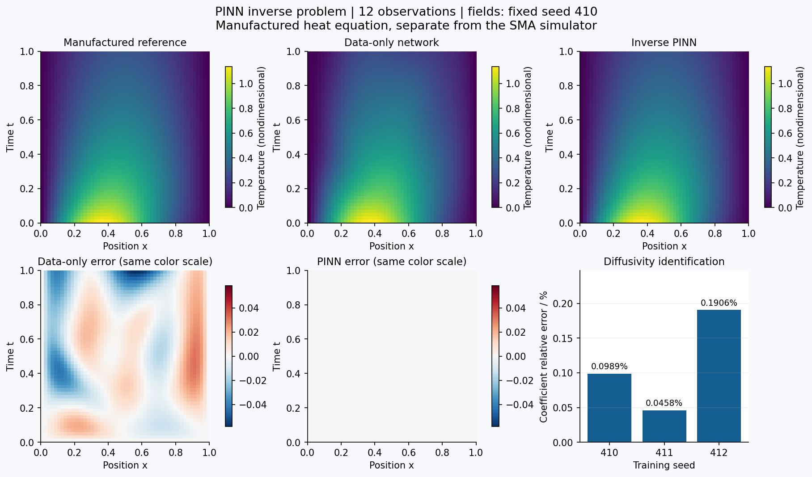

With 12 observations, the inverse PINN reconstructs a manufactured diffusion field and identifies its coefficient with **0.0458%–0.1906%** error across three seeds. The error maps share a color scale; this is a controlled heat-equation study, distinct from SMA material calibration.

使用 12 个观测，逆问题 PINN 重构制造扩散温度场，三个种子的系数误差为 **0.0458%–0.1906%**。误差图使用相同色标；该支线验证热方程反演方法，与 SMA 材料标定分别处理。

### 08 · Local thermal-response identification / 局部热响应辨识

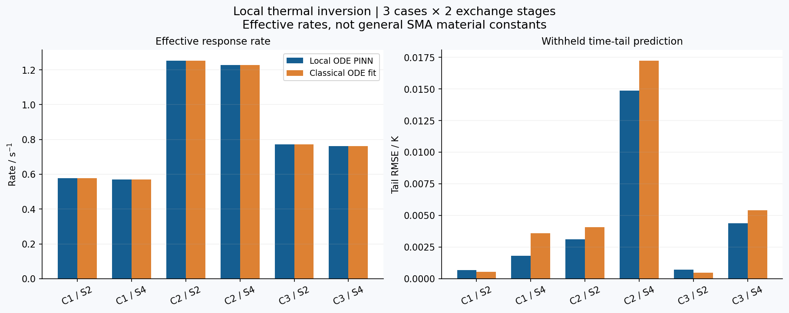

Six fits compare a local ODE PINN with classical ODE identification. Estimated effective rates agree closely; the PINN has lower withheld-tail error in four fits and higher error in two. The parameters describe local response rather than universal material constants.

六组拟合比较局部 ODE PINN 与经典 ODE 识别。两者的有效速率接近；PINN 在四组留出时间尾段上误差更低、两组更高。识别参数描述局部响应，而非通用材料常数。

### 09 · Calibrated uncertainty / 校准后的预测不确定性

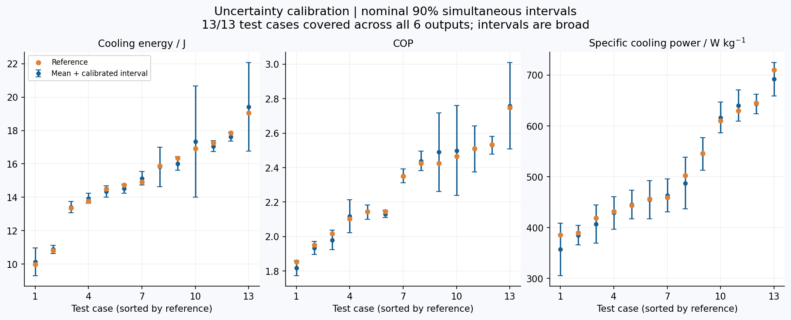

Nominal 90% simultaneous intervals cover all six outputs in **13/13** archived test cases. The plot also exposes interval width, so coverage is not mistaken for precision. With only 13 calibration cases, finite 95% intervals are unavailable under the implemented rule.

名义 90% 同时区间在 **13/13** 个归档测试工况上覆盖全部六个目标，图中同时展示区间宽度。当前仅有 13 个校准工况，按所用规则无法给出有限的 95% 区间。

### 10 · Generalization under distribution shift / 分布变化下的泛化

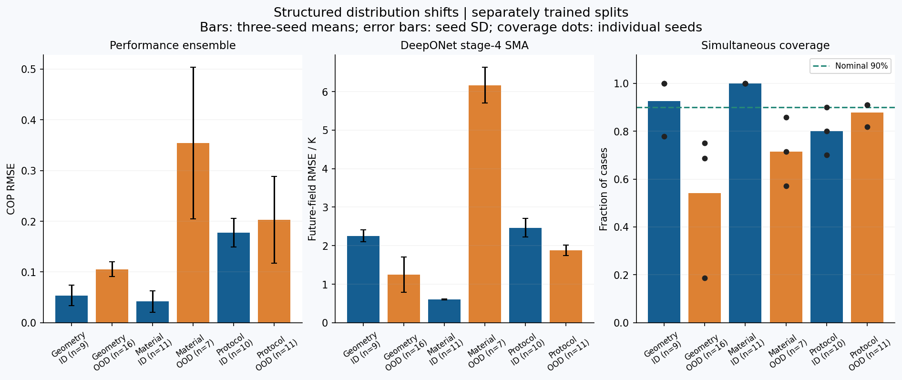

Geometry, material and operating-protocol shifts use separate splits and retrained models. Material shift markedly increases prediction error; coverage can drop below its nominal level. The figure identifies specific transfer challenges instead of treating every OOD task as equivalent.

几何、材料和运行协议变化分别采用独立切分并重新训练。材料变化显著放大预测误差，区间覆盖也可能低于名义水平；不同分布变化对应的迁移难点需要分别分析。

### 11 · Physics-loss ablation / 物理损失消融

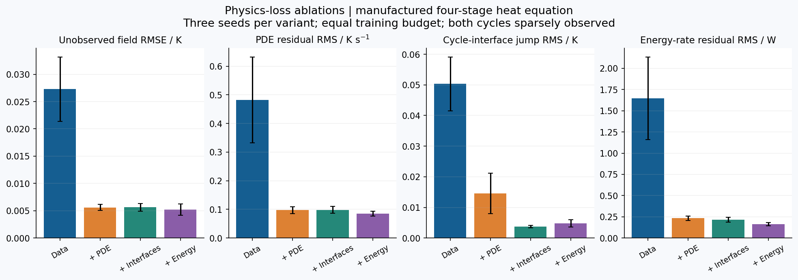

In a manufactured four-stage heat equation, the full loss reduces unobserved-field RMSE from **0.0273 to 0.0052 K**. Additional energy loss improves energy residuals but slightly worsens cycle-interface error relative to the interface-only variant. This is a controlled physics-loss study, not SMA energy-closure validation.

在制造四阶段热方程中，完整损失将未观测场 RMSE 从 **0.0273 降至 0.0052 K**。加入能量项改善能量残差，但相对接口约束版本略增循环接口误差；这是物理损失对照实验，尚不代表真实 SMA 能量闭合。

### 12 · Historical multi-cycle prediction / 历史多循环推演

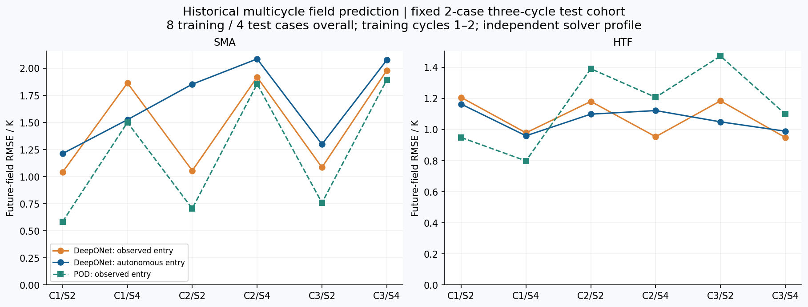

An independent historical profile uses eight training and four test cases. The plotted cohort consists of the **same two three-cycle test cases** at all horizons; training uses cycles 1–2. Autonomous third-cycle stage-4 errors are **2.076 K (SMA)** and **0.989 K (fluid)**, motivating multi-step training.

独立历史版本使用八个训练、四个测试工况。图中各预测长度始终对应**相同的两个三循环测试工况**，训练仅使用第一、第二循环。自主第三循环末阶段误差为 **2.076 K（SMA）**和 **0.989 K（流体）**，为多步训练提供明确目标。

### 13 · New: diversity-aware acquisition / 本次新增：多样性选样

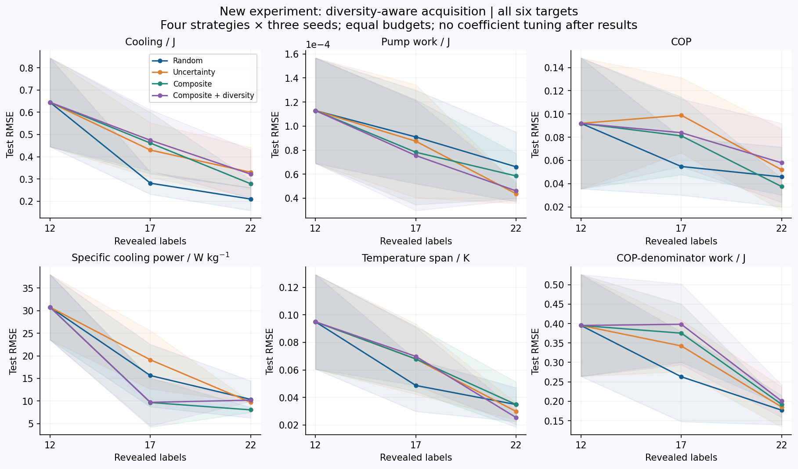

A fixed **50:50 composite-score / distance-rank** rule was evaluated over **four strategies × three seeds**, with identical 12→17→22 budgets and 200 updates per member. All three original baselines were reproduced. At 22 labels, diversity lowers temperature-span RMSE from **0.03480 to 0.02534 K**, but increases COP RMSE from **0.03751 to 0.05794** versus composite. Shading is seed standard deviation; all six targets are shown.

本次以固定 **50:50 复合分数/距离排名**构建新策略，完成**四策略 × 三种子**实验，各策略采用相同的 12→17→22 预算和每成员 200 次更新，三个原基线均得到重现。22 标签时，多样性策略使温差 RMSE 从 **0.03480 降至 0.02534 K**，但 COP RMSE 相比原复合策略由 **0.03751 升至 0.05794**。阴影为种子标准差，全部六个目标均予展示。

[Protocol, decisions, weights and results / 协议、决策记录、权重与结果](ACQUISITION_DIVERSITY.md)

### 14 · Candidate design trade-offs / 候选设计权衡

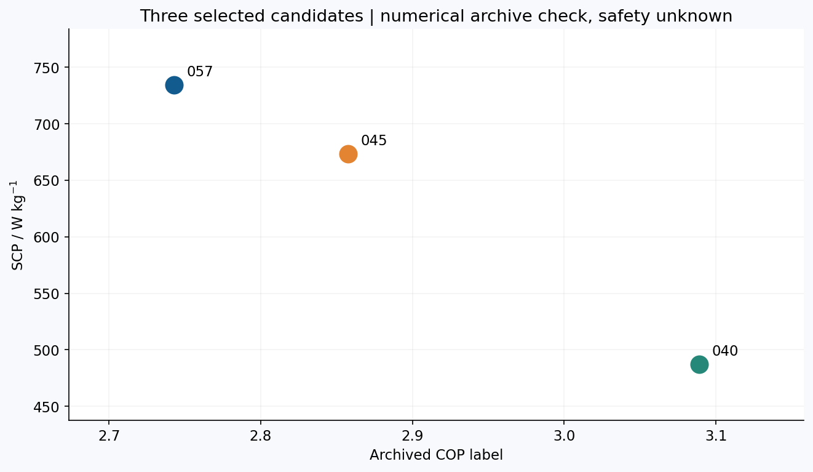

Three candidates from a 15-case pool were checked against archived numerical results after prediction. The study connects calibrated surrogates to candidate review; it does not establish a continuous global optimum or engineering safety certification.

对 15 个候选中的三个方案先预测、后进行归档数值回查，将校准代理模型连接到候选设计评价。当前结果限定于有限候选池，尚未验证连续全局最优或工程安全。

### 15 · New: multi-step training / 新增：多步训练对照

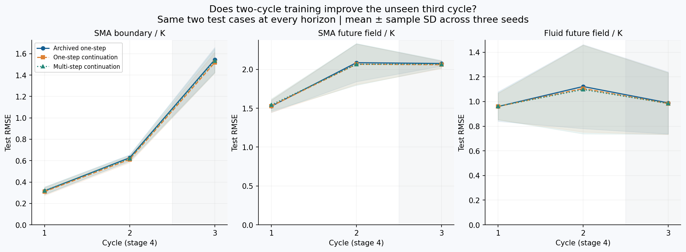

Eight two-cycle training cases supervise a differentiable nine-transition chain. Three seeds compare archived weights with **300-update one-step and multi-step continuations**, keeping the field decoders frozen. Third-cycle SMA-state RMSE is **1.5432 → 1.5334 K** with multi-step training; the matched one-step continuation reaches **1.5163 K**. Shading denotes seed SD, with the same two test cases at every horizon.

八个两循环训练工况监督完整可微九步链，三个种子比较原模型、**300 次单步续训和多步续训**，场解码器始终冻结。多步训练将第三循环 SMA 状态 RMSE 从 **1.5432 降至 1.5334 K**，同预算单步续训为 **1.5163 K**。各循环均使用相同两个测试工况，阴影为种子标准差。

### 16 · Training fit versus long-horizon error / 训练拟合与长时误差

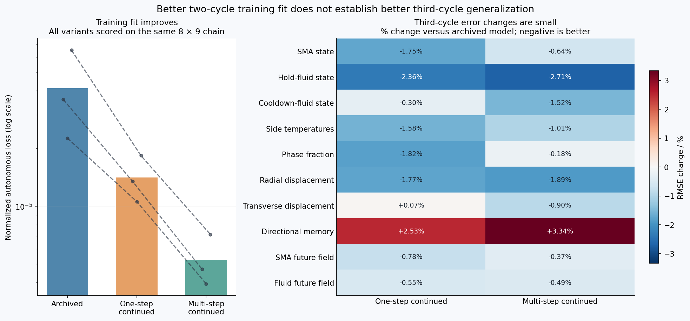

Multi-step training lowers the common autonomous training loss by **87.3%**, while third-cycle SMA-field RMSE falls only **0.37%** and directional-memory error increases **3.34%**. All eight state blocks and both fields are reported. The experiment establishes a working cross-step training path and identifies a remaining generalization problem; it does not establish multi-step superiority.

多步训练使统一评价的自主推进训练损失下降 **87.3%**，但第三循环 SMA 场 RMSE 只降低 **0.37%**，方向记忆误差反而增加 **3.34%**。图中完整展示八个状态块和两类温度场。跨步训练链已实现并验证，长期泛化问题仍待解决，当前结果不支持宣称多步训练更优。

### 17 · Every case and seed / 逐工况、逐种子结果

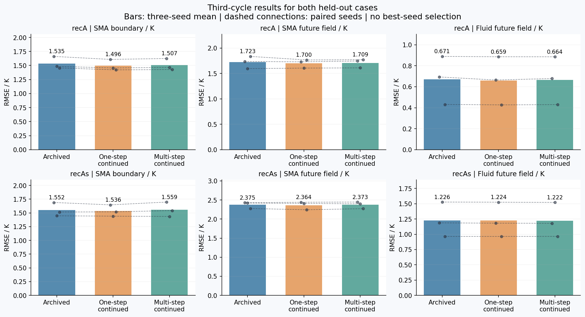

Both three-cycle cases are shown, without selecting the best seed. Multi-step SMA-state error improves for recA but worsens slightly for recAs; these are two specific cases, not material-transfer evidence. All new weights, predictions, protocols and bilingual model details are included in the [multi-cycle study](MULTICYCLE_MULTISTEP.md).

展示两个三循环工况及全部种子，不挑选最优结果。多步训练改善 recA 工况的 SMA 状态误差，但使 recAs 工况略有退化；这不构成材料迁移结论。新增权重、预测数组、协议和中英文模型说明均已保存，见[多循环研究报告](MULTICYCLE_MULTISTEP.md)。
