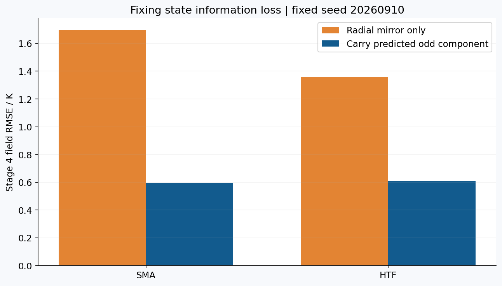
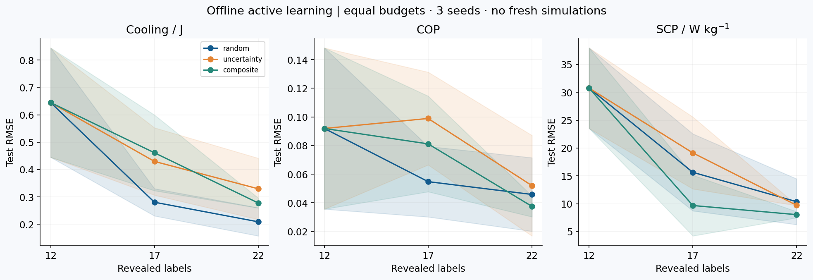

# SMA SciML — Project Showcase / 项目成果展示

**From coupled physical states to predictive models and design decisions.**  
**从耦合物理状态到预测模型与设计决策。**

[Project home / 项目首页](../README.md) · [Architecture / 架构](#architecture) · [Results / 结果](#results) · [Research potential / 研究潜力](#potential) · [Interview summary / 汇报摘要](#pitch)

[Detailed results: 17 figures / 详细结果：17 组图](RESULTS_GALLERY.md) · [Figure downloads and SVG / 图表下载与 SVG](FIGURE_INDEX.md)

**Current architecture / 当前架构:** the [3.11M-parameter hierarchical recurrent operator](HIERARCHICAL_OPERATOR.md) adds dual spatial encoders, latent attention, persistent GRU memory and joint state/field decoding. [Formal training and comparison](V13_FORMAL_BENCHMARK.md) are complete: three seeds ×200 updates, 6.7 CPU training minutes; third-cycle state/field gains with early-cycle and state-component regressions. The sections below retain the reference-model results.

**当前主模型**整合双路空间编码、潜变量注意力、GRU 持续记忆及联合状态/场解码，约311万参数，已完成三种子各200次正式训练，训练6.7 CPU分钟；第三循环状态/场改善，早期循环和部分状态分量退步。下文继续保留旧参考模型结果。

The project studies pressure-driven NiTi elastocaloric cooling through a connected set of performance surrogates, stage-transition models, temperature-field operators and decision methods. Its contribution is the combination of explicit physical state representations, controlled model comparisons and diagnosis of errors across module interfaces.

本项目面向压力驱动 NiTi 弹热制冷，构建性能代理、阶段状态推进、温度场算子与设计决策模块。项目的技术价值在于将明确的物理状态表示、公平的模型对照和跨模块误差诊断结合起来，回答模型为什么有效、误差从哪里产生，以及如何继续改进。

**Benchmark / 基准设置:** 63 complete simulation cases; 37 train / 13 calibration / 13 test; stage-2 and stage-4 SMA/fluid fields; 26 × 51 supervision and 50 × 101 evaluation grids. The test set has informed model development.  
63 个完整仿真工况，按 37/13/13 切分；预测第二、第四阶段的 SMA/流体温度场；监督网格为 26×51，评价网格为 50×101。该测试集已用于模型开发。

## 1. Architecture and physical structure / 模型架构与物理结构

| Component / 模块 | Architecture / 架构 | Training / 训练设置 |
|---|---|---|
| Performance MLP / 性能网络 | 7 inputs → 32 → 32 → 5 outputs; SiLU; **1,477 parameters/member**; five-member ensemble / 每成员 1,477 参数，五成员集成 | AdamW, lr 0.002, weight decay 1e-4, 300 full-batch updates, three seeds / 300 次全批更新，三个种子 |
| Stage dynamics / 阶段动力学 | 414 state + 12 control features; four Ridge + residual networks `426→32→32→d`; `d=204/313/313/160` / 四个阶段专属混合模型 | AdamW 0.002, weight decay 1e-4, 300 updates, three seeds / 300 次更新，三个种子 |
| DeepONet | Branches `204/9/8→32→32→32`; concatenate to 96, project to 48; trunk `2→32→32→48`; two fields × latent width 24; **20,898 parameters** / 两场各 24 维潜空间 | AdamW 0.002, weight decay 1e-5, 400 updates; 16 stage samples × 6 times × 51 positions / 每步 16 个阶段样本、6 个时刻、51 个位置 |
| Spatial Fourier / 空间 Fourier | Lift `4→12`; two spectral + local layers; eight modes; projection `12→16→2`; global conditioning; **7,886 parameters** / 两层频域与局部算子，带全局条件 | Same supervision and update budget as DeepONet / 与 DeepONet 相同监督和更新预算 |
| POD/Ridge | Four modes per temperature field; Ridge `alpha=1` / 每场四个模态 | Same coarse-grid labels / 使用相同粗网格标签 |
| Diffusion PINN / 扩散 PINN | `2→24→24→1` Tanh + trainable `log(a)`; **698 total parameters**; hard initial/boundary conditions / 含待反演参数，共 698 参数，硬初边值 | 12 observations, 128 Sobol points; Adam 1,800 + L-BFGS ≤150 iterations / 12 个观测、128 个配点 |
| UQ and acquisition / 不确定性与选样 | UQ: five `7→32→32→6` SiLU members, **1,510 parameters/member**; acquisition: three members / 校准使用五成员，选样使用三成员 | 300 updates for UQ; 200 per acquisition member; calibration uses 13 cases / UQ 300 次更新，选样每成员 200 次，13 例校准 |

**Physical structure.** The state models advance stage-specific active variables and retain inactive state components. The field operator adds a time-gated correction to the supplied entry temperature, making the initial condition exact. Directional memory is carried forward from a predicted earlier field. Full coupled SMA PDE and energy constraints remain research extensions.

**物理结构。** 状态模型更新各阶段的活动变量，并保留非活动状态；场算子在入口温度上叠加随时间开启的修正，严格承接初值；方向记忆来自前一阶段的预测场。这些结构将物理信息落实到模型接口，完整 SMA 系统的 PDE 与能量约束仍属于后续工作。

The Fourier model transforms the spatial axis and is conditioned on time; it is not a two-dimensional space–time FNO. The scalar/design and state/field paths are trained separately. Full settings and source modules are indexed in [model details](MODELS.md).  
Fourier 模型仅沿空间轴变换，以时间为条件；标量/设计路径与状态/场路径分别训练。完整设置与源码索引见[模型说明](MODELS.md)。

## 2. Performance prediction / 循环性能预测

| Model / 模型 | Cooling energy RMSE / 冷量 (J) | COP RMSE | Specific cooling power RMSE / 比制冷功率 (W/kg) |
|---|---:|---:|---:|
| Ridge | 0.5142 | 0.0627 | 23.5937 |
| MLP | 0.2239 | 0.0385 | 15.1956 |
| Five-member ensemble / 五成员集成 | **0.2222** | **0.0192** | **7.4972** |

**Finding.** Target scaling and ensembling improve the nonlinear performance surrogate: COP RMSE decreases by **69.3%** relative to Ridge on the same split. Values are three-seed means; figure error bars show between-seed standard deviation, not prediction intervals. The study also includes random-forest, gradient-boosting and unscaled-target baselines.

**发现。** 在相同切分下，目标缩放与集成改善了非线性性能预测，COP RMSE 相比 Ridge **降低 69.3%**。表格为三个种子的均值，图中误差条是种子间标准差，而非预测区间。实验还包含随机森林、梯度提升和未缩放目标的对照。

## 3. State propagation and field prediction / 状态推进与温度场预测

**Autonomous state model.** Four stage-specific hybrid models propagate the cycle from requested operating conditions and their own predicted states. The final-stage SMA-state RMSE decreases from **0.1260 K to 0.0802 K**, a **36.3%** reduction against the affine baseline, averaged over three seeds. This state error is distinct from the temperature-field errors below.

**自主状态模型。** 四个阶段专属混合模型从工况请求出发，使用自身预测状态推进循环，不读取未来阶段的真实状态。末阶段 SMA 状态 RMSE 的三个种子均值由 **0.1260 K 降至 0.0802 K**，相比仿射基线降低 **36.3%**。这一状态误差与下表的完整温度场误差分别评价。

| Model / 模型 | S2 SMA (K) | S2 fluid / 流体 (K) | S4 SMA (K) | S4 fluid / 流体 (K) |
|---|---:|---:|---:|---:|
| DeepONet, three-seed mean / 三种子均值 | 0.570 | 0.826 | 0.603 | 0.572 |
| Spatial Fourier, three-seed mean / 三种子均值 | 0.753 | 1.598 | **0.415** | 0.833 |
| POD/Ridge, deterministic / 确定性模型 | **0.501** | **0.300** | 0.438 | **0.258** |

**Finding.** POD/Ridge leads in three of four future-field RMSE metrics; Fourier leads for stage-4 SMA temperature. DeepONet supplies coordinate queries and an exact initial-condition construction, but its additional flexibility does not yet establish an accuracy advantage over the low-rank baseline. This comparison motivates studying data efficiency and representation rather than assuming that a larger neural model is preferable.

**发现。** POD/Ridge 在四项未来温度场 RMSE 中有三项领先，Fourier 在第四阶段 SMA 温度上领先。DeepONet 提供坐标查询和硬初值构造，但当前灵活性尚未转化为相对低秩基线的精度优势。因此后续重点是数据效率与表示方法，而非预设更大的神经网络一定更好。

The example uses the first stage-4 test case in the fixed corpus order. Its saved DeepONet predicts both fields from observed entry conditions, with RMSE **0.6281 K (SMA)** and **0.4891 K (fluid)**. Reference/prediction panels share a temperature scale within each channel; errors use a separate scale. This single-case visualization complements the aggregate comparison and is not an autonomous full-cycle demonstration.

示例固定选择原数据顺序中的首个第四阶段测试样本。已保存的 DeepONet 以真实入口条件预测两类温度场，RMSE 分别为 **0.6281 K（SMA）**和 **0.4891 K（流体）**。各通道的真值/预测共享温度色标，误差采用独立色标。该单例图用于解释模型输出，与全测试集评价互补，其输入条件也区别于自主完整循环。

## 4. Directional memory: diagnosing an interface failure / 方向记忆：定位并修复接口误差

**Problem → mechanism → result.** A 51-point radial state collapsed the antisymmetric component of a 101-point temperature field. Reconstructing the next stage by mirroring therefore lost the direction of the earlier heat exchange. The repair carries the odd spatial component of the **predicted stage-2 endpoint** into stage 4, without reading the future true field or retraining the operator.

**问题 → 机制 → 结果。** 51 点径向状态压缩掉了 101 点温度场的反对称分量，镜像恢复下一阶段入口时便丢失了前一换热过程的方向信息。修复方案将**预测的第二阶段末场**奇分量传入第四阶段，不读取未来真实场，也不重训场算子。

With fixed weights and seed, stage-4 SMA-field RMSE decreases from **1.6966 K to 0.5927 K (65.1%)**. The result identifies an interface representation failure rather than a lack of network capacity. It provides a concrete starting point for studying memory, latent-state design and error accumulation in coupled scientific models.

固定权重与种子后，第四阶段 SMA 场 RMSE 从 **1.6966 K 降至 0.5927 K，下降 65.1%**。这将误差定位到状态接口的信息损失，为后续研究记忆机制、隐状态设计和耦合模型误差积累提供了明确起点。

## 5. Uncertainty, active sampling and design / 不确定性、主动选样与设计

The uncertainty module combines five independent six-output networks with conformal calibration on 13 cases. At nominal 90% coverage, the archived test set has 13/13 simultaneous coverage across the six outputs, with relatively broad intervals. At nominal 95%, this calibration sample size requires an unbounded interval under the implemented finite-sample rule. Interval width and sample size therefore remain part of the decision context.

不确定性模块由五个独立六输出网络和 13 例 conformal 校准组成。名义 90% 区间在归档测试集上实现六目标同时覆盖 13/13，但区间较宽；对于名义 95%，当前样本数在所用有限样本规则下要求无界区间。因此，区间宽度与校准样本量也是决策依据。

| Strategy at 22 labels / 22 标签时的策略 | Cooling energy RMSE / 冷量 (J) | COP RMSE | Specific cooling power RMSE / 比制冷功率 (W/kg) |
|---|---:|---:|---:|
| Random / 随机 | **0.2092** | 0.0458 | 10.3702 |
| Uncertainty / 不确定性 | 0.3298 | 0.0520 | 9.7297 |
| Composite / 复合 | 0.2780 | **0.0375** | **8.0451** |

Three strategies are compared over three seeds at the same **12 → 17 → 22** label budget. Composite acquisition performs better for COP and specific cooling power; random selection performs better for cooling energy. These are offline reveals of existing simulation labels, so the experiment tests acquisition behavior without claiming measured savings in new simulation cost.

三种策略在相同 **12 → 17 → 22** 标签预算下分别运行三个种子。复合策略在 COP 和比制冷功率上更好，随机策略在冷量上更好。这是逐步揭示已有仿真标签的离线实验，用于评价选样行为，尚未测量实际新增仿真的成本节省。

### Completed extension: input diversity / 已完成扩展：输入多样性

The new experiment adds a fixed 50:50 mixture of the composite score and greedy input-distance rank, using the same three seeds and label budgets. All three historical baselines and their query sequences were reproduced. At 22 labels, temperature-span RMSE improves from 0.03480 to 0.02534 K versus composite, while COP RMSE worsens from 0.03751 to 0.05794. The complete six-target comparison is retained in the figure and [experiment report](ACQUISITION_DIVERSITY.md).

新增实验将复合分数与贪心输入距离排名按固定 50:50 混合，使用相同三个种子和标签预算，三个历史基线及其查询序列均得到重现。22 标签时，相比原复合策略，温差 RMSE 从 0.03480 改善到 0.02534 K，但 COP RMSE 从 0.03751 上升到 0.05794。图中和实验报告完整保留六目标对比。

The design module ranks a finite pool of 15 candidates and checks three against archived numerical results after recording its predictions. Conservative predicted hypervolume gains are all zero; the verified gain is **0.0072488 in the shared normalized objective space**, not a percentage. Mechanical outputs are recorded, but approved stress/deflection limits and fatigue evidence are absent, so engineering safety is unresolved.

设计模块对 15 个有限池候选排序，先记录预测，再对三个候选进行归档数值回查。保守预测超体积增益均为零；回查后的增益为**共同归一化目标空间中的 0.0072488**，不是百分比。虽然记录了力学输出，但尚缺批准的应力/挠度限值和疲劳证据，工程安全仍待验证。

## 6. Inverse modeling / 参数反演

A diffusion PINN jointly fits the temperature field and a positive coefficient using 12 observations and a PDE residual, achieving **0.0458%–0.1906% coefficient error across three seeds** on a manufactured heat-equation problem. A separate local ODE model fits effective thermal-response rates from archived SMA/fluid curves. The former tests the inversion method; the latter studies local dynamics. Neither establishes a general SMA material-parameter calibration.

扩散 PINN 用 12 个观测和 PDE 残差联合拟合温度场与正值系数，在制造热方程问题中，三个种子的**系数相对误差为 0.0458%–0.1906%**。另一条局部 ODE 支线从归档 SMA/流体温度曲线辨识有效热响应率，分别对应反演方法验证和局部动力学分析，尚不构成通用 SMA 材料参数标定。

## Multi-cycle extension: completed comparison / 多循环扩展：已完成对照

The historical 515-state model now supports full backpropagation through a nine-transition, two-cycle chain, including the learned mechanical restart. Five residual MLPs (`529 → 32 → 32 → d`, 146,411 neural parameters) are continued from the archived checkpoints; affine maps, scalers, residual scales and field decoders stay frozen. Eight two-cycle training cases and the original four-case test split are preserved.

历史 515 维状态模型已支持完整两循环九步反向传播，包含已学习的力学重启。五个残差 MLP（`529 → 32 → 32 → d`，146,411 神经参数）从原检查点继续训练，仿射映射、标准化、残差尺度与场解码器冻结，保留原八个两循环训练工况及四个测试工况。

Three seeds compare archived one-step, 300-update one-step continuation and 300-update multi-step continuation. Third-cycle SMA-state RMSE is **1.5432 / 1.5163 / 1.5334 K** respectively; SMA-field RMSE is **2.0764 / 2.0602 / 2.0686 K**. Multi-step training reduces the autonomous training loss by 87.3%, but does not beat the matched one-step continuation on the three primary third-cycle metrics. Directional-memory error grows 3.34%. The study separates successful optimization from unresolved horizon extrapolation, using existing data with no new physical simulations.

三个种子比较原单步、300 次单步续训、300 次多步续训，第三循环 SMA 状态 RMSE 分别为 **1.5432 / 1.5163 / 1.5334 K**，SMA 场 RMSE 为 **2.0764 / 2.0602 / 2.0686 K**。多步训练使自主推进训练损失下降 87.3%，但第三循环三项主要指标未超过同预算单步续训，方向记忆误差增加 3.34%。本次使用现有数据、没有新物理仿真，明确区分了优化成功与循环长度外推尚未解决。

[Architecture, loss, every case/seed and commands / 架构、损失、逐工况种子结果与运行方式](MULTICYCLE_MULTISTEP.md)

## 7. Research potential and next milestones / 研究潜力与下一阶段目标

| Research question / 研究问题 | Existing foundation / 已有基础 | Planned evaluation / 后续验证 |
|---|---|---|
| What limits third-cycle generalization? / 什么限制第三循环泛化？ | First differentiable multi-step comparison complete; better training fit, little test improvement / 可微多步对照已完成，训练拟合改善、测试收益有限 | Diagnose memory/restart errors and use case-level validation within the eight training cases before further model selection / 先定位记忆和重启误差，在八个训练工况内部验证后再选择新模型 |
| Can physical descriptors improve material transfer? / 物性描述能否改善材料迁移？ | Two material configurations, explicit control features and OOD diagnostics / 两类材料配置、控制特征与分布外诊断 | Compare category labels, physical properties and limited adaptation; seek additional independent material data / 比较类别、物性与少量适配，并补充独立材料数据 |
| Which acquisition objective should guide diversity? / 多样性应服务于哪个选样目标？ | Four-strategy comparison completed; diversity improves temperature span but not COP/SCP / 四策略对照已完成，多样性改善温差但未改善 COP/SCP | Define the primary objective before comparing alternative input metrics or acquisition rules, then seek independent validation / 先定义主要目标，再比较输入度量和选样规则，并开展独立验证 |
| Can fields support energy-consistent design? / 温度场能否支持能量一致的设计？ | State/field predictions and a separate performance surrogate / 已有状态、温度场和独立性能代理 | Establish independent port, work and stored-energy accounting before validating field-derived performance / 先建立独立端口、功与储能核算，再验证场到性能读出 |

These are the next research milestones, not completed results. The broader objective is a model that retains the state information needed for reliable multi-stage prediction and uses uncertainty to allocate simulation effort.  
以上为待开展的研究目标。长期方向是建立保留必要状态信息、支持可靠多阶段预测，并能利用不确定性分配仿真预算的模型体系。

## Project summary for discussion / 面试与研究交流摘要

> I developed a SciML workflow for pressure-driven SMA elastocaloric cooling, connecting performance surrogates, hybrid stage dynamics, neural operators and uncertainty-based decisions. On a 63-case simulation benchmark, a five-member ensemble reduced COP prediction error by 69.3% relative to Ridge. A central technical contribution was diagnosing directional information lost at a state–field interface: transferring predicted spatial memory reduced stage-4 field error by 65.1% in a controlled cascade comparison. I also compared neural operators against a strong POD baseline and extended the workflow to PINN inversion and offline active sampling. The next research questions concern multi-step stability, physical representations for transfer and energy-consistent design.

> 我围绕压力驱动 SMA 弹热制冷建立了 SciML 工作流程，连接性能代理、混合阶段动力学、神经算子与不确定性决策。在 63 工况仿真基准中，五成员集成使 COP 预测误差相比 Ridge 降低 69.3%。一个核心技术贡献是定位状态—场接口中的方向信息损失，通过传递预测空间记忆，在固定条件级联对照中使第四阶段场误差降低 65.1%。此外，我比较了神经算子和强 POD 基线，并拓展到 PINN 反演与离线主动选样。下一阶段研究问题是多步稳定性、面向迁移的物理表示，以及满足能量核算要求的设计方法。

## Evidence and presentation assets / 证据与展示材料

The original six PNG figures and animation use `python -m examples.showcase`. Nine PNG/SVG figures use `python -m examples.research_gallery`, and three multi-cycle comparisons use `python -m examples.multicycle_gallery`. The **17-figure statistical gallery** is preserved in [detailed results](RESULTS_GALLERY.md). The README now focuses on architecture, field animations and an offline explorer. New assets use `python -m examples.operator_showcase`. See the [figure index](FIGURE_INDEX.md) for sources and editable files.

原六张 PNG 与动画由 `python -m examples.showcase` 生成，九组 PNG/SVG 由 `python -m examples.research_gallery` 生成，三组多循环图由 `python -m examples.multicycle_gallery` 生成。**17 组统计图**保留于详细图集。README 当前架构、新旧场对照动画与交互演示由 `python -m examples.formal_gallery` 生成；原 `operator_showcase` 参考演示保留，图表索引提供来源与可编辑文件。

| Evidence / 证据 | Location / 位置 |
|---|---|
| Aggregate benchmark metrics / 汇总基准指标 | [metrics.json](../data/metrics.json) |
| Fixed-case checkpoint replay / 固定案例权重重放 | [demo summary](../assets/demo_summary.json) |
| Diffusion inverse results / 扩散反演结果 | [PINN summary](../evidence/archive/wp5-pinn-r1/summary.json) |
| Local effective-rate study / 局部有效速率研究 | [local ODE summary](../evidence/archive/wp5-local-thermal-r2/summary.json) |
| Multi-step continuation / 多步续训 | [protocol and results](MULTICYCLE_MULTISTEP.md) |
| Formal v13 comparison / v13 正式对照 | [protocol, results and regressions](V13_FORMAL_BENCHMARK.md) |
| Data coverage and COP definition / 数据范围与 COP 定义 | [data card](DATA_CARD.md) |
| Dimensions, losses and training / 维度、损失与训练设置 | [model details](MODELS.md) |
| Reproduction commands / 运行命令 | [quickstart](QUICKSTART.md) |

The current repository remains **private**. Public release will follow owner approval and the [release checklist](PUBLIC_RELEASE_CHECKLIST.md).  
当前仓库继续保持 **private**；公开发布需所有者批准并完成检查清单。
