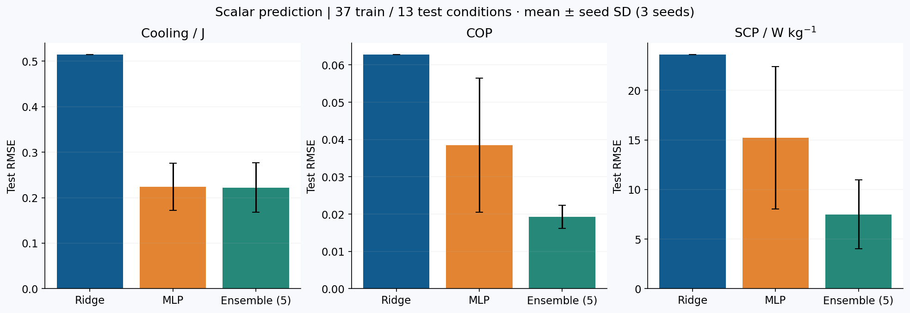
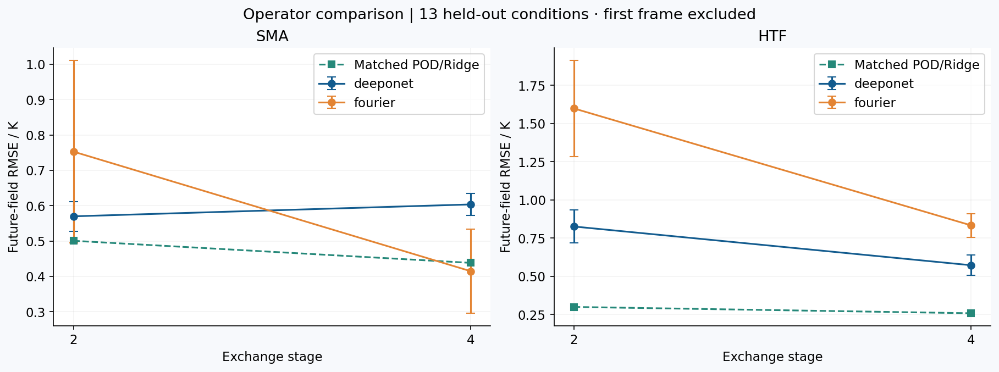
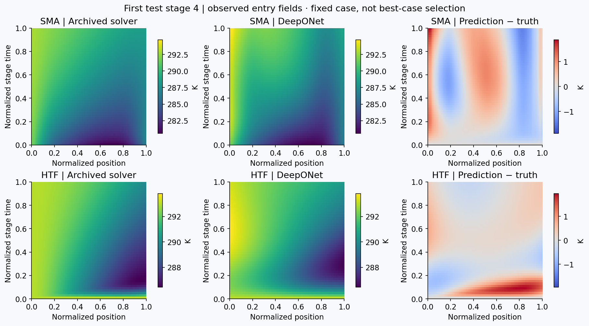
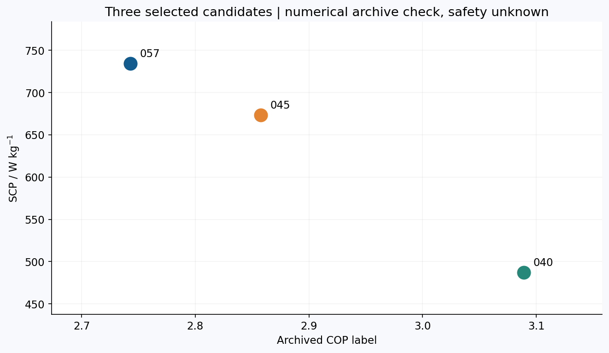

# 项目成果展示

建议汇报顺序：问题与模型 → 预测结果 → 接口修复 → 决策实验 → 下一步。图均由 `python -m examples.showcase` 从现有数值记录生成，没有合成科研分数。PNG 可以直接用于汇报；复用时保留图注和范围。

## 1 标量预测确有收益，但需要强基线

37 个训练、13 个测试工况，图中为三个种子平均 RMSE ± 种子间标准差，不是预测置信区间。目标标准化与集成对当前任务有效；并不说明任意数据下深度模型都优于树或线性模型。

## 2 神经算子预测温度场，同时接受低秩基线挑战

DeepONet/Fourier 使用相同粗网格监督与更新预算，POD 使用相同监督标签。POD 在三个指标上最佳，Fourier 在 S4 SMA 最佳。保留全部结果比仅展示神经网络优点更能说明模型选择能力。

固定第一个测试 stage4 案例，两个温度通道各自共享真值/预测色标；误差图不与温度图共用色标。输入已知阶段入口，输出是未来 50×101 的温度演化。单例图不能替代全测试集误差。

## 3 最有代表性的诊断：温度方向记忆

51 点径向表示丢失 101 点场的反对称信息。将**预测** stage2 末态的奇分量传到 stage4，固定权重和种子下 S4 SMA RMSE 从 1.6966 降到 0.5927 K。潜力在于正确设计状态表示与接口，而非盲目加深网络。

## 4 主动学习形成决策闭环，不隐去随机基线

同样 12→17→22 标签预算，3 策略×3 种子；阴影为种子标准差。复合选点对 COP/SCP 有优势，随机选点对冷量更好。这是已有标签的离线揭示实验，没有声称节省了已执行新仿真的成本。

## 5 候选展示体现权衡，不授予工程安全

三点来自预测提案之后的归档回查。候选的保守超体积增益均为零；回查后的共同归一化增益为 0.0072488，不是百分比。应力和挠度虽有记录，但没有批准限值和疲劳/设备证据，所以工程安全保持未知。

## 项目潜力

下一步可以用同一套工具比较多步状态训练、物性输入迁移、批次多样性选样；新增物理端口/储能合同后，再研究真正的场到性能读出。现有演示展示了这些扩展的接口与可测试起点，不把潜力当作已实现成果。
